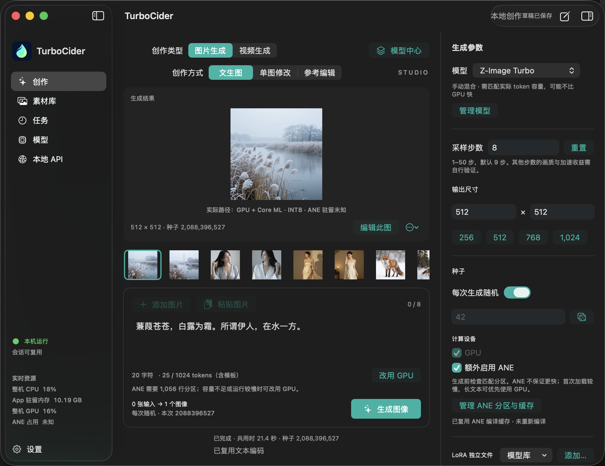

<p align="center">
  
</p>

<p align="center"><strong>原生推理，释放 Apple Silicon 的更多算力。</strong></p>
<p align="center">SwiftUI 工作室 · CLI · C / Swift SDK · 本地 HTTP API · ComfyUI</p>
<p align="center"><strong>中文</strong> · <a href="README.md">English</a> · <a href="docs/public/GETTING_STARTED.md">快速开始</a> · <a href="docs/benchmark/PERFORMANCE_REPORT.md">性能评测</a></p>

TurboCider 是面向 Apple Silicon Mac 的本地多模态推理引擎。用原生 macOS App 创作图片和视频，通过 API 自动化任务，或直接接入 ComfyUI 工作流。模型和生成内容保留在本机。

**对比 Unsloth Q4_K_M GGUF 图像生成，实测达到 3.40× 加速、耗时减少 70.6%；对比 ComfyUI，LTX 视频生成达到 1.76×。** 原生 Metal / MLX GPU 推理与可选 GPU + ANE 混合计算，让同一台 Mac 发挥更多算力。

## 性能亮点

Qwen Image 2.1／Z-Image 现支持原生 Tiny VAE 和可配置步数的实时预览，见 [Tiny VAE 使用说明](docs/public/TINY_VAE.md)。

同一台 **Apple M4 Max · 64 GiB**，比较完整生成耗时，包含编码、采样、解码和结果输出。

| 模型与任务 | 对比框架 / 格式 | 对比耗时 | TurboCider | 加速比 / 耗时减少 |
|---|---|---:|---:|---:|
| Qwen-Image-2.1 · 512×512 · 40 步 | **Unsloth Q4_K_M GGUF**，sd-server Metal | 125.365 秒 | **36.870 秒** · GPU + ANE | **3.40× / 70.6%** |
| Qwen-Image-2.1 · 512×512 · 40 步 | **ComfyUI v0.39**，BF16 源 | 48.350 秒 | **31.059 秒** · GPU + ANE | **1.56× / 35.8%** |
| Z-Image Turbo · 512×512 · 8 步 | **ComfyUI v0.39**，BF16 源 | 8.535 秒 | **5.780 秒** · GPU + ANE | **1.48× / 32.3%** |
| LTX 2.5 · 704×448 · 97 帧 · 11 步，含音频 | **ComfyUI v0.39**，同源模型 | 112.230 秒 | **63.848 秒** · GPU 质量配置 | **1.76× / 43.1%** |

**GGUF 对比使用相同的 Unsloth Q4_K_M 编码器和 DiT 权重、BF16 VAE**：Unsloth 通过固定版本的 sd-server Metal 执行，TurboCider 使用原生 GPU + ANE 路线。ComfyUI 对比采用各任务中更快的已测 MPS 配置；LTX 仅使用 GPU，每段视频约节省 **48 秒**。

图像数据为热态中位数。ComfyUI 表格复用 TurboCider 已有最佳配置记录，属于跨测试窗口对照；LTX 的 ComfyUI 数据为单次热态观察。另有 Z-Image 同窗口配对结果 **1.46×**。GPU + ANE 是需准备并显式启用的近似配置（Qwen GGUF 使用 Private ANE），默认使用 GPU；热态收益不代表冷启动收益或逐像素一致。

[Unsloth GGUF 与完整性能评测](docs/benchmark/PERFORMANCE_REPORT.md) · [ComfyUI 各模型对比](docs/benchmark/COMFYUI_MODEL_COMPARISON.md) · [ComfyUI 同窗口配对验证](docs/benchmark/COMFYUI_MAC.md)

## 支持的功能

- **图像与视频创作：** 文生图、图片修改、多参考图编辑、文生视频和图生视频，按模型能力开放。
- **LoRA 与生成控制：** 管理适配器、强度、随机种子、尺寸和步数，支持模型允许的运行时或内存合并策略。
- **本地 API：** App 一键启停 HTTP 服务；支持模型发现、请求预检、任务提交、进度查询、取消和结果下载。另有 Unix socket 服务、Python HTTP 客户端及 C / Swift SDK。
- **ComfyUI / Comfy Desktop：** 提供模型、LoRA、生图、编辑和原生视频请求节点；图像结果可接标准预览、保存与合成节点。权重由 TurboCider 管理，无需在 ComfyUI 再装一份模型。
- **模型管理：** 共用 App / CLI 模型库，登记已有本地模型，支持 Hugging Face / ModelScope 下载预览与兼容文本组件复用。
- **重复任务与内存优化：** 常驻会话、批量任务、提示词缓存、GPU 图编译，以及模型支持的分阶段驻留和流式加载。

## App 预览



## API 与 ComfyUI

在 App 的「本地 API」页面点击「启动服务」，默认地址为 `http://127.0.0.1:8765`，可直接查看 curl / Python 示例。

```sh
curl http://127.0.0.1:8765/v1/health
curl http://127.0.0.1:8765/v1/catalog
```

将节点安装到已有 ComfyUI，然后重启 ComfyUI：

```sh
python3 tools/comfyui/install.py /path/to/ComfyUI
```

连接 **Model (API) → Generate Image → Save Image**，在 Model 节点填入 App 显示的 HTTP 地址；需要 LoRA 时加入 **LoRA (API)** 节点。此集成在图像边界与 ComfyUI 组合，采样由 TurboCider 执行。

[ComfyUI 中文教程](docs/public/COMFYUI_TUTORIAL.zh-CN.md) · [HTTP 接口与独立 CLI 启动](docs/public/COMFYUI.md) · [本地任务 API](docs/public/LOCAL_API.md)

## 开始使用

需要 Apple Silicon、可用的 macOS SDK / Swift / Clang 和兼容的 MLX 0.32.x。已验证仅安装 Command Line Tools 即可完成构建，可通过 `DEVELOPER_DIR`、`SDKROOT` 选择。执行 `make setup` **之前需要先安装 arm64 CPython 3.11**；Python 用于依赖安装和离线工具，生产推理使用原生运行时。

新机器请先看[本地环境配置指南（英文）](docs/public/ENVIRONMENT_SETUP.md)：包含系统 Python 版本不足时的本地安装方法、两套锁定依赖环境、SDK 选择、FFmpeg 视频测试依赖和实际配置中遇到的问题。最低运行系统版本由链接的 MLX 库决定，不能用 SDK 版本代替判断。

```sh
make setup
make package
make test
open dist/TurboCider.app
```

`make setup` 会安装 `.venv` 和独立的离线 Core ML 工具环境，不会下载 Python、模型权重或 ANE 产物。模型下载、检查及 ANE 导出／编译／登记的完整命令见 [FLUX.2 Klein 4B 准备指南（英文）](docs/public/FLUX_PREPARATION.md)。配置、文件检查和请求规划通过，仅表示准备步骤通过，真实生成和性能复现需要另行验证。

在 App 先选择图片或视频创作，自动匹配兼容执行器，再登记所需模型文件夹。已有权重可以继续放在原来的目录；Z-Image 可关联 FLUX.2 Klein 4B 的兼容文本组件。首次先使用 GPU，成功生成后再按设备配置 ANE。发行目录中的 App 当前为本机 ad-hoc 签名，尚未完成 Developer ID 公证。

任务页支持勾选、全选后批量删除，也可一键清空任务历史；正在进行的任务会保留，最近一次删除可整批撤销。删除任务记录保留结果文件。素材库和创作结果缩略图支持 Ctrl/Command 点击增减选择、Shift 点击连续选择，再统一移到废纸篓；素材库双击图片可查看结果。

CLI 示例：

```sh
dist/cli/turbocider doctor
dist/cli/turbocider models
dist/cli/turbocider plan examples/requests/z-image-turbo.json
dist/cli/turbocider generate /absolute/path/to/z-image-turbo examples/requests/z-image-turbo.json
```

相对输出路径按当前工作目录解析；示例可能使用 `/tmp` 下的绝对路径。完整图像、视频、LoRA、ANE 准备和服务步骤见[快速开始](docs/public/GETTING_STARTED.md)与[使用参考](docs/public/USAGE.md)。

## 模型能力

| 模型 | 主要能力 |
|---|---|
| Qwen-Image-2.1 | 文生图、多参考图编辑、LoRA；支持特定 Viggle 六步适配器 |
| FLUX.2 Klein 4B / 9B | 文生图、图片修改、参考图编辑、LoRA；4B 有已验证混合配置 |
| Z-Image Turbo | 文生图、LoRA、可选 GPU / ANE 混合推理 |
| MiniMax H3 Turbo | 视频生成、关键帧与参考素材；需要媒体工具 |
| LTX 2.5 Distilled | 文生视频、图生视频及可选音频输出；受后端与配置限制 |
| Wan 2.1 1.3B QAD | 原生三步视频生成；需离线转换产物及已验证预合并 LoRA |

具体可用操作以 `turbocider models` 和请求 `plan` 为准。不同模型的 LoRA、输入和加速选项不能互换。参阅[模型与请求参考](docs/public/USAGE.md#model-capabilities)、[Qwen 指南](docs/public/QWEN_IMAGE_21.md)和[GPU/ANE 加速状态](docs/status/acceleration.md)。

## 项目结构

| 目录 | 内容 |
|---|---|
| `native/` | 推理核心、模型执行器、Metal / MLX / Core ML 后端 |
| `apps/`、`services/` | SwiftUI App、CLI、本地任务服务与模型库 |
| `bindings/`、`integrations/comfyui/` | C / Swift SDK、Python HTTP 客户端与 ComfyUI 节点 |
| `tools/`、`tests/` | 构建、转换、回归测试和性能验证 |
| `docs/public/`、`docs/benchmark/` | 使用指南与可核查的评测记录 |
| [`techniques/`](techniques/README.md) | Apple Silicon 优化百科：Metal、ANE、GPU/ANE 协同、内存、profiling 与新模型接入 |

[文档入口](docs/public/README.md) · [模型库](docs/public/MODEL_LIBRARY.md) · [缓存与内存](docs/public/CACHES.md)

TurboCider 原创代码采用 MIT 许可证；第三方代码与模型权重遵循各自许可证。仓库不包含大型模型权重和生成结果。
