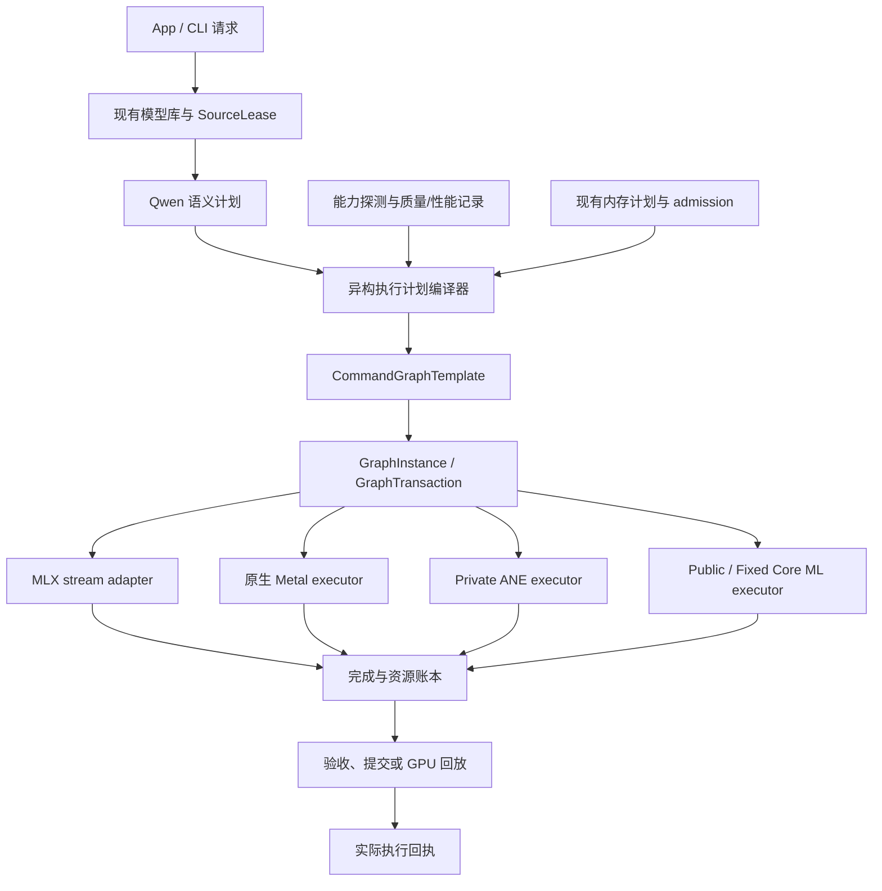
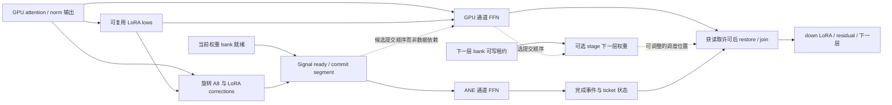

# 02 · 总体架构与共同合同

状态：设计草案。以下类型与模块是拟议接口，不表示已有文件或可直接编译的实现。源码现状与测量见 [01](01-evidence-and-gap-analysis.md)，设备细节见 [03](03-command-graph-and-handoff.md)。

本章描述最终可扩展架构；实施首先只接入 BaseOnly。具体 session、双 bank、scales、负缓存和启动顺序见 [09](09-base-first-splash-review.md)。下文 LoRA 相关节点/类型属于后续扩展，不要求 base 以零修正模拟，也不要求首轮实现全部 backend。

## 1. 目标架构



模型层声明“算什么、精度如何、哪些输入/状态依赖什么”，执行器声明“在哪个队列/设备执行、何时完成”。内存计划约束两者，不能等分配失败后才补记资源。

不是把所有 backend 包装为同一个同步 `run()`。统一的是计划、身份、能力、依赖、结果与资源合同；执行器的完成机制仍可不同。

## 2. 两个后端方向及渐进实施边界

A 是基础改造，N 是 [10 的独立 Native Metal Graph 后端](10-native-metal-graph-backend.md)。两者都遵守相同资源/模型合同；N 的启动不取决于 A 的成败。以下 2.1/2.2 描述 A 及可共享的纵切，2.3 定义 N 的完整目标。

### 2.1 A：MLX stream adapter

保留 MLX 的 GEMM、SDPA 和已验证自定义 kernel，通过 Primitive/受控适配层把外部 ANE 的准备、提交和等待连接到实际 Metal stream。

必须先证明：编译器不会消除或错误重用外部副作用；提前 commit 后数组和临时存储仍活到设备使用结束；ANE 外部写入被 GPU 正确消费；失败可返回事务管理器而非发布非法张量。当前 CaptureBuffer 诊断只能证明接口可访问，不能证明这些条件成立。

如果依赖少量 MLX 内部接口，集中放在一个版本适配模块，固定依赖版本并做能力探测。禁止在 transformer、量化、LoRA、worker 中散落对 MLX Metal 内部对象的访问。

### 2.2 原生 FFN / block 纵切

MLX attention 输出进入原生 FFN island，内部统一编码 gate/up、ANE branch、GPU branch 和 join；输出交还 MLX。它仍有 island 入口/出口，能改善 FFN 内部调度，但不能宣传已经消除逐层框架边界。

下一步可扩大为完整 Qwen block。原生 GPU-only 必须独立与现有最佳 GPU 比较，native hybrid 同时对照本后端 GPU 和当前最佳路线，防止较慢的重写基线夸大 ANE 倍率。N 的完整 DiT 不在每层返回 MLX attention；纵切可复用但需如实标记覆盖域。

### 2.3 N：独立 Native Metal Graph 后端

新增后端直接拥有 Metal queue、command buffer、原生 kernels、PSO、ANE handoff 与执行 ticket，完整覆盖 Qwen DiT。它参考 Splash 的完整 runtime 组织，用同一原生执行器提供 GPU-only / GPU+ANE；不是只在 MLX 中封装一个 ANE Primitive。

去噪域内可用有界 step 图表达 32 层，encoder/VAE 继续由现有路径处理，只在阶段边界互操作。它复用 QwenExecutionPlan、QuantRecipe、后续 PreparedLoRA 和已有内存/事务合同，不另建模型管理器。native 热路径不依赖 MLX 编码 GEMM/SDPA。

该后端可以独立研发，不要求先证明 MLX adapter 失败。推进仍需原生 FFN、完整 block、DiT 的正确性与性能闸门；产品采用必须对当前最佳路线有完整请求证据。源码映射、目录、权重接入和 N 系列里程碑见 10；完整 Splash 风格 runtime 规格见 [16](16-splash-native-backend-spec.md)。共同语义 IR 仍是目标，当前两套模型流程靠 oracle 对照，不把已有 delegate 写成统一 IR 已交付。

## 3. 模块归属建议

以下目录为拟议文件位置，不是本轮创建内容：

```text
native/runtime/hetero/
  plan.hpp / plan.cpp                 # 设备无关节点、依赖、能力降级
  graph.hpp / graph.cpp               # template 与 request instance
  transaction.hpp / transaction.cpp   # 状态提交、回放、隔离
  prepared_cache.hpp                 # 程序、binding、计划的类型化缓存入口
  evidence.hpp / evidence.cpp         # calibration / qualification / receipt

native/backends/metal_graph/
  backend.hpp / backend.mm            # N 后端 device/queue/ticket
  encoder.hpp / encoder.mm            # compute/blit/event/segment lowering
  command_batch.*                     # 有界原生提交，消费共同 graph
  kernel_registry.*                   # kernel/PSO/host ABI 与数值合同
  buffer_view.hpp                     # 统一 storage lease 的原生视图
  mlx_bridge.*                        # 阶段边界数据交接
  mlx_adapter.hpp / mlx_adapter.mm    # A 路线内部接口适配；N 热路径不依赖

native/backends/private/
  ane_program.*                      # 保留现有 driver/ABI/cache 能力
  ane_w8_executor.*                  # 增加非阻塞 encode/enqueue 合同
  ane_handoff.*                      # 拟议持有 ticket 与物理完成状态

native/models/qwen21/
  execution_plan.*                    # prefill/steady、prefix、reference
  denoiser.hpp / native_denoiser.*     # 请求选择 delegate；N 完整 DiT
  native_ops.*                        # Qwen 算子到原生 kernel dispatch
  prepared_lora.*                     # 低秩 factors、rank scratch、舍入合同
  runtime_ffn_graphs.hpp              # 迁移期 oracle / legacy executor
```

不另建一个绕过 `MemoryExecutionContext` 的 memory manager。新 `BufferLease` 只是现有 storage/admission/completion 机制的类型化视图。持久 worker 扩展所需的跨请求账本见 05。

H3/LTX 的完成回调、批处理、source/residency 经验可以逐步抽出通用部分；第一版不强行重构它们，避免 Qwen 项目同时改变所有模型。

## 4. 共同词汇与所有权

| 类型 | 生命周期 | 权限 / 禁止事项 |
|---|---|---|
| `ExecutionPlan` | 可缓存、不可变 | 包含语义、能力选择和资源预算；不含活跃事件值或请求输入指针 |
| `QwenExecutionPlan` | 模型专用不可变计划 | 包含阶段、token segments、prefix 语义、rounding 与精确 FfnVariant；BaseOnly 无 LoRA IO |
| `CommandGraphTemplate` | 可缓存、不可变 | kernel、边、slot 需求；不把请求地址或事件 generation 固化 |
| `GraphInstance` | 单次执行 | 绑定输入、地址、事件 epoch、程序与 BufferLease |
| `PreparedProgram` | 可跨请求 | 已验证的编译/加载程序；动态权重与冻结权重身份不同 |
| `PreparedBinding` | 进程内可复用 | program + surface/layout/slot generation；不是一次性 driver request |
| `HandoffTicket` | 一次外部执行 | 持有 driver request、完成状态、资源引用；move-only |
| `CompletionDomain` | 一组有序设备访问 | 分别跟踪逻辑状态和物理完成，协调 quarantine |
| `GraphTransaction` | 一段可回放执行 | 管理有效结果、状态提交、取消与完整重算 |
| `BufferLease` | 持有期覆盖设备访问 | 带 allocator/storage/generation、范围、访问模式与完成 token |

不得用 `bool done` 同时表达“callback 到达”“event 已拉高”“结果可用”“可以释放”。03/05 分别展开状态机。

## 5. 可描述副作用的有限 IR

第一版不写通用编译器。节点集只覆盖 Qwen 真实需要的操作：

```cpp
// 设计伪代码；字段为合同示意，不是现行 ABI。
namespace tc::hetero {
enum class NodeKind {
  GpuCompute, GpuBlit, PrepareWeight, PrepareActivation,
  AneEnqueue, EventSignal, EventWait,
  ValidateStatus, TransactionCommit
};
enum class Access { Read, Write, ReadWrite };
enum class CompletionKind { GpuEvent, HostCallback, HostFence };

struct BufferUse {
  ResourceId resource;
  ByteRange range;
  Access access;
  GenerationConstraint generation; // 模板中的符号约束；不是活跃请求的代次
};
struct Node {
  NodeId id;
  NodeKind kind;
  std::vector<NodeId> dependencies;
  std::vector<BufferUse> uses;
  ExecutorId executor;
  KernelOrProgramKey operation;
  bool has_external_effect;
};
struct ExecutionPlan {
  SemanticIdentity semantic;
  RoundingContract rounding;
  CapabilityRequirements requirements;
  std::vector<Node> nodes;
  CompiledMemoryPlan memory;
  FallbackPlan fallback;
  QualificationIdentity qualification;
};
}
```

`has_external_effect` 只是前端标记，不能自动让 MLX compiler 正确处理副作用。适配器必须把真实 dependency/token 编入其执行合同，并通过删除/重排/重复调用测试。

计划验证器至少拒绝：

1. 依赖有环、读未产生的资源、相交写入未排序；
2. 写入仍被另一个设备读取的 bank；
3. signal 的生产者没有可提交 segment，wait 在同一不可推进链中阻塞生产者；
4. event generation、buffer generation、program/binding 身份不一致；
5. 图改变 dtype、LoRA 顺序、文本行数但未改变语义/rounding identity；
6. 超过内存计划、缺少 fallback 所需的输入或源权重；
7. 可回放事务在成功前修改外部可见 cache、latent 或进度；
8. 将只能 host completion 的 public executor 当作 device-event executor。

## 6. 能力协商与路线选择

不以单一 `backend=ane` 判断兼容性。拟议能力向量：

```cpp
struct ExecutorCapabilities {
  bool device_event_handoff;
  bool dynamic_weights;
  bool reusable_bindings;
  bool multiple_row_functions;
  bool lora_activation_corrections;
  bool native_int8_io;
  bool physical_completion_observable;
  bool supports_bounded_async_window;
  SupportedShapes shapes;
  SupportedLayouts layouts;
  RoundingContracts rounding;
};
```

这些值来自当前二进制、SDK、运行系统和探测，不是硬编码“private 都支持 / public 都不支持”的产品承诺。

| 执行器 | 统一方式 | 特殊限制 |
|---|---|---|
| GPU MLX | 普通图或事件适配 | 内部版本、lazy graph、外部写入依赖 |
| GPU native Metal | 直接 command graph | kernel 覆盖与 GPU-only 性能门 |
| Private ANE | device event + retained ticket | selector/encoding ABI、超时与迟到访问隔离 |
| Public runtime Core ML | 可异步的 host completion bridge | 不伪装成 private SharedEvent 协议；SDK/模型支持逐项探测 |
| Fixed Core ML | manifest 绑定的预编译 program | checkpoint/LoRA/rows 容量必须匹配；setup 与内存实际计入 |

选择顺序不是固定“private > public > fixed > GPU”。先语义匹配，再能力和内存准入，再质量资格，最后按当前 workload 的完整请求收益选择。

资格状态分开记录：

```text
Unsupported -> Compatible -> Prepared -> CorrectnessChecked
                                      -> PerformanceQualified(scope)
                                      -> Degraded / Quarantined
```

兼容不等于推荐；准备成功不等于性能通过。

## 7. 目标 FFN 依赖图



上图展示包含后续 LoRA 扩展的依赖；BaseOnly 图必须省略 low/correction/down-LoRA 节点与 hidden 导出，最小图见 09，不能仅把 delta 置零。

实线表示数据/资源依赖，虚线表示可选择的提交策略。GPU head 只需自身输入、LoRA lows 和 GPU 权重，不应被图语义强制等待 ANE 的 A8/correction/bank；先提交 ready 是当前部分候选有效的排程选择，不能固化成所有请求的依赖。

此图不表示 GPU FFN 和同一 GPU 上的 stage 必然同时执行。是否将 stage 放在 attention 前、GPU head 后或独立队列，取决于带宽竞争和实测；best-known 当前候选仍有 prefetch 关闭的情况。done 事件本身也不授予读取权限：W0/W1 在物理完成后准入 restore，W2 需要 03 定义的已认证访问协议。

跨层真正可重叠的是已有输入后的各通道工作、权重准备和必要的低秩子计算；第 L+1 层 activation 依赖第 L 层结果，不能把 32 层当作互相独立任务。

生产路径不要求一个超大的 command buffer。按 ready 边界分段，按有界事务窗口限制在途资源；控制 command buffer 容量、取消延迟和失败重算成本。

## 8. 图模板与请求实例

模板 key 至少覆盖：

- 模型结构与 operator semantic version；
- phase、实际或分桶行数、attention segment/layout；
- weight encoding、kernel family、FfnVariant 与相应数值策略；
- FP16/BF16/FP32 边界、QuantRecipe、通道划分；
- executor/capability ABI 和编译版本。

运行实例只绑定：

- 本请求 input/weights/source generation；
- 当前 timestep/modulation；
- 当前 LoRA strength/factor generation（若模板支持参数化）；
- prefix/KV handle 与内容身份；
- event epoch、slot 租约与状态缓冲。

shape 相同但 graph capture 引用了旧权重的闭包不能复用。若当前 `mx::compile` 无法安全参数化某项，则该闭包降级为 request-local，不为复用而冒险保留。

## 9. Qwen step 事务

Qwen 当前在 `dit.forward` 后更新 latent、`mx::eval(latents)`，再检查 finite 和发出进度。原生 step graph 应利用这个自然边界，但增加显式的有效性提交。

```cpp
// 设计伪代码。drain_or_quarantine 不一定能在同进程安全恢复。
StepResult execute_step(StepInputs immutable_inputs,
                        MutableSessionState& committed,
                        const ExecutionPlan& plan) {
  GraphTransaction tx = begin_transaction(immutable_inputs, committed, plan.memory);
  auto graph = instantiate(plan, tx.request_bindings());
  Outcome outcome;
  try {
    submit_into(tx, graph); // 每次 enqueue/commit 前登记到 tx 的 CompletionDomain
    outcome = tx.await_validation_and_device_completion();
  } catch (...) {
    outcome = tx.record_submission_or_execution_failure(std::current_exception());
  }
  if (outcome.success()) {
    return tx.commit(); // latent、prefix/cache 和 progress 在此以后才可发布
  }
  auto recovery = tx.drain_or_quarantine();
  if (outcome.cancelled()) return cancelled_without_commit();
  if (!recovery.can_replay_safely()) return restart_worker_required();
  auto replay = begin_gpu_replay_transaction(tx.rollback_inputs(), committed,
                                             plan.fallback);
  try {
    submit_gpu_replay_into(replay); // 同样先登记，再提交
    auto gpu_result = replay.await_validation_and_device_completion();
    if (gpu_result.success()) return replay.commit();
    replay.drain_or_quarantine();
    return failed_without_commit(gpu_result);
  } catch (...) {
    replay.record_submission_or_execution_failure(std::current_exception());
    replay.drain_or_quarantine();
    return failed_without_commit(); // 不递归重试
  }
}
```

注意：

- submit_into 必须在外部提交前把 request/CB、资源租约及部分执行状态交给事务；即使只提交一部分后抛异常，await/drain 也能看到它们。不能丢弃返回的 GraphTicket，再让事务等待一个空账本。
- 初版事务窗口可以是一个 FFN/一个 block；扩展到 step 需要 03 的深窗口资源证明。
- step 输入 latent 形状 1024×64，BF16 约 128 KiB；block hidden 1024×4096 约 8 MiB。不能仅按 latent 大小估算回放内存。
- 首步产生的新 prefix KV 采用 pending namespace / copy-on-write 所有权，成功后发布；失败时丢弃新状态。已有只读 prefix 不原地修改。
- Qwen 的近似 DiT/FFN cache、计数器、随机数、scheduler 状态也属于事务；首版禁用近似 cache，未来接入时显式快照或失效重建。
- fallback 必须保留原输入和原始权重来源，不能依赖已被下一层覆盖的转换 slot。
- GPU replay 指从本事务检查点执行完整 GPU 计算；此前已提交的 latent/prefix 可能来自成功的 hybrid step，它不等同于质量验收用的整请求纯 GPU oracle。后者必须从相同初始 noise 和完整请求重新执行，回执不得把局部回放标成整请求纯 GPU。
- 确认失败前不发出“step 已完成”事件；不能让 App 保存来自失败事务的预览或最终图。

## 10. 错误类型、策略和回执

| 错误 | 策略 | 回执 |
|---|---|---|
| 编译前不兼容 / 无缓存 | 选择已兼容 GPU，不先启动半个图 | capability / cache miss 原因 |
| 数值误差超阈值 | 取消候选资格，GPU oracle | recipe、层/步骤、误差 |
| A8 overflow / 非有限 | 失败事务整体 GPU 重算；未来请求再校准 | overflow、回放范围 |
| ANE 明确失败但已完成访问 | 排空图，丢弃 pending 状态，重算 | driver status、epoch |
| timeout / 物理完成不明 | 隔离整个相关 CompletionDomain，必要时退出 worker | quarantined bytes、恢复方式 |
| source generation 改变 | 停止旧计划；drain 后重新解析/校验 | source invalidated |
| 内存压力 | 停可选预取/缓存；安全边界缩减或回退 | peak、pressure、被取消资源 |
| 用户取消 | 不再提交新工作，排空或隔离；不自动重算 | cancelled，无成功产物 |

深图内不允许无计划地原地扩 headroom、更换 ANE program 后继续消费旧事件。这会改变 bindings 和后续预排队依赖。首版在边界回放 GPU，随后形成新 recipe/实例。

## 11. 稳态性能目标与非目标

目标：减少可避免的 host 阻塞、binding 构造、分配、低秩重复和中间输出流量；在保持最佳 GPU kernel 的同时让 ANE 与 GPU 有效重叠。

非目标：让 ANE 使用率最大、分出去的通道最多、每层都用 ANE、把所有模型完整转成 INT8、用减少步数/截短 prompt 证明调度更快。

计划选择的目标函数是给定质量、内存、温度条件下的完整请求延迟。短 LoRA 请求应计入 setup；编辑请求应计入 encoder、prefix；首次和连续请求分别有资格记录。

## 12. App 与公共协议

产品展示“自动 / GPU / 经验证的混合方案”和实际选择原因。开发诊断页可查看 phase、rows、份额、recipe、冷热状态、fallback 和证据范围，不让用户手工排列 fence/prefetch 环境变量。

现有 worker profile 保留兼容。新 plan/receipt 通过版本化 worker 协议接入，不能在同一个 profile ID 下悄悄更改通道、舍入或失败策略。

所有 runtime 执行仍使用 native C++/Objective-C++/Metal；离线研究脚本不是 App 推理依赖。代码移植时保留上游许可证与 attribution，具体来源见 08。
