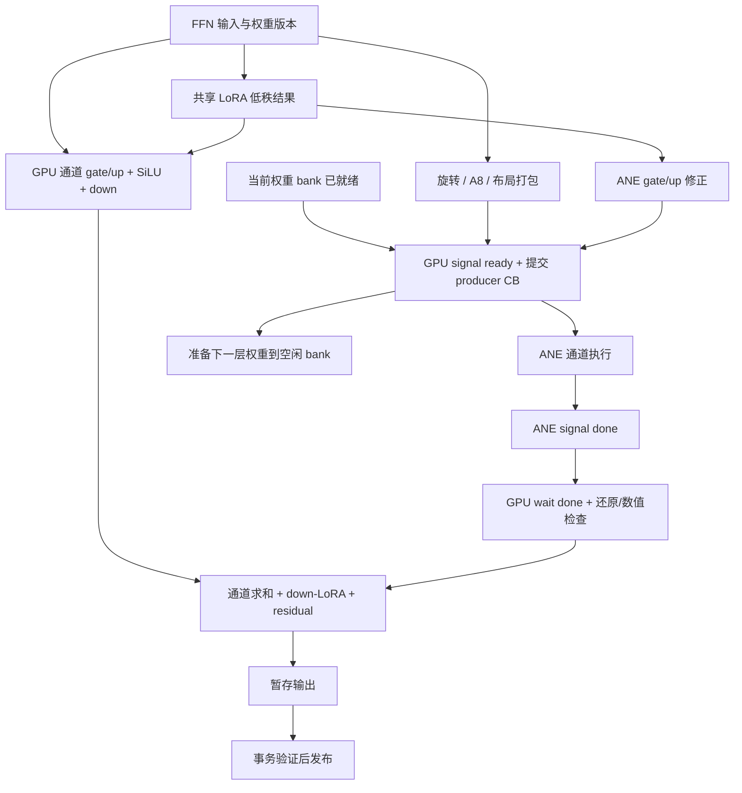
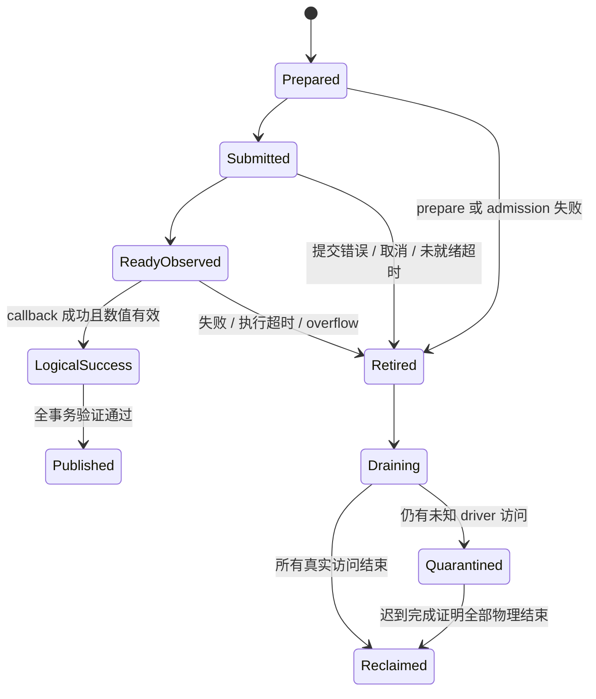

# Command graph、MLX 接入与 GPU/ANE 交接协议

> 状态：实现设计草案，2026-10-07。本文没有把所述桥接方案视为已通过验证的能力。代码块是接口与控制流示意，省略真实错误类型、ABI 适配和平台检查，不能直接复制成生产实现。本文不要求下载模型、导出全模型或运行性能实验。

## 1. 设计结论与边界

以 Splash PR #260 的“应用拥有有序 GPU 命令与设备事件依赖”为基础，在 TurboCider 增加 `tc::hetero` 执行层。该层管理执行计划、资源租约、ANE handoff、完成状态和事务提交；不以“先重写全部 MLX 算子”为前提。

必须区分三个概念：

1. **拥有执行计划**：应用知道算子、资源与依赖，可以选 GPU-only 或 hybrid 的等价执行计划。
2. **拥有设备提交**：应用控制 ready 信号何时提交、GPU 补集何时执行、何时等待 ANE 和何时合并。
3. **拥有所有 GPU kernel**：应用替换 MLX GEMM、SDPA、归一化等。这是独立的工程选择；N 将其作为完整目标，A 不以此为前提。

A 基础路线以前两项完整可控为目标，保留 MLX 算子并逐步替换。新增的 [N 独立后端](10-native-metal-graph-backend.md) 则将三项完整覆盖 Qwen DiT 作为目标：自行管理 GPU kernels 和实际提交。N 可以独立开始，不需要等待 MLX 适配失败；下文交接和故障合同适用于两者。

本设计不是 `MTLIndirectCommandBuffer` 或通用“图捕获重放”方案。`CommandGraphTemplate` 是应用自有的、可验证的调度表示；每次请求创建拥有资源和事件值的 `GraphInstance`。模板缓存不缓存上一请求的活动事件、裸指针或已消费的 ANE request。

**成功路径减少 host wait，失败路径保持完整所有权，是同一个设计要求。** 禁止以删除 `mx::eval`、`finish()` 或超时隔离来获得表面加速。

## 2. 已核对的实现依据

以下本地行号对应编写时工作树，后续修改后应更新。路径从仓库根目录起算。

| 依据 | 已观察到的行为 | 设计含义 |
| --- | --- | --- |
| [`ane_ffn.cpp:976`](../../../native/backends/ane_ffn.cpp#L976) | 输入及 LoRA 修正先 `mx::eval`；1000 行启动 ANE，1009 行运行 GPU，1011 行等待 ANE；1039 行拼接完整 hidden | 当前主干存在逐层 CPU 交接；优化不能只看 ANE 内部 kernel |
| [`ane_w8_executor.mm:205`](../../../native/backends/private/ane_w8_executor.mm#L205) | A8 stage 的 `finish()` 在 ANE enqueue 前；247–257 行按结果检查和调整 headroom 重试 | 预排队图要重新设计 readiness 和重试协议 |
| [`ane_w8_executor.mm:127`](../../../native/backends/private/ane_w8_executor.mm#L127) | 权重 staging 的所有 producer 都必须被追踪；超时后禁用 bank | 现有资源安全要求必须继承 |
| [`ane_program.mm:243`](../../../native/backends/private/ane_program.mm#L243) | callback 持有 model/request/surface，超时隔离，迟到 callback 才可释放 | 超时是逻辑失败，不是物理结束 |
| [`ane_program.mm:307`](../../../native/backends/private/ane_program.mm#L307) | 每次 prepare 构建 surface 对象、indices、events 和 request | 可分离可复用 binding 与单次 request |
| [`ane_gpu.mm:165`](../../../native/backends/ane_gpu.mm#L165) | 计算、权重 staging、激活 staging 三条队列 | 需要显式说明跨队列依赖；多队列不等于自动重叠 |
| [`memory_execution.hpp:55`](../../../native/runtime/memory_execution.hpp#L55) | 已有 admission、completion mailbox、失败隔离 | 接入已有内存协议，不建立第二个互不知情的资源账本 |
| [`memory_plan.hpp:24`](../../../native/runtime/memory_plan.hpp#L24) | resource interval、alias group、异步释放已建模 | graph buffer 的实际完成期必须映射进内存计划 |
| [`z_image_gpu_time_probe.cpp:21`](../../../tools/native/z_image_gpu_time_probe.cpp#L21) | 自定义 Primitive 可访问当前 MLX command buffer | 只证明诊断接入点存在，不证明生产异构图已安全 |

固定上游依据：

- Splash：[`80827e1c…/CommandGraph.hpp`](https://github.com/incoai/splash/blob/80827e1c3593f7d10c266394e4d4381321b73ad0/runtime/metal/CommandGraph.hpp)，dispatch 与 EventStep 的顺序表示、参数字节由 graph 持有。
- Splash：[`MetalBackend.mm:773`](https://github.com/incoai/splash/blob/80827e1c3593f7d10c266394e4d4381321b73ad0/runtime/metal/MetalBackend.mm#L773)，signal 后拆 command buffer；completion 保持 allocation 所有权；1071 行解释预建过多 command buffer 的队列容量死锁风险。
- Splash：[`AneFfn.cpp:530`](https://github.com/incoai/splash/blob/80827e1c3593f7d10c266394e4d4381321b73ad0/runtime/ops/AneFfn.cpp#L530)，输入准备→signal→GPU 补集＋下一层权重→wait→join；568 行先排 ANE jobs，再提交 Metal graph。
- Splash：[`Program.mm:673`](https://github.com/incoai/splash/blob/80827e1c3593f7d10c266394e4d4381321b73ad0/runtime/ane/Program.mm#L673)，`bind` 与 `enqueue` 分离；707 行以后仍创建每次运行的 events/request。这里的复用不是无限重放同一个 request。
- Splash：[`Handoff.mm:39`](https://github.com/incoai/splash/blob/80827e1c3593f7d10c266394e4d4381321b73ad0/runtime/ane/Handoff.mm#L39)，从 ready 开始计时，失败后 retire，迟到报告仍有独立 outstanding 追踪。
- MLX 0.32.0：[`device.h`](https://github.com/ml-explore/mlx/blob/v0.32.0/mlx/backend/metal/device.h)、[`device.cpp:496`](https://github.com/ml-explore/mlx/blob/v0.32.0/mlx/backend/metal/device.cpp#L496)，`wait_event`/`signal_event`/`commit` 及错误传播。
- MLX 0.32.0：[`device.cpp:321`](https://github.com/ml-explore/mlx/blob/v0.32.0/mlx/backend/metal/device.cpp#L321)，使用 `commandBufferWithUnretainedReferences`；[`event.h`](https://github.com/ml-explore/mlx/blob/v0.32.0/mlx/backend/metal/event.h) 的 `EventImpl` 自己拥有底层 SharedEvent。

vpipe 的参考在本章主要体现在“稳定的 Metal 执行资源与预分配 workspace、按能力选择路径”，不把其 CPU 分发、FP16 staging 或 LoRA 权重合并当作本设计的设备事件协议。具体 LoRA/量化与缓存方案由相邻章节定义。

## 3. 不可破坏的执行不变量

### 3.1 数据与完成状态

每个消费者都必须有两类信息：

- **数据就绪依赖**：这段内存何时可以被读取；
- **有效性证据**：生产者是否成功，输出是否符合数值与布局约定。

设备事件达到某个值只解决第一类依赖的正常路径。为了防止 GPU 等待永久卡住，异常路径可能人工放行事件，因此事件值本身不能作为第二类证据。

```text
event satisfied  ≠  ANE succeeded
host timed out   ≠  driver stopped
logical retired  ≠  allocation reusable
GPU output ready ≠  request result publishable
```

`GraphTransaction` 只有在 GPU command 状态、ANE completion、数值状态和所有必要依赖均成功后才允许提交结果。预览、prefix KV、缓存元数据、采样器状态不能提前成为请求的有效状态。

### 3.2 缓冲复用与别名

复用条件必须覆盖全部角色：

```text
Reusable(resource) =
    every GPU producer physically completed
    AND every GPU consumer physically completed
    AND every ANE reader/writer physically completed
    AND no future submitted command references this generation
    AND epoch is not quarantined
```

“下一层开始了”“done 的数值已经被 CPU 拉高”“C++ ticket 析构了”均不满足该条件。租约针对实际 allocation 与 generation，不能只按 view 的指针身份判断。

### 3.3 依赖只表达真实可并行性

同一层的 GPU FFN 通道与 ANE FFN 通道可以重叠；下一层权重 staging 可以与当前层算术重叠。下一层 activation 依赖当前层 attention/FFN/residual 的完整结果，不因为使用 command graph 就变得独立。

额外队列仅在测得收益时启用。Apple Silicon 上 GPU、ANE 和 staging 共享内存系统，多队列重叠有可能提高带宽竞争。默认先把 GPU 补集和 staging 的优先次序放在一个可分析的计划中，不追求队列数量。

## 4. 对象模型与职责

建议新模块归属 `native/runtime/hetero/`，Apple 对象封装留在 `.mm`；Qwen 仅负责生成模型语义正确的计划。目录与 backend adapter 的具体拆分遵循 [02](02-architecture-and-contracts.md)。以下是设计接口，不是现有 API：

```cpp
namespace tc::hetero {

// Executor-side projection of the authoritative ExecutionPlan in chapter 02.
// Derived during plan resolution; not a second plan or independently hashed schema.
struct ExecutionPlanView {
    PlanKey key;                       // geometry / semantic / precision recipe
    std::shared_ptr<const CommandGraphTemplate> graph;
    MemoryRequirement memory;          // feed existing MemoryExecutionContext
    ExecutorKind executor;
    uint32_t maximum_inflight_handoffs;
    ReplayBoundary replay_boundary;
};

struct CommandGraphTemplate {
    std::vector<Node> nodes;            // immutable op + dependency declarations
    std::vector<ResourceUse> uses;      // read/write ranges, layouts, alias groups
    std::vector<ExternalEdge> edges;    // symbolic IDs, never last run's values
    SchemaDigest schema;
};

struct BufferLease {
    AllocationOwner owner;             // typed view over existing StorageLease / StorageId
    ResourceGeneration generation;
    ByteRange range;
    TensorLayout layout;               // shape, logical dtype, physical pitch/stride
    CompletionSet physical_users;      // existing completion ledger's consumer tokens
};

struct GraphInstance {
    std::shared_ptr<const CommandGraphTemplate> graph;
    std::vector<BufferLease> buffers;
    std::vector<HandoffTicket> handoffs;
    std::shared_ptr<CompletionDomain> domain;
    RuntimeParameters parameters;      // owned bytes; immutable after encode
};

struct PreparedProgram { ProgramIdentity identity; /* owns loaded program */ };
struct PreparedBinding {
    std::shared_ptr<PreparedProgram> program;
    FunctionId function;
    std::vector<BufferLease> surfaces;
    BindingGeneration generation;      // invalid after reallocation or unload
};

struct HandoffTicket {
    JobId id;
    EpochId epoch;
    EventPoint ready;
    EventPoint done;
    BindingLease binding;
    std::shared_ptr<CompletionRecord> record;
};

class CompletionDomain;                 // bounded jobs, deadlines, late callbacks
class GraphTransaction;                 // tentative output -> verified publication
class NativeMetalExecutor;
class MlxGraphExecutor;                 // optional, version-certified adapter

} // namespace tc::hetero
```

本章 `ExecutionPlanView` 只是 [02 §5](02-architecture-and-contracts.md#5-可描述副作用的有限-ir) 所定义的共同 `ExecutionPlan` 在执行器侧的只读投影：其 key、graph、memory、executor、窗口及 replay 字段均从权威计划解析得到，不独立保存另一套语义身份，也不单独改变计划选择。后文称 `ExecutionPlan` 时均指 02 的共同类型。

`AllocationOwner` 和 `CompletionSet` 同样是概念适配字段。实际实现沿用现有 `StorageLease`、`StorageId` 与完成 token，遵循 [05 §6](05-resources-cache-and-worker.md#6-内存集成沿用一套物理账本) 的唯一物理账本：同一 MLX allocation、MTLBuffer 和 IOSurface backing 的不同视图增加持有及消费者记录，不产生第二次分配计费或互相独立的释放权。若适配层需要额外强引用，它只延长已有 allocation 的寿命；只有该账本确认全部物理访问结束才允许复用或回收。

职责要求：

| 对象 | 可缓存/共享的内容 | 不应承担的职责 |
| --- | --- | --- |
| `ExecutionPlan` | executor、行数桶、通道方案、能力与内存需求 | 持有活动 job 的 surface |
| `CommandGraphTemplate` | 静态依赖、kernel IDs、参数布局 | 捕获某次请求的 LoRA 数组或 raw pointer |
| `GraphInstance` | 单次运行的绑定、参数、epoch、暂存输出 | 作为跨请求模板重复执行 |
| `PreparedProgram` | 兼容 ABI 的编译/加载程序 | 假设所有 function 具有相同 binding |
| `PreparedBinding` | surface wrapper、indices、function 绑定 | 同一个 request 多次提交或跨 epoch 共享可写槽 |
| `CompletionDomain` | callback、deadline、lease 和隔离记录 | 在驱动回调线程修改 MLX 图或整个内存调度器 |
| `GraphTransaction` | 检查点、有效性、一次性发布 | 用假 done 冒充执行成功 |

callback 向现有 completion mailbox 发送有限、无阻塞的完成记录；owner thread 处理内存计划与后续 admission。callback 不加载模型、不做 hash、不执行 MLX、不等待其他 callback。

## 5. 单个 FFN 的命令与事件布局

### 5.1 必需依赖

下面以通道切分为例，`G` 为 GPU 通道，`A` 为 ANE 通道。LoRA 修正必须在各自非线性之前进入 gate/up；不能因为划分设备而移动算子语义。



`Ready` 是 Pack、Corr、当前 bank staging 的共同后继。如果这些 producer 在不同队列，ready producer 必须先 wait 所有 producer 的实际完成事件，不能仅在主队列上 signal。

目标 GPU 命令序列如下。它描述通过失败访问协议认证后的设备路径；W0 初版会在物理完成确认后才提交 restore/join，不能仅照下面的顺序预排队就声称完成了超时安全性：

```text
CB0:
    wait(weight_ready)                  // only if staging is on another queue
    encode input rotation / A8 / correction copy
    signal(job.ready)
    END + COMMIT                       // the ANE must be able to observe ready

CB1:
    encode GPU FFN complement
    encode next-layer weight staging    // only into an admitted free bank
    wait(job.done)
    encode ANE restore / validation
    encode channel join / LoRA / residual into tentative output
    END + COMMIT

Completion:
    validate CB0 + CB1 + ANE report + numeric status
    commit or abort GraphTransaction
```

`signal` 后分 CB 是清晰、可验证的初始策略，并与 Splash 的实现一致。避免把 ready producer 留在一个包含后续等待的尚未提交 buffer 中；也避免只优化 CPU enqueue 数量而延迟 ANE 启动。未来合并某些 buffer 必须有实测与依赖证明。

### 5.2 事件域、数值与 epoch

不允许多个无序生产者共享一个递增 timeline，然后各自 signal 更大的值。`event >= value` 的语义会让“未来”的 signal 意外放行仍未生产的数据。

首版每个 admitted job 使用独立的事件对语义：同一个 SharedEvent 的 `ready=1`、`done=2` 只绑定这个 job，或使用兼容后端支持的两个独立事件。具体 ABI 由 backend capability 决定，不假设 private API 已验证多 event 任意组合。每个事件对象必须有唯一 epoch；退役的事件对象不进入新请求的对象池。

通过验证后，可把严格串行的 jobs 放到同一个 timeline：

```text
ready_0 < done_0 < ready_1 < done_1 < ...
```

前提是所有未来 ready 的 GPU producer 确实位于前一个 done 的依赖之后，并且失败后的放行不被任何新 epoch 误读。权重 staging 的独立队列不能在这个主 timeline 上随意发出未来数值。接近 `UINT64_MAX` 时只在 idle 边界换新事件，不回绕。

`EventPoint` 应携带 `{domain, epoch, native_event_owner, value}`。日志中同时记录 epoch 和 value，否则多个请求中的 value=1 无法追踪。

### 5.3 binding 预构建

对计划实际选择的少量 function×bank×activation/output slot 组合预构建 `PreparedBinding`，保持 surface 与 indices 强引用。每次运行只创建 request/events/completion token。

预构建前校验：

- function 的符号索引、dtype、实际物理 pitch、surface 尺寸；
- FfnVariant 与实际 IO ABI 精确匹配；BaseOnly 无 correction 输入和 hidden 导出。legacy 超集兼容若仍保留，必须初始化零修正并独立标记，不能作为新 base 快路径；
- 只绑定完整合法 IOSurface，不能拿逻辑切片冒充独立 driver surface；
- program generation 与 binding generation 一致；
- input/output、hidden 与 correction 的允许/禁止别名；
- 所有 byte offset、范围和乘法均检查溢出。

binding 是进程内资源缓存。surface resize、program reload/rebuild、headroom 影响程序生成、recipe 切换均需失效相应 binding，不能只更改一个数值字段。

## 6. 双 bank 与多层预排队：安全窗口先于深度

### 6.1 正常路径约束

设第 `i` 层使用 bank `i % 2`。覆盖该 bank 以准备第 `i+2` 层，必须在第 `i` 层 ANE 读权重物理完成之后。activation、output、token scale、LoRA correction 也各有最后消费者，不能只保护权重。

```text
bank 0: stage W0 → ANE0 reads → true physical release → stage W2
bank 1: stage W1 → ANE1 reads → true physical release → stage W3
```

一个图模板中的序号正确，不等于运行时 generation 正确。所有 staging 节点持有租约 generation，executor 编码时和提交时均验证，防止重排或计划切换后写入过期 bank。

### 6.2 为什么不能直接复制“出错时拉高整个 timeline”

Splash 的 [`Handoff::State::retire`](https://github.com/incoai/splash/blob/80827e1c3593f7d10c266394e4d4381321b73ad0/runtime/ane/Handoff.mm#L42) 会将事件放到最高已分配值，让等待中的 GPU 命令退出。其 [`AneFfn::encode`](https://github.com/incoai/splash/blob/80827e1c3593f7d10c266394e4d4381321b73ad0/runtime/ops/AneFfn.cpp#L547) 则交替复用权重 bank。

这些代码证明上游存在退役和缓冲复用机制，但**不构成 TurboCider 所有超时、迟到写入与 LoRA 输出别名组合都安全的证明**。迁移时必须处理：

1. job0 超时，但 driver 仍可能读 bank0 或写 output0；
2. 人工 signal 解开后续 GPU wait；
3. 已提交的 stage W2 覆盖 bank0，或后续 restore 读取仍在写的 output0；
4. 即使最终输出被丢弃，也已发生跨 agent 的不受控重叠访问。

因此“丢弃结果”还不够。必须同时解决资源隔离和已提交命令的后续访问。

### 6.3 分阶段允许的窗口

| 模式 | 允许的行为 | 解除下一阶段门槛 |
| --- | --- | --- |
| W0：单 FFN | 一次 handoff；明确物理完成后才 restore/复用；可保留 host finish | 建立结果与生命周期基线，证明事件 ready 更早提交确有收益 |
| W1S：同步主机准入的并行 FFN | ANE 与 GPU 补集允许并行；主机确认全部物理完成后消费／复用，一个 bank | 当前 native W1 实现；仍有逐层 host wait，不是设备驱动深图 |
| W1R：有界异步 admission | 1–2 个独立 slot；共享 bank 写命令仅在真完成后由 reactor 提交；owner thread 不阻塞等待 | completion 驱动提交、回调延迟、线程约束与收益验证；尚未实现 |
| W2：多 block graph | 全部可能跨越失败边界的资源具有独立版本，或有已证明的提交/跳过协议 | 任意单点超时不能让仍在用的 bank、A8、output 被读写复用 |
| W3：整 step graph | 保留 step 检查点；允许无效暂存输出丢弃；所有资源与队列容量有上界 | W2 全部故障注入通过，首步 KV 回滚完整，峰值内存可接受 |

历史文档的异步 W1 现在称 W1R；现有 API／回执的 native W1 是 W1S，以 control-plane 标识区分。W1S/W1R 均不声称消除逐层 host admission；reactor 也有调度成本。W2/W3 需额外协议，不能仅把窗口数字由 1 改成 32。按 09 区分 B1 安全原型和 B2 设备驱动目标，详细完整后端规格见 [16](16-splash-native-backend-spec.md)。

W1 建议把 **ANE 写入 surface** 与 **GPU 可消费暂存结果** 分开管理。正常物理完成后才提交读取/还原；未知完成的 surface 整体隔离，GPU-only 重放使用独立 scratch。这样首版不要求 GPU 在 ANE 超时后冒险读取 output surface。

要实现真正的预排队 wait→restore，可选择并验证以下协议之一：

- **提交隔离**：restore/slot-reuse 所在的 CB 在真完成或明确失败后才被 admission。失败时根本不提交这些访问。这条路线最容易证明，但仍有控制平面 callback；
- **设备可见的事务状态与条件访问**：GPU 先读取以正确内存顺序发布的状态，失败时完全跳过 ANE surface 读取和后续 staging，同时所有已排 ANE request 的 input/output 都独立隔离。CPU 对 Shared 内存写一个普通布尔值不构成该协议；必须证明 CPU/GPU 发布、Metal 原子/内存可见性和 private driver 的顺序关系；
- **独立版本的深窗口**：每个在途 job 拥有独立资源，只有真物理完成才归还。可以避免覆盖，但增加 W8 bank 内存；仍需防止超时后 GPU 读取仍被 ANE 写入的输出，不能仅靠独立地址完成证明。

实施时选择一种完整协议，不将三种各取一半。若 private API 无法提供所需完成保证，保持较浅窗口并报告性能上限。

### 6.4 command buffer 容量

以 signal 数量推算 CB 数量，并受 executor 的最大在途 buffer 数约束。不要在尚未提交第一个 buffer 时无界创建整步所有 buffer。Splash [`MetalBackend.mm:1071`](https://github.com/incoai/splash/blob/80827e1c3593f7d10c266394e4d4381321b73ad0/runtime/metal/MetalBackend.mm#L1071) 明确指出这种队列容量问题。

优先有界创建、及时 commit、完成后补充；把最大窗口纳入内存与调度计划。提高 `newCommandQueueWithMaxCommandBufferCount` 只是容量配置，不是死锁证明。

## 7. Native Metal executor 参考结构

以下示意只描述**已通过窗口安全检查的图**如何编码；不隐藏 6.3 节对 restore/reuse 提交的限制。

```objective-c++
// Design sketch. Not a directly compilable implementation.
GraphTicket NativeMetalExecutor::submit(GraphInstance instance) {
    auto state = make_shared<GraphRunState>(std::move(instance));
    validate_dag_ranges_aliases_and_window(*state);
    state->retain_all_allocation_and_parameter_owners();

    // Prepare before submission; malformed bindings produce no driver work.
    auto jobs = prepare_one_shot_requests(*state);
    auto batch = encode_admitted_segments(*state);  // bounded CB creation

    try {
        // Request waits for ready. Drivers may retain work even if enqueue throws.
        for (auto& job : jobs) {
            state->domain->register_before_enqueue(job);
            enqueue_ane(job, completion_record_only(state->domain, job.id));
        }
        for (auto& cb : batch) {
            attach_completion(cb, state);          // owns buffers until actual end
            state->register_before_commit(cb);     // preallocated ledger; completion may be immediate
            [cb commit];
            state->note_submit_returned(cb);       // nonthrowing; not a success/completion mark
        }
    } catch (...) {
        state->domain->retire(current_exception());
        state->stop_admitting_new_segments();
        state->release_only_certified_abortable_waits();
        state->quarantine_uncertain_driver_resources();
        // Never destroy all `state` merely because submit did not return a ticket.
        throw SubmissionFailure{state};
    }
    return GraphTicket{state};
}
```

编码器细则：

```objective-c++
void encode_event_step(const EventStep& step, RunState& state) {
    end_active_compute_encoder();
    if (step.kind == EventStep::Wait) {
        assert(state.window.permits_wait_and_consumers(step));
        [currentCB encodeWaitForEvent:step.event.native value:step.value];
        state.retain(step.event.owner);
        return;
    }
    [currentCB encodeSignalEvent:step.event.native value:step.value];
    // On error: retire the domain before any emergency release.
    // Release is permitted only under the previously certified abort protocol.
    attach_producer_failure_handler(currentCB, step, state.shared_owner());
    finish_and_commit_or_enqueue_ready_segment();
    begin_next_bounded_segment();
}
```

不能只给最后一个 CB 添加成功检查。所有已提交 CB 的状态进入 `CompletionSet`；前面的失败可能没有正常执行 signal，最后的 completion 也不能覆盖最早错误。

资源由 ticket state、driver callback 和 completion mailbox 的明确 owner 保持；`@autoreleasepool` 仅负责临时 Objective-C 对象，不充当 GPU/ANE 资源寿命协议。

## 8. MLX executor：可行接入点与严格准入

### 8.1 当前已知与未知

已知：本地 MLX 0.32.0 的 `CommandEncoder` 提供 `end_encoding`、`signal_event`、`wait_event`、`commit`。这些接口允许表示需要的设备顺序。

未知且必须验证：

- 在 Primitive 内提前 commit，是否与 MLX scheduler 的 task 完成、异步求值、allocator 回收完全兼容；
- 外部 ANE 写入是否能被 MLX 的 hazard/fence 追踪正确表达；
- 带有异构副作用的 Primitive 在 `mx::compile`、重算、多输出裁剪及 CSE 中的行为；
- 原生 shared event 在 Metal validation wrapper 下是否能供 private ANE 使用；
- 内部 C++ ABI、metal-cpp 和 Objective-C ownership 在构建升级后的兼容性。

`CaptureBuffer` 只保留一个 command buffer 用于读时间戳，并没有解决以上问题。不能把该示例改名为 `AneSignalPrimitive` 后直接上线。

### 8.2 事件桥接所有权

`EventImpl` 不是 `id<MTLSharedEvent>`。优先选择 MLX 创建并拥有 `EventImpl`，适配层通过其 `mtl_event()` 取得同一个底层事件，构造带显式 owner 的 private-ANE handle。反向“将外部 SharedEvent 塞入 EventImpl”需要新增受控接口，现有头文件不提供任意外部事件构造器。

禁止：

```cpp
// WRONG: different object types and ownership models.
auto event = reinterpret_cast<mlx::core::metal::EventImpl*>(nativeSharedEvent);
```

Native handle 只在适配层中暴露，接口不以 `void*` 抹去所有权。`PreparedRequest` 必须持有 event owner 至驱动真完成。

Splash [`Program.mm:720`](https://github.com/incoai/splash/blob/80827e1c3593f7d10c266394e4d4381321b73ad0/runtime/ane/Program.mm#L720) 检查了 validation wrapper 的 eventPort 问题。TurboCider 应报告 `event-sharing-unavailable` 并回退，不能关闭验证层错误处理来掩盖能力缺失。

### 8.3 commit 与引用生命周期

MLX 0.32.0 使用 `commandBufferWithUnretainedReferences()`。因此：

- 获取 `MTLBuffer*` 不等于持有底层 MLX allocation；
- `copy_shared_buffer` 建立别名不等于证明所有未来消费者都完成；
- 外部 surface wrapper、原始权重 owner、LoRA factors、参数 bytes 必须被保留；
- 不能只保留 Objective-C buffer 而让 MLX allocator 把同一存储重新分配给别的 tensor；
- `add_temporary` 有自身的 fence/临时资源语义，不能不加区分地将所有输入标记为 temporary。

对 MLX 内部接口的调用收敛到 `mlx_command_adapter.{hpp,mm}`，固定适配版本与 build key。该适配层提供的概念接口应是：

```cpp
struct MlxBridgeCapabilities {
    bool explicit_event_edges;
    bool safe_producer_commit;
    bool external_output_lifetime;
    bool compiled_primitive_ordering;
    bool private_ane_event_sharing;
};

class MlxCommandAdapter {
public:
    // Executes on the MLX stream's permitted scheduler thread only.
    void encode_ready_and_submit(
        StreamContext&, const EventPoint&, LifetimeBundle);
    void encode_result_dependency(
        StreamContext&, const EventPoint&, ExternalWriteContract);
    // Returns a real completion record, not merely a void callback.
    CompletionToken track_current_segment(StreamContext&, LifetimeBundle);
};
```

真实适配层必须在 commit 前正确结束 encoder，并追踪 CB 的真实 status。MLX [`commit` 实现](https://github.com/ml-explore/mlx/blob/v0.32.0/mlx/backend/metal/device.cpp#L517) 中 completion 回调执行在后续事件错误传播之前；不能把这个无参数 callback 被调用当作成功证据。

### 8.4 图语义与编译

初期将纯数值 GPU 段继续 `mx::compile`，异构 handoff 保持显式边界。生产 Primitive 若要参与编译，必须提供：

1. 所有实际输入，包括 LoRA 与版本变化，作为图输入或经过验证的不可变资源 token；
2. 所有实际输出，包括恢复后的 tensor 与依赖 token，构成被最终消费者使用的数据依赖；
3. 不可重复/不可合并的 invocation 身份或受 MLX 支持的副作用约定；
4. CPU 路径、autodiff、vmap 等不支持能力的明确错误，而不是静默执行不完整计算；
5. 不捕获悬空 request、上次 events、已退役 binding 或旧 adapter 的闭包；
6. 编译图销毁后权重释放的检查。

仅添加一个“输出原样返回输入”的 marker 可能被重排、删去或复用，不能承担跨设备副作用。若 MLX 的扩展契约不足以证明这些性质，保持 handoff 在编译范围之外，或转到原生 FFN executor。

MLX API 版本变化时，`compiled_primitive_ordering` 等能力默认失效，先跑无模型的事件和生命周期测试，再恢复认证。

### 8.5 两条路径必须同口径比较

比较至少分开：

- 当前 MLX GPU-only；
- 新 executor 的 GPU-only；
- 当前最佳 hybrid；
- 新 executor 的 hybrid。

否则“hybrid 变快”可能掩盖 GPU-only 被重写慢了，而混合路径只是弥补退化。适配层不得全局修改所有模型的 MLX buffer limits；若需要特殊 limits，只能对专用 executor/stream 生效，并记录在结果身份中。

## 9. CompletionDomain 与事务状态机

### 9.1 两套状态不可混为一谈



`LogicalSuccess` 仍不是资源全部回收状态。正常 ANE callback 可能先于 GPU restore 完成；资源要等 `physical_users` 全部清零。

### 9.2 deadline

分开记录：

- `prepare/load_deadline`：编译、加载、绑定服务的有界等待；
- `ready_deadline`：GPU producer 未达到 ready 的异常等待，按事务上限保护；
- `ane_execution_deadline`：从真正观察到 ready 起算；
- `drain_deadline`：失败后的有限清理等待；
- `request_deadline/cancellation`：用户请求层。

不要从 ANE request enqueue 开始计算其执行超时，因为 request 可能合法等待前面几十毫秒的 GPU 工作。ready notification 自身有调度延迟，日志应标注这是 host-observed ready 时间，不能伪装成精确 ANE kernel 时间。

使用单调、明确睡眠语义的时钟；笔记本休眠/唤醒后不能因 wall-clock 跳变重复提交或复用未完成槽。Splash 的 AwakeClock 是可参考策略；本机超时阈值必须按 driver 行为和测试确定，不直接复制上游 2 秒或将其视为系统保证。

### 9.3 一次性结算

```cpp
void CompletionDomain::on_report(JobId id, DriverReport report) noexcept {
    // Sketch: actual implementation must avoid throwing from callbacks.
    auto record = lookup_owned_record(id);
    if (!record) return;                       // stale ID never touches a new epoch
    if (!record->mark_physical_report_once()) return;
    record->record_driver_result(report);
    mailbox.try_push(PhysicalCompletion{id, record->epoch, report});
    // A timeout may already have retired the transaction.
    // This report releases ownership; it NEVER resurrects its output.
}

void GraphTransaction::retire(Failure why) {
    if (!try_set_first_failure(why)) return;
    executor.stop_admission(epoch);
    domain.retire(epoch);
    executor.apply_certified_abort_protocol(epoch);
    quarantine.attach_all_unknown_physical_users(epoch);
    // No publish, no cache insert, no reuse of event/surface generations.
}
```

mailbox 必须有有界溢出策略。若无法记录完成，不得乐观归还资源；使用保守隔离，并把错误带回 owner thread。

### 9.4 Qwen 的重放检查点

重放最小边界可以先是完整 FFN；原生 block/step graph 扩展后，以实际可重建边界为准。

| 状态 | FFN 重放 | block/step 重放 |
| --- | --- | --- |
| 输入 hidden | 保留不可变 FFN 输入 | 保留 block/step 起始 hidden，禁止原地覆盖唯一副本 |
| 权重与 LoRA | 同一模型、adapter、strength、精度 recipe | 同样固定，重放期间不能切换 adapter |
| prefix KV | FFN 通常不修改，但仍验证所属请求 generation | 首步新增 KV 先写 tentative bank，整边界成功再发布 |
| timestep/modulation | 不改变 | 保存当前 sigma/timestep 与调度索引，不重复推进 |
| RNG | FFN 路径不新增随机消费 | 保存必要随机状态或显式噪声，重放不能重新抽样 |
| caches | 失败输出不进入缓存 | snapshot、prefix 命中元数据和完成标记一起提交 |
| UI/receipt | 不发布失败预览 | 性能 receipt 记录重放，不伪装成正常快速路径 |

重放规则：

1. 先停止当前 epoch 的新提交。
2. 识别所有仍在物理访问的资源，完成或隔离；不能一边重放一边复用同一 bank。
3. 检查纯 GPU 重放的额外内存预算；不能因隔离占用而越过原有 admission。
4. 从最早被不可信结果污染的检查点重算完整等价路径，包括 LoRA。
5. GPU 队列/MLX stream 本身健康才允许原进程重放；出现 GPU command error、driver 状态未知或预算不够时，终止本 worker 并返回可重试错误，不能保证每种故障都能无缝 GPU fallback。
6. 用户取消时不为了生成最终图片再重放；只进行有界清理。

跨 block 的 prefix KV 发布尤其需要注意：第 `i` 层 KV 可能来自已经被上层错误结果污染的 hidden。不能只清除“失败层”的缓存；失效范围由 checkpoint 依赖闭包决定。

## 10. Overflow/headroom 重试与计划变更

当前 executor 可在一次调用内 `build(headroom*4)` 后重试。深图中的后续 commands、binding、bank generation 已经预排队，不能照搬这个循环。

首版规则：

- 量化/恢复检查发现 overflow 或 nonfinite：退役当前事务，完整边界 GPU 重放；
- 在安全 idle 边界记录该 recipe/shape 的 headroom 需求；
- 如果新 headroom 改变 MIL/program，生成新的 program identity、bindings 和 plan generation；
- 下一事务才启用新计划；不能静默改写当前 `PreparedProgram`；
- BF16 value-boundary 等禁止 headroom 改写的 recipe，保持其明确限制。

未来允许局部重试的条件：没有下游消费者被提交；输入、修正和当前权重 bank 全部仍被租约保留；旧 driver 物理完成已确认；新 request 使用新事件值与新 generation；不会重用未来已排队的生产者。这实质上是一个可回滚的小事务，必须单独测试。

LoRA strength、文本行数、参考图几何、旋转/SmoothQuant recipe、GPU kernel variant 都只能在计划边界变更。长文本选择不同 function 或纯 GPU，不改变提示词内容。

## 11. 观测与性能归因

每个 job 记录 `plan_id / epoch / layer / step / function_rows / valid_rows / bank_generation / adapter_identity`。至少导出以下指标：

| 指标 | 含义与限制 |
| --- | --- |
| producer encode/submit wall | host 成本，不能当作 GPU 量化耗时 |
| ready host-observed time | deadline 起点，有通知延迟 |
| GPU CB execution interval | 与其他 CB/队列可能重叠，不能相加当总耗时 |
| ANE callback interval | 包含服务/队列/回调开销，不自动等于纯 ANE kernel 时间 |
| exposed join wait | 临界路径等待，优先优化的证据之一 |
| staging overlap and contention | 隐藏 staging 仍可能争用带宽，须与 GPU-only 分段比较 |
| restore/join bytes and duration | 显示布局、hidden 拼接与 LoRA 低秩优化效果 |
| host gaps between admitted segments | 判断 W1 reactor 是否成为新的瓶颈 |
| buffer count / in-flight peak / quarantine bytes | 调度与生命周期成本 |
| retries / fallback / cancelled / replayed blocks | 准确解释 E2E，不能计为正常成功候选 |

所有计时模式会改变同步时，必须单独标识 `instrumented`。不能把逐段同步测得的 kernel 时间与无同步 E2E 相加，预测一个不存在的总收益。

验收性能需要包含新 executor 的纯 GPU 路径。没有该对照，就无法区分“ANE 提速”与“GPU 重写退化后被部分补偿”。

## 12. 无模型故障注入矩阵

先用很小的确定性 buffer、CPU 模拟 ANE producer 和虚拟时间测试；需要真正 Metal/private API 的场景再做最小设备测试。不要为调度协议测试加载全模型。

| 注入点 | 必须观察到的结果 |
| --- | --- |
| binding geometry/index 不匹配 | enqueue 前拒绝，没有任何 driver work |
| 第一个 ready CB 创建/提交失败 | ANE 等待被按已认证协议退役；无有效输出 |
| 部分 ANE enqueue 后抛异常 | 已 enqueue jobs 仍保有资源；prepared 但未提交对象解除循环引用 |
| producer CB 失败但无 signal | 事务失败；不会把人工放行当成功 |
| ANE callback 失败或从不返回 | deadline 生效；停止 admission；资源隔离；禁止 bank 重用 |
| ANE 完成事件早于 callback / callback 早于通知 | 不双重结算；deadline 不误将已完成任务重启 |
| timeout 后迟到写入 | 写入仅触及隔离 generation；新请求与 GPU 重放结果不被污染 |
| 重复 callback | 一次结算、一次回收，错误不被后续成功覆盖 |
| future timeline signal 先于 earlier signal | 计划验证失败，或独立事件域保持正确依赖 |
| 两 bank 交替并在第 0 层超时 | 第 2 层 staging 不可覆盖 bank0；浅窗口不得偷偷提前提交 |
| abort 后 restore 仍已排队 | 必须由认证协议阻止读取未完成 ANE surface；否则该窗口不可发布 |
| GPU join 非有限值 | 事务退役，完整 FFN/step 重放，不缓存错误输出 |
| overflow 要求 headroom 更新 | 当前计划不原地修改，下一安全边界生成新版本 |
| 用户取消发生于任意阶段 | 无最终结果发布；有限清理；无自动再生图 |
| worker 退出/析构而 callback 未到 | 不触碰销毁对象；受控隔离或进程退出回收 |
| 事件值接近上限 / epoch 复用 | 拒绝回绕；idle 创建新事件域 |
| command buffer 容量设为很小 | 不会在首次 commit 前阻塞于无界创建 |
| MLX 编译裁剪、多次 eval、异步 eval、图销毁 | handoff 次数正确、无 CSE 误复用、无悬空存储 |
| 切换 LoRA、shape、function、program reload | 旧 binding/graph 不命中；旧 callback 不能作用于新 epoch |
| 首步图失败后 prefix KV 命中检查 | 未提交或受污染 KV 不可命中；GPU 重放与基线一致 |
| 隔离占用导致 fallback 内存不足 | 正确返回重试错误，不越过预算或删除有效用户模型 |
| 休眠/唤醒、clock 跳变 | 不重复提交、不将逻辑 timeout 视为驱动物理结束 |

每个故障测试同时验证输出、完成次数、资源强引用、generation、队列可用性和内存状态。只验证“没有 crash”不算通过。

## 13. 实施顺序与完成定义

### A. 可独立落地的控制面

1. 实现不依赖 MLX/ANE 的 graph schema、资源范围和 event DAG 验证器。
2. 实现 `CompletionDomain`、`GraphTransaction`、有界 completion mailbox 适配与状态测试。
3. 将现有 Program 的 reusable binding 与 one-shot request 分开；保持现有同步 executor 行为不变，先验证等价性。
4. 将 callback/超时资源状态接入现有 `MemoryExecutionContext`，明确 `NeedsGpuDrain` 与 `QuarantineWorker`。

完成定义：所有无设备协议测试通过；当前同步路径结果和资源释放行为不退化。

### B. 单 FFN 执行图与 MLX 能力验证

1. W0 路线显式表达 ready producer、GPU 补集与结果消费，不提前启用深窗口。
2. 对 MLX 适配器分别验证 event sharing、producer commit、allocation 所有权、编译语义；不以一个综合通过标志隐藏具体失败能力。
3. 不能认证的能力转为原生 FFN executor 或保留现有边界。
4. 使用已有真实 FFN capture 比较完整路径，包含 staging、量化、同步、LoRA 和 join。

完成定义：完整路径正确；没有 fallback/retry 的成功样本有可复现收益；新的 GPU-only executor 不出现未解释退化；不能满足则保持实验状态。

### C. 有界异步窗口到 Qwen block/step

1. W1S 可先形成完整基线；W1R 异步 admission 独立比较 host gap，若收益足够可交付 B1 并暂停扩大窗口。明确 B2 尚未完成，不隐藏逐层主机成本。
2. 按 6.3 节选择一个可证明的 W2 失败协议；独立核算 slot、checkpoint、quarantine 和 replay 的峰值内存。
3. 保留 MLX attention 时，明确每个 block 的桥接边界；原生 attention 不在此阶段顺带重写。
4. 首步 prefix KV 与后续 decode-style 步分别建立事务；通过故障测试后才允许 W3。

完成定义：在当前笔记本上用少量、同口径 base/LoRA E2E 证明最终收益；任何取消/失败都不污染下一请求。不能用组件收益代替整图收益，也不能将 W0 的安全性自动推导到 W3。

### D. 需要保持开放的决策

- MLX 内部 ABI 是否值得长期承担，还是最终转为 Qwen 原生 block executor；
- private driver 的实际完成保证是否足以支持无 host admission 的深窗口；
- 单/双事件或严格主 timeline 哪种经过能力与故障测试后最简单；
- 固定几层一组还是按内存/行数动态分段，哪种减少实际临界路径；
- 设备事件调度收益是否大于 callback、额外 slot 和 staging 带宽竞争。

这些问题都要由明确的能力探测或轻量测量回答。设计目标是让它们能在统一 `ExecutionPlan` 下被替换和验证，而不是把某一种未验证的 MLX/private API 行为固化为全系统前提。
