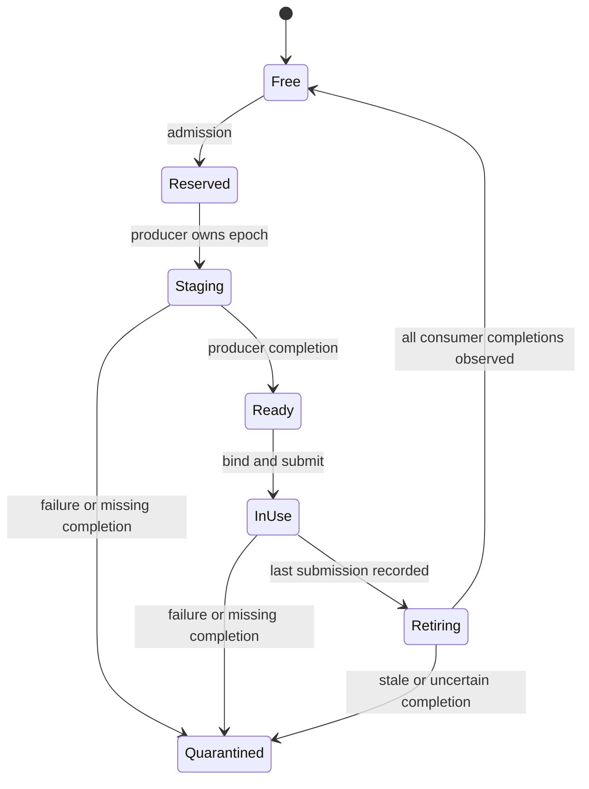
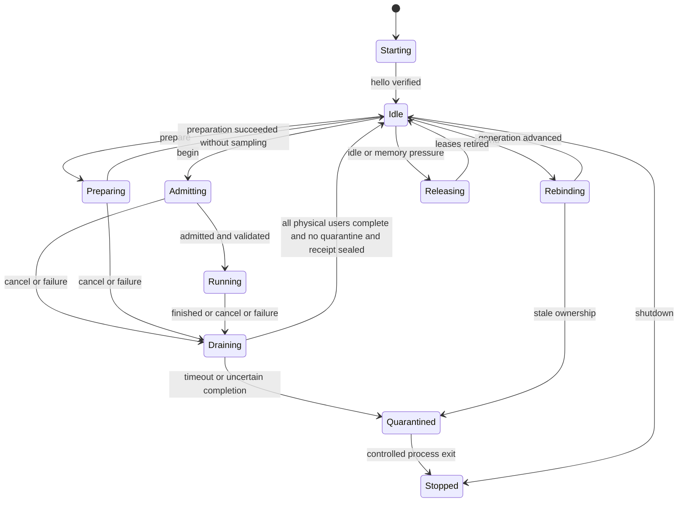

# 05 · 统一资源、缓存与 worker 生命周期

> 状态：改造设计，尚未实现。本文提出的新类型、JSON 字段、CLI 命令及数值预算均不是现行公共协议。本轮不下载、复制或转换模型，不运行性能实验。基线为 2026-10-07 的 `dev-verify` 工作区；工作区中的未提交实现也属于本次阅读对象。
>
> 本文负责“谁拥有资源、什么时候可以复用或释放、怎样证明缓存仍然匹配”，设备事件的具体拓扑和数值算子由同目录其他章节定义。公共资源对象位于拟议的 `tc::hetero` 命名空间，并复用现有 `tc::MemoryExecutionContext` 等内存基础设施。共同语义以 [02](02-architecture-and-contracts.md) 为准，事件与一次性请求合同以 [03](03-command-graph-and-handoff.md) 为准；本文代码仅展开资源侧关系，不声明另一份 ABI/header，也不是可与其他章节结构定义直接拼接的代码。

本章给出可扩展资源能力。首个 BaseOnly session 的具体组合、启动顺序和负结果管理见 [09](09-base-first-splash-review.md)；持久 worker 是独立后续能力，不能阻塞单请求 Base 验证。[10 的 Native Metal Graph 后端](10-native-metal-graph-backend.md) 同样使用本章账本与 cache 分层，另加 backend/shader/bridge 身份，不创建第二套物理内存管理。

## 1. 目标与边界

GPU/ANE command graph 的价值依赖可靠的资源生命周期。缺少生命周期设计，扩大异步范围会把目前容易观察的 CPU 等待，变成难以复现的旧权重读取、过早复用 IOSurface、取消后回调访问已释放内存，或越来越大的常驻工作集。

本方案的目标是：

1. 模型、LoRA 和外部模型目录仍只登记一次；加速衍生物引用其身份，不另建模型副本。
2. 程序、权重转换、binding、scratch、校准与请求输入各自拥有独立的身份和失效条件。
3. GPU、ANE、I/O 共用同一物理存储账本；异步完成前不释放或覆盖仍在使用的资源。
4. 在当前单请求独立 worker 之外，增加可取消、可排空、可重绑定的受控持久 worker；保留原路径作为隔离回退。
5. 给“复用命中”“首次加载”“程序已编译”“缓存有效”“性能已验证”不同含义，避免用一个绿色开关代替事实。
6. 在 48 GiB 笔记本上优先保留高收益的小资源；不默认缓存全部 W8 权重、所有行数、所有 LoRA 或全部 encoder/DiT/VAE。

非目标：重新实现模型下载器；绕过现有内存能力认证；把系统 Core ML/ANE 编译缓存宣称为 App 完全可控；把近似 DiT cache 包装成精确结果复用。

## 2. 已有基础与明确缺口

下表源码行号为本次阅读时的定位，后续代码移动以符号为准。

| 范围 | 现有实现 | 改造需要补什么 |
|---|---|---|
| 模型和 ANE 目录 | [`ModelLibraryController.swift`](../../../apps/macos/ModelLibraryController.swift) 340–385 行已有登记、选择、编译、移除登记；移除登记保留源文件 | 将动态 ANE program/配方/性能记录作为衍生资源展示，不能要求用户把每个 row function 当独立基础模型管理 |
| 诊断张量缓存 | [`TensorCacheController.swift`](../../../apps/macos/TensorCacheController.swift) 4–49 行已有 inventory、保留时间、诊断目录登记 | 扩展分类统计和安全清理；诊断张量与运行程序分不同配额和生命周期 |
| 源文件租约 | [`source_lease.hpp`](../../../native/runtime/streaming/source_lease.hpp) 20–41、81–136 行已有路径与解析目标、持有 fd、generation、可取消内容验证 | 将 Qwen resident source、LoRA、转换 bank、持久 worker 绑定到同一来源代次；磁盘 JSON 中的 hash 不能自行授予“已验证”资格 |
| 内存计划 | [`memory_plan.hpp`](../../../native/runtime/memory_plan.hpp) 24–81 行已有 alias group、异步释放、allocation site、epoch；[`memory_manifest.hpp`](../../../native/runtime/memory_manifest.hpp) 45–80 行已有来源和生命周期 | 给 graph 的 bank、surface、低秩 scratch、编译临时量增加真实 site，不另建一个估算器 |
| 分配与完成 | [`memory_scheduler.hpp`](../../../native/runtime/memory_scheduler.hpp) 145–167、193–207 行已有先 reserve 再 commit、异步 completion mailbox | 接入 Metal/ANE 两方消费者和持久 worker；覆盖迟到、重复、旧 generation completion |
| 请求状态 | [`memory_execution.hpp`](../../../native/runtime/memory_execution.hpp) 20–35、55–108 行已有 drain、failed、quarantine | 扩展 worker 级物理账本与请求级视图；当前对象默认请求作用域，不能假装已经支持跨请求保留 |
| 校准选择 | [`ane_channel_selection.hpp`](../../../native/backends/ane_channel_selection.hpp) 23–63 行已有有界、进程内缓存和 weak source owner 校验 | 持久化“证据记录”，但重新绑定当前来源；不能把离线建议直接升级为已接受路线 |
| Metal PSO | [`ane_gpu.mm`](../../../native/backends/ane_gpu.mm) 51–125 行已有按形状/编码缓存的 PSO，W8 变体上限 52 | 共用设备资源服务，避免每个请求重建；需要时评估 BinaryArchive，保持源码编译回退 |
| ANE program | [`private/ane_program.mm`](../../../native/backends/private/ane_program.mm) 187–220 行已有源缓存、编译/加载；307–365 行仍每次包装 surface、indices 和 request | 区分可复用 `PreparedBinding` 与每次提交的新 request/event；增加空闲 unload 与有界服务队列 |
| 编译闭包 | [`runtime_ffn_graphs.hpp`](../../../native/models/qwen21/runtime_ffn_graphs.hpp) 8–10 行明确要求 request/calibration-local，闭包捕获 `Weights&` | 不可直接放入全局 graph cache；要么权重作为参数，要么 graph 严格归属不可变 session generation |
| App worker | [`JobStore.swift`](../../../apps/macos/JobStore.swift) 813–871 行按任务启动 `worker-runtime-generate`、等待退出再验收 | 增加持久协议和逐请求终态回执；不能继续用“进程退出”表示某个请求已完成 |
| App runtime 配置 | [`RuntimeImageWorker.swift`](../../../apps/macos/RuntimeImageWorker.swift) 317–330 行是固定实验 profile，非最新 CLI 最优组合；68–70 行程序源缓存预算为 128 MiB/64 项 | 将配置解析为可审核执行计划；分别记录 base/LoRA、首次/复用请求和所选计划，不在 App 中复制一份复杂调参逻辑 |

现有 Qwen 并非没有输入缓存。`pipeline.cpp` 365–499 行已有 text/edit/reference 缓存及编码器来源检查；reference 小缓存最多 3 项、128 MiB。197–229 行还有受严格路径约束的 prefix snapshot。它们目前不应因持久 worker 引入而无条件扩展到 hybrid 路径。

## 3. 上游参考的采纳范围

### 3.1 以 Splash 资源组织为主

参考 Splash #260 合并前最终提交 `80827e1c3593f7d10c266394e4d4381321b73ad0`：

- [`runtime/ops/AneFfn.cpp`](https://github.com/incoai/splash/blob/80827e1c3593f7d10c266394e4d4381321b73ad0/runtime/ops/AneFfn.cpp)：同一 program 内多个 rows function、最大容量共享 I/O、双权重 bank、预建 bindings、复用各层 scale metadata。
- [`runtime/ane/Program.mm`](https://github.com/incoai/splash/blob/80827e1c3593f7d10c266394e4d4381321b73ad0/runtime/ane/Program.mm)：bind 与 enqueue 分离；复用绑定对象但每次创建带事件的新请求；空闲程序 unload/reload 和有界编译/加载服务。
- [`runtime/engine/AneFfnStartup.cpp`](https://github.com/incoai/splash/blob/80827e1c3593f7d10c266394e4d4381321b73ad0/runtime/engine/AneFfnStartup.cpp)：启动 admission、持久校准记录、失败/不适合路线的记忆。

采纳资源分层，不照搬其模型身份粒度：TurboCider 的模型、adapter、量化配方和质量证据必须继续独立绑定。程序结构相同不代表某 checkpoint 的 W8A8 质量相同。

### 3.2 从 vpipe 复用驻留与 scratch 思路

参考 vpipe 提交 `3e2682a0847c9e76dd37978f2be01f53195ae5e3`：

- [`generative-models/shared/block-residency.h`](https://github.com/tgo-app-dev/vpipe/blob/3e2682a0847c9e76dd37978f2be01f53195ae5e3/generative-models/shared/block-residency.h)：循环层访问下固定保留一部分 block，依据实际驻留/压力和预算调整，避免普通 LRU 不断淘汰下一轮马上需要的层。
- [`generative-models/shared/runtime-lora.h`](https://github.com/tgo-app-dev/vpipe/blob/3e2682a0847c9e76dd37978f2be01f53195ae5e3/generative-models/shared/runtime-lora.h)：按一次 forward 最大行数/rank 预留 scratch，投影中复用。
- [`generative-models/shared/ane-ffn.cc`](https://github.com/tgo-app-dev/vpipe/blob/3e2682a0847c9e76dd37978f2be01f53195ae5e3/generative-models/shared/ane-ffn.cc)：受控 worker、staging 与计算重叠、复用容量足够的 buffer。

本设计不继承 vpipe 的 BF16 低秩精度作为默认值，也不把其 LoRA staging-time 权重融合替代 TurboCider 的 FP32 activation correction。复用的是分配、调度和驻留模式；数值路径由质量验证单独决定。

## 4. 对象边界：计划可复用，运行实例不可混用

建议对象关系如下；不是六套相互独立的内存池。

```text
ModelLibrary / SourceLease ──> SessionGeneration
                                    │
                  immutable ExecutionPlan
                                    │
                  PreparedProgram / KernelLibrary
                                    │
             PreparedBinding(function, bank, arena generation)
                                    │
               GraphInstance(request, step segment, epoch)
                                    │
          BufferLease + CompletionDomain + existing memory ledger
```

| 对象 | 所有权和可变性 | 允许复用的范围 |
|---|---|---|
| `tc::hetero::ExecutionPlan` | 不可变的已解析执行选择与资源要求；不持有请求张量或 driver pointer | 来源、adapter、影响选择的 strength、质量/性能资格、环境能力、请求阶段、形状及实现版本均匹配 |
| `CommandGraphTemplate` | 不可变的结构模板；不含已接受模型资格或实际来源代次 | 相同拓扑、精度 ABI、形状类别/LoRA 布局，可跨相容 checkpoint 复用 |
| `PreparedProgram` | ANE/Core ML program 或 Metal pipeline 集合；持有编译产物租约 | 满足 program identity；动态权重程序可跨相容 checkpoint |
| `PreparedBinding` | 持有 surface、参数索引及 program/function 引用；不含上次事件值 | 相同 program 及 load generation、function、arena generation、binding schema；允许权重内容按合法 bank epoch 更新 |
| `GraphInstance` | 一次执行的绑定集合；持有输入/输出、事件与租约，由 `GraphTransaction` 管理回放和提交 | 不跨请求复用实例；只复用其不可变模板 |
| `GraphTransaction` | 一个检查点到提交边界；持有 tentative 状态、失败与回放策略 | 不与缓存命中或普通 graph completion 混用 |
| `BufferLease` | 包装已有 `StorageLease`、存储 owner、视图范围和消费者集合 | 存储容量可复用；内容有效性由 generation/epoch 判断 |
| `CompletionDomain` | 聚合一个提交/隔离代次的 GPU、ANE、I/O 完成；有界 mailbox；只向 owner thread 发布 | worker 持有服务；每个域有独立 generation，退役域永不恢复；token 含 request/session/bank generation |
| `SessionGeneration` | 不可变的模型和 adapter 绑定，持有 `SourceLease`、prepared weight views | 同一来源与 adapter 布局；重绑定产生新 generation，旧代次排空后退休 |

`ExecutionPlan` 是异构子计划，名称不得与现有 `tc::ExecutionPlan` 的顶层请求计划混用。顶层计划通过强类型字段或 handle 引用 `tc::hetero::ExecutionPlan`。共享图模板不意味着共享可变运行状态。

跨 checkpoint 的结构复用发生在 `CommandGraphTemplate` 和未嵌入权重的 `PreparedProgram`；`ExecutionPlan` 是为当前来源、资格和请求阶段解析后的结果。改变 LoRA strength 即使无需重编译程序，也可能影响质量资格、通道选择或是否应启用 ANE，因而必须重新解析计划。资源是否已热加载、当前内存压力等环境变化也须重新 admission；模板命中不能跳过这些步骤。

### 4.1 PreparedBinding 与单次 request 必须分离

当前 `Program::prepare()` 每次生成 `_ANEIOSurfaceObject` 和 indices。应改为：

```cpp
// 设计草图：不可直接编译；实际 driver 类型留在 .mm 私有实现中。
struct BindingKey {
    ProgramId program;
    uint64_t program_load_generation;
    FunctionId function;
    uint64_t arena_generation;
    BindingSlotsDigest slots; // 所有输入/输出 StorageId、view、独立 slot 的有序集合
    BindingSchemaId schema;
};
class PreparedBinding {
public:
    HandoffTicket make_submission(EventPoint ready, EventPoint done,
                                  EpochId epoch, CompletionDomain&);
private:
    // 缓存 surface wrappers 与 indices；Submission 单独持有事件和 callback。
    std::shared_ptr<PreparedProgram> program_;
    std::vector<BufferLease> backing_;
};
```

实际 request 与 completion callback 不共享复用。每次 `make_submission` 产生新 submission ID；迟到 callback 只能结算自己的 ticket。上次请求的“完成”不能满足新请求同名 bank 的消费条件。

即使 program 的内容 key 没有改变，unload/reload 后也先递增 `program_load_generation` 并重建 binding。只有后端另有独立测试证明绑定可跨 reload 保持有效时，才可放宽；不能从 program 磁盘命中推导出 driver wrapper 仍有效。

`slots` 不能只记录 weight bank ID：W1 等路线可能给不同 job 分配独立 activation/output slot，同一权重 bank 对应多个合法 bindings。digest 包含每个输入/输出的有序角色、`StorageId`/generation、byte range、layout/pitch 和 slot ID。动态权重内容 epoch 属于运行时 slot lease 和提交校验，不进入 binding key；否则每层更新权重都重建 binding，失去该复用的意义。

## 5. 分层缓存 key：不是把所有 hash 塞进一个 key

缓存 key 由 canonical typed encoding 生成，明确字段版本、整数/浮点编码和有序集合语义。JSON 展示格式不作为唯一规范；NaN、无穷、非规范枚举拒绝。LoRA strength 采用规范 IEEE 数值编码并统一 `-0/+0`，不能用格式化字符串近似。

| 缓存 | 必须绑定的字段 | 故意不绑定/边界 |
|---|---|---|
| 动态 ANE program | MIL/图源码 digest、function 集、尺寸/分块、输入输出 ABI、计算精度、嵌入常数、private ABI/编译器相关版本、设备能力、系统兼容范围 | 若没有嵌入权重，不应仅因为 checkpoint 或 LoRA strength 变化而重新编译；若旋转 seed/scale 被编译为常数则必须绑定 |
| 冻结 Core ML/ANE program | 动态 program 的结构身份 + 实际嵌入权重身份 + baked adapter/strength + baked quantization/scales | 基础模型重绑或 frozen LoRA 改变必须失效；不能把它当动态程序 |
| Metal library/PSO | shader 内容、function/constants、语言/编译参数、kernel ABI、设备能力、构建/兼容版本 | 不绑定 prompt/seed 或纯运行时权重内容；dispatch dimensions 不改变 PSO 时不重复建项 |
| W8/FP16 转换结果 | 已验证源 artifact、tensor ID、物理布局/stride、通道/行列范围、转换/旋转/scale recipe、输出布局、舍入版本 | base-only W8 不应绑定 LoRA strength；若执行合并/LoRA-aware 的权重变换则必须绑定对应 adapter 数据 |
| Scale/rotation metadata | 来源 tensor/range、scale 粒度、rotation seed/algorithm、recipe 版本 | 若 S1/S2 来自激活/LoRA 校准，还需引用该校准身份；不能仅凭相同 tensor shape 复用 |
| LoRA prepared factors | adapter artifact、目标算子映射、rank、布局/精度、旋转变换 recipe | strength 作为运行参数时不重复保存 factor；预乘 strength 或合并权重时必须绑定 strength |
| Binding（仅内存） | program/function、program load generation、surface backing identity、容量/stride、arena generation、schema | 无路径、指针、IOSurface ID 磁盘恢复；bank 内容 epoch 在每次提交另行验证 |
| 图模板 | 拓扑、形状类别、精度/舍入、kernel ABI、LoRA rank/目标布局、融合方案 | 不捕获上一请求 `Weights&`；可参数化权重但必须固定可用存储和类型约束 |
| 质量校准证据 | 模型+adapter/strength、recipe、采样输入 provenance、layers/steps/shapes、基准路径、实现版本、误差门槛 | 不把同架构模型或 base 记录当 LoRA 质量证明；当前少量样本不授予全提示词质量资格 |
| 性能策略证据 | 质量证据引用、设备/OS/build、路径、shape/rows、channels、LoRA 布局、冷热状态、计时定义、功耗/压力记录 | 临时过热/内存紧张不得永久记为模型不兼容；负记录应有原因和重试条件 |

“本次运行来源身份”和“跨路径稳定 artifact 身份”也要分开：`SourceLease::digest()` 绑定当前快照，`artifact_digest()` 只有完成原生内容验证后才能提供跨副本内容身份。仅以文件名、size、mtime 或用户提供的 SHA 字符串命中持久 W8 结果不安全；完整 SHA 验证不应隐藏在每次生成热路径中，可复用原生持有文件代次的验证证明。

### 5.1 示例：衍生资源索引

以下是提议的侧车记录，用于扩展现有模型库；`<...>` 是占位符，不是可执行配置，不改写现行 `NativeRequestV2`。

```json
{
  "schema": "turbocider.hetero_resource.proposal.v1",
  "id": "derived:qwen-ffn-dynamic-w8-example",
  "kind": "ane_program_dynamic",
  "ownership": "app_derived",
  "source_refs": ["model-library:qwen-image-2.1"],
  "program": {
    "structural_digest": "<validated graph digest>",
    "weight_mode": "runtime_inputs",
    "functions": ["rows1024", "rows1152"],
    "binding_schema": "qwen-ffn-w8-correction-vNext",
    "compiler_identity": "<runtime-probed identity>"
  },
  "location": {
    "managed_relative_path": "programs/<program-key>/",
    "system_compiler_cache": "opaque"
  },
  "evidence_refs": ["evidence:<quality-id>", "evidence:<performance-id>"],
  "retention": {
    "policy": "bounded-derived",
    "pinned_reason": "accepted-local-candidate"
  },
  "bytes": {"owned_disk": 0, "owned_disk_known": false}
}
```

`source_refs` 用于 UI 关联和可用性判断；动态 program key 并不因此包含该模型 hash。权重可变、LoRA corrections 可变，不代表模型与 program 的 ABI 兼容可以跳过验证。

记录的 `system_compiler_cache: opaque` 表示：App 能管理自身 MIL、manifest、明确创建的 `.mlmodelc` 目录和元数据；驱动或系统维护的缓存体积、真正冷启动和逐项删除不能承诺可控。现有 128 MiB 程序源预算也不等于系统所有编译缓存的上限。

## 6. 内存集成：沿用一套物理账本

### 6.1 worker 级账本、请求级计划和配额

当前 `MemoryExecutionContext` 默认拥有请求内的 admission/scheduler。持久 worker 需要增加一个复用现有实现的 `WorkerResourceDomain`，而非绕开它：

- 物理 `MemoryLedger`、分配身份和持久资源所有权位于 worker domain。
- 每次请求仍编译 `CompiledMemoryPlan`，并建立新的 `MemoryExecutionContext` 请求视图、trace、失败状态和 site 约束。
- `MemoryExecutionContext` 增加注入共享 admission/domain 的构造方式；保持现有独立请求构造行为兼容。
- 持久对象在请求间只移动所有权标签，不重复“分配”。请求计划记录自己将使用的现有资源、增量资源、可释放缓存和框架上界。
- Admission 将“现有常驻 bytes + 本次新增峰值 + 框架/未知量保守上界”与预算比较。持久 bytes 不能同时计入 process baseline 和 storage ledger。
- 单 worker 第一阶段只执行一个图像请求；共享 domain 不意味着放开多图并发。App 与本地 API 继续通过统一 busy/admission 仲裁。

建议扩展 allocation sites：

```text
qwen.hetero.program.compile_temporary
qwen.hetero.program.framework_envelope
qwen.hetero.weights.bank[0..1]
qwen.hetero.weights.scale_metadata
qwen.hetero.input.a8
qwen.hetero.lora.gate_up_rank
qwen.hetero.lora.down_rank
qwen.hetero.output.ane_partial
qwen.hetero.output.gpu_partial
qwen.hetero.join.output
qwen.hetero.rollback.segment_input
qwen.hetero.binding.metadata
```

是否需要完整 hidden、FP32 partial、额外 prefetch bank，由实际执行计划决定，不全部预分配。bank 数量、function 最大行数、最大活跃 LoRA rank、取消回退快照均进入 manifest。编译临时量如只能靠经验证 envelope 估计，必须标记其 provenance；不能声称具备精确容量保证。

### 6.2 同一存储不重复计数

[`StorageId`](../../../native/runtime/memory_accounting.hpp) 已包含 allocator domain、handle、capacity、session generation。`BufferLease` 应复用它：

- `MTLBuffer`、同一 IOSurface 的 Metal view、`mx::array` 包装若共享同一 backing，登记同一个 storage ID，只增加 view/consumer 引用。
- view 的逻辑字节数不能替代实际 backing capacity；重用大 arena 中的小 view 仍保留整个 arena 的占用。
- 不同 IOSurface 即使保存相同数据，也必须各自计费。
- 不能仅以裸指针作为身份，释放后地址重用会造成 ABA；generation 必须参与。
- OS driver/MLX allocator 的不可见内存通过测量和 envelope 管理，不能因为不在自有 buffer 表中就算为零。
- `mx::clear_cache()` 清的是可释放 allocator cache，不是“立刻回收所有图和权重”的承诺。被编译闭包或 callback 持有的 array 仍活跃。

### 6.3 双 bank 与完成条件

单个权重 bank 状态机：



允许下一层 staging 写 bank B，同时 ANE/GPU 消费 bank A。下次重用 bank A 的条件不是“ANE done event 已被设置”，而是：**该代次的 producer 完成、所有 ANE/GPU/转换消费者确实终结，且结果或失败状态已被 owner thread 结算**。

失败时为了解除设备等待而提高 event value，只表示尝试解除逻辑等待，不证明结果成功。`CompletionDomain` 分别保存 dependency-release、physical-completion 与 semantic-success，禁止用第一个状态把 poisoned bank 放回可用池。

更严格地说，**提高 event value 本身也不证明已经排空**。如果后续 staging 已预排队等待这个 timeline，强行提高值可能让它覆盖尚未真正结束的 ANE 正在读取的 bank。应为“继续/放弃计算”和“允许复用存储”建立不同证据：前者可以解除逻辑等待，后者只能由真实完成或确认不再访问该存储授予。初版须限制同一 bank 的预排队复用深度，或使后续写入受独立的真实完成域控制；未确认终止时整个 bank/arena 留在 quarantine，不能继续本进程 hybrid。不能从 Splash 的解除等待手法推导出可以安全重用原 bank。

开始时不默认增加第三个 bank。只有完整路径证据证明 prefetch 被当前双 bank 限制、且新增带宽和内存不拖慢 attention，才扩展。所有 prefetch 都是低优先级可撤销准备；停止提交新 prefetch，不等于能撤销已经提交的 GPU/ANE 工作。

### 6.4 释放协议

设计级伪代码：

```cpp
// 使用已有 retire_async/post_completion，不从 driver callback 操作请求状态机。
auto lease = allocate_after_reservation(site, capacity);
auto consumers = completion_domain.track(lease, request_epoch, bank_epoch);
encode_gpu_use(consumers.gpu_ticket());
submit_ane_use(consumers.ane_ticket());
// 最后一个真实消费者结束后，domain 聚合一次终态，进入 scheduler mailbox。
// owner thread 在 safe point drain；通过 generation/status 校验后才缓存或释放。
```

提交前登记 token，再把 token 发布给异步回调，避免极快完成先于登记。现有 mailbox 容量 1024、completion records 上限 4096 是有界保护，不是可以把每个 primitive 都登记一个 token 的理由；应在图段/资源最后一次使用处聚合。容量不足应提前拒绝扩大 in-flight 窗口，不允许丢消息后继续执行。

## 7. 常驻与磁盘保留策略

### 7.1 内存保留优先级

按“复用收益、重建成本、体积、下一请求概率”选择，初始策略如下；具体 MiB 数值应由 admission 和实测决定。

1. 优先保留小型执行计划、kernel PSO、已验证 program、scale/rotation metadata 和校准记录。
2. 在同一模型/LoRA 连续请求时，保留兼容 bindings 和必要最小 arena；进入 VAE 前如果阶段预算不允许，先排空后释放 arena，program 可以保留。
3. 参考图/text 缓存按既有上限纳入同一预算，不能免费挤占 ANE bank。
4. 大型 prefix KV、完整 DiT 权重或额外转换权重 cache 是可选层，受预算和请求模式控制。
5. idle 分成 `small-hot`、`program-unloaded`、`fully-released`；超时/压力触发降级而不立即结束进程。示例 30 秒大缓存、120 秒卸载程序只能作为待测产品策略，不能当默认已定值。
6. 背景预加载先做 metadata、kernel/program cache 检查；真实编译/加载需要 admission、可取消任务和功耗策略，不在打开设置页时无条件启动。

程序只 compile 一次不等于一直加载到 ANE。Splash 的 idle unload/reload 思路适合将“保留可复用程序产物”和“持有设备资源”分开。

### 7.2 循环权重访问不用普通 LRU

32 层以 `0..31` 重复访问、缓存只能容纳 C<32 层时，普通 LRU 可能每步零命中。借鉴 vpipe，可固定保留一部分层的 W8 结果，其他层使用双 staging bank；每轮可得到 C/32 的结构性命中机会。

但固定保留不等于必然加速：

- 上次 base 实验累计 staging 13.10 s，暴露 staging wait 仅 0.232 s。消灭全部 staging 不能被宣传为省 13 s。
- 已隐藏的 staging 仍消耗 GPU/内存带宽；需要看 attention/GPU head 是否因此加快，而不是只看等待计数。
- 缓存层按实际转换成本/带宽收益选，不必总取前 C 层；固定策略先保持稳定，压力下降有滞后再增长，避免来回抖动。
- 不默认写盘全 32 层 W8 副本。允许小型 scale metadata 常驻，权重 block cache 初始关闭；后续候选须在给定额外内存预算下证明净收益。

### 7.3 清理只处理自有衍生物

清理算法：inventory → 确认 ownership/根目录与引用 → 标记候选 → 获取 entry lock/cache lease 排他权 → rename 到自有 quarantine/trash → 删除 → 原子更新索引。

不删除：基础模型、LoRA 原文件、外部链接目标、用户登记的源 `.mlpackage`、非本次 owner 创建的实验目录。模型库“移除登记”继续与“删除衍生缓存”分开。

清理条件：无活跃 `CacheLease`、没有正在加载/编译/运行的 program、属于 App 受控根目录、路径不逃逸且不是替换后的 symlink。只检查“worker 空闲”在持久模式下不够，因为 idle worker 仍可能持有加载程序；需要 worker ack 明确释放该 entry。

保存优先级：当前 accepted 候选及小型证据 → 最近兼容程序 → 无验证候选 → 失败/损坏/未完成临时物。失败大产物及时回收，小型失败回执保留用于避免重复试错。负缓存区分：ABI 不兼容、质量失败、性能失败、内存压力、瞬时 timeout；后两者设置短 TTL/环境条件，不永久封禁模型。

若失败 callback 仍可能访问资源，文件删除不能代替设备排空；先隔离 worker，必要时结束进程，再处理自有磁盘项。系统缓存仅显示“系统管理/大小未知”，不递归扫描或删除其目录。

## 8. 输入缓存、prefix KV 与近似 DiT cache 分开管理

| 类别 | 复用条件 | hybrid 新路径策略 |
|---|---|---|
| 文本编码 | prompt/tokenizer/编码器身份、预处理选项、输出 dtype/layout | 逐项验证后可复用；执行计划切换不应无故重新编码，但不同 encoder 实现的数值兼容必须明确 |
| 参考图编码/VAE latent | 图像内容 hash、resize/crop/色彩处理、编码器/VAE 身份、几何 | 保留同路径重写检查；不以文件名作为内容身份 |
| 精确输入派生状态 | 相同语义输入与精度路径、确切依赖身份 | 可共享存储，但按物理 backing 计费 |
| Qwen prefix snapshot/KV | transformer/model/LoRA、prompt/reference、几何、sigma/阶段、执行与舍入路径 | 当前 GPU 路径限制保持；需专门证明 hybrid 兼容，不能只因 metadata 相同就复用 |
| 近似 DiT/FFN 重用 | 模型/LoRA、调度器/步数、阈值和误差策略、历史状态 | 单独命名和开关；默认关闭用于性能归因，不计为 command graph 自身收益 |
| 回放/校准张量 | 来源、prompt digest、seed、step/layer、模型/LoRA/构建、捕获格式 | 诊断工件；受磁盘预算；不能作为普通用户输入缓存无限累积 |

prefix snapshot 即使代数上可复用，也可能因目标专用首步 kernel 改变 BF16 舍入；现有代码已提示该差异。因此“精确”标签需限定为经过验证的同路径复用，不能泛化成任意 backend 位级等价。

## 9. 持久 worker 协议与兼容迁移

### 9.1 保留现行单任务模式

`worker-runtime-generate input.json` 和现有 v1 terminal 校验继续工作。新增模式建议名 `worker-runtime-serve`，通过版本协商启用；App 不认识能力、worker 异常退出或请求不受支持时，回到旧模式或 GPU 路线，不悄悄放松现有请求校验。

协议采用有界 framing（例如长度前缀＋JSON，具体由 CLI 章节确定），stdout 只承载机器协议，stderr 承载诊断。每帧上限、队列上限、超时和 sequence 校验必需。第一阶段 one active request，控制消息 `cancel/drain/release` 不能被排在耗时生成任务后面。

建议命令：

| 命令 | 要求与效果 |
|---|---|
| `hello` | 回传 protocol/build/MLX/private ABI、能力、worker nonce；不凭客户端声明启用 private 能力 |
| `prepare` | 来源预检、计划解析、预算预留；可取消；可以只准备小程序，不等同开始采样 |
| `begin` | 请求 digest、来源 generation、plan digest、deadline；admission 成功后固定本请求配置 |
| `cancel` | 停止后续提交；当前段标记不可发布；进入 drain，不声称 driver 已即时取消 |
| `drain` | 等待指定 generation 所有消费者结算，返回 `drained` 或 `quarantined`，有界超时 |
| `rebind` | 只在 idle/drained 状态切模型/adapter，产生新 session generation；释放旧 capture closures |
| `release` | 释放指定类别或全部可释放资源，返回实际释放量、仍被持有的原因 |
| `inventory` | 报告已加载程序、活跃 bank、pending releases、缓存类别和预算；不返回裸指针 |
| `shutdown` | 停止接收、cancel/drain、释放；超时隔离/结束进程 |

提议的请求 envelope：

```json
{
  "protocol": "turbocider.hetero_worker.proposal.v1",
  "worker_nonce": "<from hello>",
  "sequence": 4,
  "command": "begin",
  "request_id": "<uuid>",
  "request_digest": "<canonical request digest>",
  "session_generation": 2,
  "plan_digest": "<resolved plan>",
  "native_request_v2": "<unchanged typed request object>",
  "resource_policy_ref": "<native-validated policy reference>"
}
```

`resource_policy_ref` 不是用户可授予的内存认证；原生仍执行 capability resolution。真实实现中 `native_request_v2` 是对象，示例字符串仅用于省略内容。

### 9.2 worker 状态机



`Running` 结束不等于结果已发布。只有段输出通过语义状态检查、源 lease revalidation、所有必需 completion 完成、最终 receipt sealed 后，App 才能提交图片事务。取消后的文件即使存在也不能发布。

`prepare` 只准备兼容程序/资源，成功返回 `Idle` 并报告 prepared handle；`begin` 才会 admission 和采样。`begin` 缺少 prepared handle 时可先准备，但必须再经过 `Admitting`，不能由“准备成功”直接绕过请求预算。ticket 的 timeout/retired 是逻辑终态，不满足 `Draining → Idle`；存在任何未确认物理访问或 quarantine 时，该 worker 不接受下一次 begin。

持久 worker 的成功回执不能要求 process exit code 为 0；必须新增 per-request terminal record 与 `drained=true`、worker/session/sequence 身份校验。旧 `RuntimeImageWorker.validateTerminal` 继续只处理旧协议，不能直接去掉 exitCode 条件。

Private ANE 发生无法确认完成的错误后，不将同进程重新标为 healthy。清理 ticket/surface 的寿命要覆盖迟到 callback；若无法安全排空则结束 worker，由新进程恢复 GPU 请求。进程退出是隔离手段，不是“驱动工作已被精确撤销”的证据。

### 9.3 重绑定和编译闭包

只改变 LoRA strength：若 strength 是 runtime 参数，program/PSO/factors 可保留；request/calibration identity 改变，激活缓存失效，graph instance 重新创建。若现有闭包捕获旧 strength 或合并权重，必须重建。

切换 adapter：先 drain，退休旧 `Weights&` 闭包、旧低秩 scratch 内容及质量选择；能复用结构相同的 program/PSO，不能复用旧 adapter 的张量和性能资格。新 adapter rank 更大时重新 admission 才能扩容 arena。

切换模型：先 drain 和 revalidate，创建新 `SourceLease` generation；相同结构程序可以复用，但 weight views、scale cache、Qwen prefix 和校准证据按各自 key 重新查找。

不允许实现为“全局 map 中保存 `mx::compile([&weights])`，在外面把 weights 对象换掉”。第一阶段最安全的实现是模板可复用、捕获权重的 compiled closure 只归属不可变 session generation；后续再实现权重显式参数化。

## 10. App 展示与默认选择

模型中心继续展示基础模型和 LoRA；在选定 Qwen 模型下显示“加速资源”摘要：程序是否可用、支持的行数/LoRA ABI、占用、来源、最近验证记录。无需列出每个 PSO、bank 或 event。

高级配置建议提供：自动 / GPU / 实验 GPU+ANE；可选“保留少量加速资源以便连续生成”；显示首次准备和复用状态。private ABI、校准细节和缓存 key 进入诊断页，不塞入生图主流程。

自动模式应使用本请求的预测总时间，而非只比较稳态 FFN：

`预计 ANE 净收益 = T_GPU(相同 worker/缓存/来源验证状态) − T_hybrid(相同 worker/缓存/来源验证状态)`。

两条路线都要计入本次实际准备、编码、去噪、VAE、排空与额外内存压力影响。文本/reference 编码缓存若 GPU 也能命中，就不能归为 ANE 的独有收益；同样，不允许拿持久 hybrid worker 与每次冷启动的 GPU worker 比较后宣称 GPU/ANE 调度加速。实验至少分离“旧独立 worker GPU → 持久 worker GPU”的生命周期收益，以及“持久 worker GPU → 持久 worker hybrid”的异构收益；首次请求与重复请求分开报告。

2026-10-07 本机 LoRA 六步记录中，去噪只节省约 0.545 s，却增加约 1.187 s ANE setup；说明持久 program/binding 复用值得做，但不能在未实测前默认所有 LoRA 请求使用 ANE。base 20 步已观察总时间 48.400→43.044 s；仍需 App 路径单独验收。详情见[本机真实 FFN 报告](../../status/2026-10-07-qwen-real-ffn-screen.md)。

回执至少报告：`worker_reused`、program cache/load 状态、binding/arena 是否复用、source verification bytes、准备时间、去噪时间、各类 retained/pending bytes、真实 ANE 调用和回退次数、执行计划 identity。不要把“磁盘命中”“ANE 已加载”“零准备成本”合并为一个 cache hit。

## 11. 实施顺序和验收

### R1：建立只读资源目录和身份

- 补 typed keys、resource inventory、owned/unowned 分类及 manifest site。
- 现行单 worker 行为不变；先让每项现存分配、编译、缓存命中可解释。
- 验收：key 变更矩阵、源文件替换/链接重定向、同存储 alias 计费、非法路径/未验证 hash、损坏临时文件恢复。

### R2：程序与绑定复用

- 分离 `PreparedProgram`、`PreparedBinding`、Submission；同一请求内跨层/step 复用 bindings 与 arena。
- 使用现有完成账本；补 bank epoch 和状态，先保持当前调度顺序，再接事件图。
- 验收：不同 function、两个 bank、超时/重复/迟到 callback；复用后 numerics 不变化、无 stale pointer、无不可控增长。

### R3：持久 worker 与 request view

- 注入 worker 级共享物理账本，保留请求 `MemoryExecutionContext` 的独立 report。
- 实现握手、begin/cancel/drain/rebind/release；旧 worker 完全兼容。
- 验收：连续 base→LoRA→不同 strength→base、重绑源文件、App 退出/重启、内存压力；每个请求结果只结算一次；运行中清理不会删活跃产物。

### R4：证据驱动的缓存和预热

- 将当前进程内 selection 与持久证据目录衔接，仍要求当前来源/实现匹配和必要的小型确认。
- 引入有界 idle unload 和 optional pinned block cache；不自动导出全模型。
- 验收：首次和重复请求分别统计；热启动收益不能由省略加载计时伪造；缓存命中不会使质量失败候选被重新启用。

CPU 逻辑测试应优先覆盖 identity、状态机和账本；设备测试采用已有真实 FFN 回放，先验证生命周期与输出，再按整体计划进行有限的 base/LoRA E2E。不要为缓存测试启动长时间高频生成。成功标准是完整路径净收益、可证明的内存边界和可恢复失败语义，而非缓存命中率本身。
