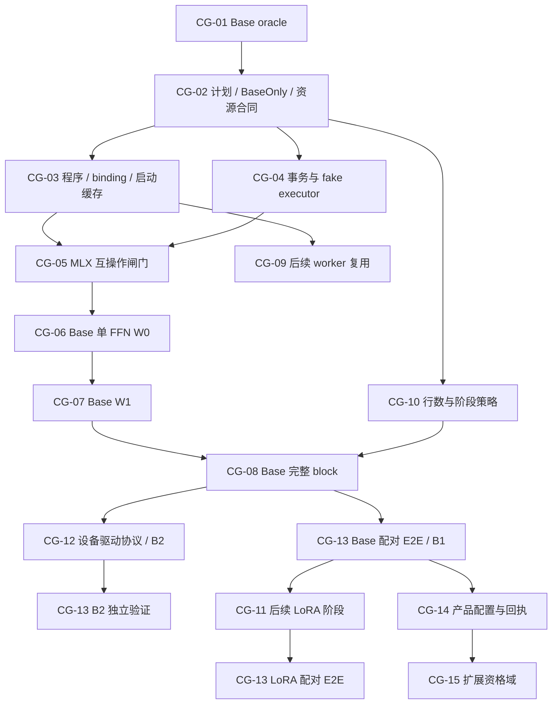

# 07 · 实施工作包、依赖与交付定义

本章把 02–06 收敛为一个实施顺序。章节中的 W0/W1/W2/W3 是设备执行窗口等级；16 进一步将 W1 分为当前同步准入 W1S 和待实现 reactor W1R。05 的 R1–R4 是资源能力阶段。它们不是同一编号，也不是必须串行完成的一个大重写。

以下工作包定义目标与完成门槛。独立 Metal backend 和 BF16 FFN 的初始代码已开始实施，具体已验证范围见 [源码接线与状态](../../status/2026-10-07-native-graph-source-map.md)；未在状态中记录通过的接口、profile 与能力仍是提案。小型命令层合同测试通过不等于 CG-02/04 的完整跨设备事务或 N-04 原生 DiT 已完成。

## 1. 基础改造依赖与独立新后端

下图是基础 A 路线的 CG 工作包；新增 N 路线见 [10 的 N-00 至 N-07](10-native-metal-graph-backend.md)，完整 runtime 规格／W1S→W2 差距见 [16](16-splash-native-backend-spec.md)。N 复用 CG-01～04 的语义、资源和故障合同，直接开始 native backend/kernels，不依赖 CG-05 MLX 适配成功或失败。两者是可独立推进的设计路线，不意味着同时运行模型实验。

主线先独立形成 Base B1，再推进 B2 设备驱动目标或 LoRA 扩展，各自经过验收。CG-09 持久 worker 独立验证，不是 Base E2E 的前置依赖；同样，LoRA、完整原生 DiT、App UI 不阻塞 Base 的 native CLI 证明。后续能力被启用时必须做对应 CG-13 对照，图中省略这些重复连线。

B1 可以是安全且有收益的 W1；若决定暂停深窗口，明确 B2 尚未完成。B2 的成功路径不得依赖逐层 host admission，需已认证的 W2/W3 或等价协议。详见 [09 Base 优先复审](09-base-first-splash-review.md)。

## 2. 工作包

### CG-01 · 固定 oracle、数值合同和基线

**输入**：现有普通 GPU、legacy hybrid、真实 FFN samples、原始回执。

**改动**：

- 记录当前 dirty source manifest / runtime build，不能只记 git HEAD；
- 在 probe 中明确 pure-GPU oracle、compatible-hybrid oracle、GPU replay 的不同角色；
- 先固定 BaseOnly 的 `RoundingContract`、精确 IO ABI、首步策略与相容 hybrid oracle；
- LoRA 阶段再建立 adapter 舍入合同；已有 multi-adapter 风险保留记录，不阻塞 Base，也不提前开放新路径；
- 复用现有报告，不为“建新基线”立即重跑所有图。

**完成定义**：每个后续候选知道比较哪份实际 GPU 实现；source、variant、形状、steps、adapter（BaseOnly 为空）和缓存状态都可追溯。没有宣称多 adapter 已逐位一致。

### CG-02 · 有限执行 IR 和内存桥

**建议改动**：`native/runtime/hetero/plan.*`、`graph.*`，接入现有 `memory_plan/execution/scheduler`。

**实现内容**：

- 02 的不可变 plan、模板、实例分离；
- read/write byte range 与 generation 约束；
- model semantic、quant、rounding、backend capability 身份；
- 编译 DAG，检查 signal/wait、bank 和 alias 冲突；
- 资源 site 先准入、再分配、完成后释放；
- fallback 所需输入/权重/临时内存纳入计划。

**测试**：纯 CPU 的依赖环、未产生读、重叠写、代次不匹配、预算不足、无 source lease、提前释放。无需真实模型。

**完成定义**：相同语义计划可被 fake executor 执行并生成确定的访问/释放记录；新系统没有第二套物理内存私账。

### CG-03 · 程序和 binding 生命周期

**建议改动**：现有 `private/ane_program.*`、`ane_w8_executor.*`，新增 typed prepared cache。

**实现内容**：

- 将重复构建的 symbol/index/IOSurface binding 抽为可复用对象；
- 每次 driver request/ticket 仍单独生成，不复用一次性 completion state；
- cache key 分层、program load generation 与 IO slot 集合身份；
- bounded prepare/load service；取消之后仍持有驱动访问资源；
- Base 阶段先准备 1024 function、两个 weight banks、小型全层 scales；ABI/profile 相同的层共用动态程序；
- 按 09 先内存试算和查质量/性能正负记录，再 prepare；NoGain 命中不重新编译或校准；
- scope 内只准备少量已知 rows，不编译大量形状。

**完成定义**：反复请求不累积 request/surface；更换 variant/source/slot 不误命中；base→LoRA→base 的 fake/session 测试覆盖精确 ABI；准备完成不等于采样开始。

### CG-04 · 事务、故障注入与回放

**建议改动**：`transaction.*`、`CompletionDomain`、fake ANE / fake Metal。

**实现内容**：

- submit 前登记持有资源，处理部分提交成功后异常；
- logical outcome、result validity、physical completion 三类状态；
- pending latent/KV/cache/metrics、成功提交、失败丢弃；
- ReplayPlan 使用相同输入及语义，GPU replay 自身也需验证/提交；
- 迟到 callback、timeout、cancel 的 once-only 结算；
- 物理状态不明时隔离，不能自动把资源归还 pool。

**完成定义**：03 的无模型故障矩阵通过；任意异常点都不会发布半结果或将未知 in-flight bank 复用给新请求。

### CG-05 · A 路线的 MLX stream 互操作可行性闸门

**建议改动**：`metal_graph/mlx_adapter.*`；现有 CaptureBuffer 仅作为 API 定位参考。

**最小验证**：

1. 小张量 GPU producer → external device event → GPU consumer；
2. 显式提交前后 MLX 临时对象销毁，buffer 仍有效；
3. `mx::compile`、重复调用、shape 改变和不同 stream，不消除/复用副作用；
4. MLX 自身 CB 容量触发 commit 时依赖仍正确；
5. event wrapper 使用正确 ownership，不能强转 private SharedEvent 成 EventImpl；
6. 失败传播后 stream/worker 是否可恢复有明确结果。

**通过后**：固定 MLX 版本，适配器只暴露自己的稳定合同。

**未通过时**：停止扩展该适配器，选择原生 FFN island；不 fork 大量 MLX 核心代码，不将“接口能调用”写为通过。

### CG-06 · Base 单 FFN W0 纵向原型

**内容**：

- 模型仍用已有 attention；
- BaseOnly 的 input、A8、GPU head、ANE partial、restore/join 进入 plan；无 corrections、rank scratch 或 hidden 导出；
- 与当前最佳候选保持同 kernel、rows、份额、rounding；
- W0 只在物理完成许可后提交 restore/join；
- 实际执行回执包含准备、提交、等待、binding hit 和安全窗口。

**完成定义**：真实 FFN 回放正确且无新增生命周期错误，能够解释总耗时；允许此阶段没有显著加速。它的价值是建立一致的可替换执行路径，不是作为“全图无 CPU 等待”发布。

### CG-07 · W1R 完成驱动的有界执行

**内容**：

- completion reactor 负责安全 admission，调用线程不逐层阻塞；
- 槽位按所有物理用户完成才归还；
- 推进依赖已经满足的 graph segment，不改变模型顺序；
- 记录 host admission gap；设置 bounded queue / in-flight 上限；
- 快速取消停止 admission，保持已提交资源持有。

**完成定义**：W1 能在 03 合同下稳定驱动一串 block；host gap 可测；队列容量、回调重入、释放线程与有限内存均受控。

W1 仍可能受 CPU reactor 延迟影响，但比“不知道谁何时提交”的混合回调更可分析。该间隙是否显著决定继续投入的性能价值。若停在 W1，可以交付 B1，但不能把 callback 驱动执行写成 B2 已达成。

### CG-08 · Base 完整 block 真实路径筛选

**内容**：将 base 的 attention、norm/modulation、FFN、residual、可选 next-stage 全部计入。只测一个既有候选配置和新图，不同时换量化方案。后续 LoRA 阶段再执行包含 LoRA 的完整 block 门。

**完成定义**：06 的完整路径收益线、误差和资源门通过；纯 GPU 保持其最佳已有融合。失败则保留控制面/安全改进，停止向全 DiT 扩展。

### CG-09 · 受控持久 worker（独立后续能力）

**建议改动**：native worker protocol、`RuntimeImageWorker.swift`、`JobStore.swift`、resource domain。

**内容**：

- 保留旧单请求协议作为隔离回退；
- 版本化 prepare/begin/cancel/drain/rebind/release；
- prepared idle 与 running 分离；
- source generation、adapter binding、cache key revalidation；
- 请求账本和 worker 常驻账本视图不重复计数；
- 进入 VAE/压力/idle 时释放优先级，不能无限常驻；
- IPC 断开、parent exit、quarantine 有确定终态。

**完成定义**：连续请求无旧 LoRA/旧 prompt 泄漏，无资源增长；GPU-only 也可以使用同样的生命周期能力。性能对照不能把两路共有的 cache 节省归入 ANE。

### CG-10 · 行数和 phase planner（Base 先行）

**内容**：

- 从实际 token/patch geometry 创建 prefill、steady、reference plan；
- Base 首个候选将 prefix-build 阶段留给 GPU；新旧 graph 在相同阶段策略下对照；
- 管理/调度证明后，再独立比较一个覆盖实际首步行数的 function；
- steady 使用已测 1024；
- rows 超出已准备能力时沿用安全分块或 GPU，禁止截断；
- mask、prefix、末层 target-only 与原实现一致；
- 多 function 共享 program/arena 时按照最大实际需求准入。

**完成定义**：bucket 边界、短/长 prompt、prefix hit/miss 无覆盖遗漏；不同 rows 的质量和收益范围明确。

### CG-11 · 后续 LoRA 与独立 kernel 优化

Base B1 独立通过后，才启动 LoRA 首次接入。先新增 ActivationLoRA ABI、资源预算、独立资格与舍入合同；以一个既有 r128 / strength=1 adapter 为边界。以下按独立小改动推进：

1. PreparedLoRA 与 rank scratch 复用；
2. 同一 adapter 的 xA 在 GPU/ANE 通道间共享；
3. down-LoRA 分片低秩累加，减少完整 hidden concat；
4. gate/up 通道投影联合 kernel；
5. restore/join/residual 合并；
6. QKV/norm/RoPE 或 split-prefix SDPA，需独立 GPU-only 门；
7. 小额 pinned converted-weight cache，需额外内存/带宽收益门。

第 4–7 项中与 LoRA 无关的 kernel 优化可作为 Base 后续独立候选，不必等 LoRA，也不成为首个 Base 交付的依赖。

**完成定义**：每项独立报告完整路径变化、数值变化和额外内存；不将 kernel fusion 的收益与图调度混成一个不可解释提交。LoRA 引入后重新量测 ready 关键路径，Base profile 的 IO 与资格保持独立。

### CG-12 · 深窗口与原生 block / step

本项是 A 路线扩大窗口/原生范围的决策；N 后端完整目标与里程碑单独见 10，不受本项启动条件限制。这里包含两个独立决策：

- **窗口深度**：W2/W3 需要已认证的失败访问协议、ResultReadPermit、隔离资源和有界 replay；不能只增加 max command buffer count。
- **算子覆盖**：native block/DiT 需要 GEMM、SDPA、prefix/LoRA/rounding、量化来源和 GPU fallback 的完整覆盖。

若无法证明 timeout 后资源访问安全，保留 W1。A 可继续保留 MLX attention/GEMM；N 则定位原生算子的回归，同时对照自身 GPU-only 与现有最佳路线，不隐式调用 MLX 后声称全原生。既有实验 profile 不因为“实现更彻底”就自动替换。

**完成定义**：window template 可重放但每次绑定新的 epoch/timestep/资源；所有发布状态按事务提交，完整请求真实收益超过较简单路线。只有成功路径无需逐层 host admission 且失败访问协议通过，才可标记 B2；同样的安全检查适用于 Base 和后续 LoRA。

### CG-13 · 分阶段配对 E2E 与空间清理

依 06 的每会话最多两组预算，Base 优先一组 GPU / candidate 配对；必要的第二组只解答一个明确问题。LoRA 在后续阶段独立验证，不是本次 Base 通过条件。B2 或 worker 后续启用时也单独匹配对照，不一次堆满所有组合。

记录全部 arms、实际路由、variant、source/kernel hashes、图版本、窗口协议、host admission gap、冷热状态、footprint、误差和失败。

性能不达标时保留对照与拒绝原因，删除 owned 无效编译/导出候选。保留 GPU 默认，不扩展导出全模型。只有当前候选本身通过，才考虑下一种 recipe。

### CG-14 · App 集成与可见回执

拟议 profile 名 `qwen21-command-graph-base-512-experimental-v1` 仅作命名示例，实际应由注册表分配。后续 LoRA profile 具有独立资格，不能覆盖 base 的 ABI / 证据。

App 自动/高级配置从同一 plan registry 读取，不能另写一套 env 值。展示：

- 本请求选择 GPU 或 hybrid 的理由；
- 实际 phase/rows/LoRA 支持范围；
- 本机实验或已资格的状态；
- 准备与复用状态；
- 回退/恢复是否发生。

模型中心管理来源及加速衍生物，用户不必理解每个 bank/function。取消、模型切换、导出文件和最终 artifact 回执都继续走现有产品路径。

**完成定义**：App/CLI 使用相同版本配置可产生可比回执；App E2E 和 UI 验收独立记录，不能用 CLI 数字代替。

### CG-15 · 扩展资格域

在后续小批次中逐项开放：

- 其他 strength、rank、多 adapter；
- 长文本、参考图编辑、不同参考顺序、不同尺寸；
- 精确 prefix/encoder 缓存和近似 DiT cache 的组合；
- GGUF/affine/ConvRot 来源；
- public runtime / fixed executor；
- 其他芯片与内存档位。

每项都保持旧 GPU 功能可用，不能因未通过加速资格而让用户失去模型功能。

## 3. 复杂度与主要不确定性

| 工作类别 | 相对复杂度 | 最大风险 |
|---|---|---|
| 计划、binding、资源身份整理 | 中 | 与现有内存/worker 协议重复 |
| MLX event 适配 | 高，需早验证 | 内部接口、副作用、存储寿命 |
| W0/W1 与故障恢复 | 高 | late callback、跨设备槽位复用 |
| LoRA scratch / 分片 down | 中到高 | rounding、多 adapter、basis |
| 持久 worker | 高 | rebind、取消、跨请求内存 |
| 原生 Qwen block / DiT | 很高 | SDPA 性能与模型语义回归 |
| 新 W8A8/SmoothQuant recipe | 独立研究项 | 校准外误差与真实执行成本 |

A 的主要不确定性是 MLX 互操作和 W1 完整 block；N 的主要不确定性是原生 GEMM/SDPA、Qwen 语义覆盖及设备驱动失败协议。分别交付早期闸门结果，再更新工作量，不能把 N 的完整新后端承诺为几天内完成。

## 4. 建议的提交组织

每个提交有清晰的 before/after 行为和必要验证：

1. 合同类型 + CPU tests，无产品路线变化；
2. PreparedBinding/资源身份，legacy 行为回归；
3. 事务/fake executor 故障测试；
4. MLX adapter 或 native FFN 纵切，显式实验入口；
5. W1 + 真实 replay 证据；
6. Base 完整 block + 配对 E2E + 本机 qualification/回执；
7. B2 协议、kernel 或 worker，各自独立提交和对照；
8. LoRA ABI / scratch / 资格及独立配对 E2E；
9. App 配置与 UI，不阻塞先前 CLI 证明；
10. 经验证才扩大自动范围。

不要把 native kernel、量化误差变化、持久 worker 和 App 默认一起放进一个难以回滚的合并。旧 route 只有在新路线覆盖同一能力且通过验收后才删除。

## 5. 首个 Base 可交付切片的完成定义

- 本地模型无需额外下载/复制；
- CPU 计划、key、状态和故障测试通过；
- 新路线有实际 capabilities 与资源预算；
- BaseOnly 精确 ABI，无修正输入和 hidden 导出；base 双 oracle 结果可解释；
- 不凭人工 signal 回收未知物理访问的资源；
- 小规模 base 真实 FFN / 完整 block / 配对 E2E 有对应证据；
- 清楚标记 B1 或 B2，不把 host reactor 误称为无逐层 host admission；
- 不把 warm worker/cache 收益冒充 ANE 本身收益；
- 不满足条件可回到相容 GPU，CLI/worker 回执有真实原因；App 接入阶段再展示；
- 有效小型产物保留、无效 owned 衍生物清理；
- “本机实验通过”与“产品自动默认”状态分离。

后续 LoRA 完成定义另加：实际 adapter 效果、pre-SiLU 修正、down rank 计算和数值合同全部通过；完整请求有自己的收益记录；base→LoRA→base 的来源、资源和缓存没有串用。Base 不等待这些扩展才能形成首个可审查结果。
