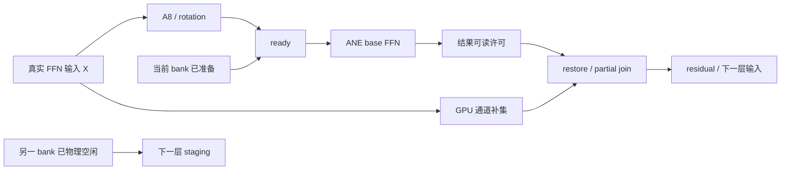

# 09 · Base 优先：对照 Splash 的复审与实施合同

更新：2026-10-08。状态：**独立 native GPU DiT／Euler／Session 和 private W1S 稳态全层接线已存在。历史构建 `4fd1e980…` 在请求内尺度缓存关闭时完成一组 Base GPU／hybrid 整图配对，有完整请求收益，尚无通用性能资格。** 原始记录见 [Base E2E 状态](../../status/2026-10-08-native-register-w1-base-e2e.md)。当前 `16fecb41…` 构建新增默认关闭的请求内尺度缓存，生成数据与真实 FFN 的精确复用已验证，耗时随顺序反转，没有稳定净收益，因此未追加 E2E；历史收益不转授该改动，见 [真实缓存筛选](../../status/2026-10-08-native-scale-cache-real-screen.md)。完整图实际接口见 [12](12-native-denoiser-runtime.md)，W1S 与后续 W2 的实现边界见 [16](16-splash-native-backend-spec.md)。

本章落实新的实施顺序：先独立完成 Qwen Image 2.1 base 的 Splash 式 GPU/ANE 路线，再加入 LoRA。它细化 [02 架构](02-architecture-and-contracts.md)、[03 交接](03-command-graph-and-handoff.md) 和 [05 资源](05-resources-cache-and-worker.md)，不建立第二套模型身份、资源策略或内存账本；A/N 可以有独立执行器。LoRA 的完整数学仍见 [04](04-qwen-lora-and-quantization.md)，但不再是 Base 阶段的前置条件。

后续补充的 [10 独立 Native Metal Graph 后端](10-native-metal-graph-backend.md) 与本章基础改造并列：可直接建立 Splash 式原生 DiT 执行域，不等待 MLX adapter 失败。Base → LoRA 的先后顺序及本章资源/资格要求对两个后端都适用。

## 1. 复审结论：方向成立，原交付边界需要收紧

| 原设计不足 | 后果 | 本次修订 |
|---|---|---|
| 首个纵切同时要求 base 20 步和 r128 LoRA 六步 | 调度、修正运输、rank scratch 和量化误差一起变化，难归因 | Base 阶段独立交付；LoRA 是后续阶段，有自己的资格 |
| 通用可选 LoRA 图作为主要示例，未明确禁止 base 使用其超集 ABI | 可能为零修正清零、传输及 hidden 导出付费 | `BaseOnly` 是独立程序 ABI；不分配这些资源 |
| 类型和 cache key 很完整，但缺少实际 owner 及启动先后顺序 | 容易每层 prepare、先编译再发现无收益，或堆出第二套管理 | 增加有界 session、启动状态、缓存负结果和 breaker 合同 |
| W1 可交付与最终无逐层 host admission 的目标界线不够清晰 | 可能把 callback 驱动的逐层执行称为 Splash 式完整完成 | 区分“有收益的过渡版本”和“设备驱动目标达成” |
| 实施依赖图把 LoRA、worker 与首次 E2E 绑在一起 | 最小 base 路径被产品整合和扩展研究拖住 | Base E2E 不依赖持久 worker、LoRA、全量原生 DiT |
| 上游拟合和在线 breaker 可直接移植的边界未展开 | ANE 内部快被误当成整条链快；LLM 比例被套到扩散模型 | Qwen 按完整 block / 请求选择，breaker 只作退化保护 |

这不意味着当前 base 已经无条件承担全部 LoRA 成本。现有 `HybridFfn` 能以 `require_lora_inputs=false` 构造程序，MIL 也按该标志省略 hidden 输出。需要修正的是**新设计的强制边界，以及复用时可能接受能力超集的条件**。

## 2. 从 Splash 采用的具体管理方式

以下依据固定于 [Splash #260 的源码版本](https://github.com/incoai/splash/tree/80827e1c3593f7d10c266394e4d4381321b73ad0)。观察和本项目建议分开：

| Splash 已有实现 | TurboCider 的采用方式 | 不直接照搬的部分 |
|---|---|---|
| [AneFfn 构造](https://github.com/incoai/splash/blob/80827e1c3593f7d10c266394e4d4381321b73ad0/runtime/ops/AneFfn.cpp#L400)：一个动态权重程序、若干 rows function、每个 function 绑定两个权重 bank | 每个相容的 FFN ABI/profile 一份程序，跨 Qwen 层复用；binding 与单次 request 分离 | 不为 32 层生成 32 个含权重模型；不默认编译全部 rows |
| 同一构造中批量计算各层 gate/up/down 的 row scales | scales 按 source、切分范围、量化 recipe 准备一次，跨层迭代复用 | 仅依赖权重的 scales 可这样复用；activation 校准统计不能冒充权重常量 |
| [encode / commit](https://github.com/incoai/splash/blob/80827e1c3593f7d10c266394e4d4381321b73ad0/runtime/ops/AneFfn.cpp#L530)：ready → GPU 补集与下一层 staging → done → join，先 enqueue ANE jobs 再提交 GPU graph | 采用有序的设备依赖和显式提交；用事务持有部分提交成功的对象 | 不假设任意 MLX 调用会留在同一 command buffer；不照搬未认证的失败访问假设 |
| [Startup](https://github.com/incoai/splash/blob/80827e1c3593f7d10c266394e4d4381321b73ad0/runtime/engine/AneFfnStartup.cpp#L69)：先内存可行性，查已有校准，NoGain 可在 prepare 前返回 GPU | 先准入和查资格，再准备；负结果也缓存，避免每次启动重复成本 | 不复制 LLM KV context 预算或 prefill 的最小行数阈值 |
| [Calibration](https://github.com/incoai/splash/blob/80827e1c3593f7d10c266394e4d4381321b73ad0/runtime/ops/AneFfnCalibration.cpp)：少量份额拟合、邻近选择、rows 平台判断 | 将其作为候选筛选器，最后用 Qwen 真实 FFN / 完整 block 复核 | 不能假定高份额必然 ANE-bound；不把线性拟合当实测 |
| [RuntimeResources](https://github.com/incoai/splash/blob/80827e1c3593f7d10c266394e4d4381321b73ad0/runtime/engine/RuntimeResources.mm)：准备对象、校准身份、idle release / reload | 为程序加载、资源保留和失效建立明确 owner，内存压力优先释放可重建部分 | 不默认所有模型、所有 adapter、所有编译程序常驻 |
| [Handoff](https://github.com/incoai/splash/blob/80827e1c3593f7d10c266394e4d4381321b73ad0/runtime/ane/Handoff.mm)：ready 起计时、outstanding 跟踪、retire | 区分排队时间、执行等待和迟到完成；按物理使用期保留资源 | retire 拉高 event 的逻辑解锁，不能单独证明资源已可复用 |

Splash 的可借鉴核心是这些部件作为一个闭环工作，而不只是“调用 private ANE”或“增加一条 GPU 队列”。其源权重格式、GPU kernels 和工作负载不同；本机 BF16 Qwen 必须重新测量 staging、并发带宽和切分点。

TurboCider 已有双 bank、GPU I/O 和可启用的 scale cache，见 [ane_gpu.mm](../../../native/backends/ane_gpu.mm) 与 [当前差距表](01-evidence-and-gap-analysis.md)。新设计应复用它们，并把 key、准备时机和所有权接入 session；不能把既有缓存命中的收益再次算作本次改造新增收益。全层提前准备 scales 也要计入 setup，是否优于当前按需缓存取决于完整请求。

vpipe 继续提供后续原生 GPU 与 LoRA 管理参考：紧凑 factor、scratch 复用、按投影选 kernel，以及 staging 时合并权重的独立路线。它们不成为 Base 阶段的依赖，相关固定来源见 [08](08-source-map-and-decisions.md)。

## 3. Base 阶段必须成立的合同

### 3.1 独立的 BaseOnly ABI

建议新增明确枚举，替代仅靠“是否存在某个可选指针”判断语义：

```cpp
// 设计伪代码；属于 02 的 QwenExecutionPlan，不是第二份计划。
enum class FfnVariant {
    BaseOnly,
    ActivationLoRA,       // 后续阶段
    StagedMergedLoRA      // 独立量化/舍入 recipe，后续研究
};
```

`BaseOnly` 的要求：

- 无 gate/up correction surface、清零 kernel、rank scratch 或 down-LoRA 节点。
- ANE 仅返回本分支 down partial 及该 recipe 必需的 scale/status；不为 LoRA 导出完整 hidden。
- GPU gate/up/SiLU 的内部中间量仍然必需，但不作为外部持久输出暴露。不能把“不导出 hidden”写成“没有 hidden 计算或 scratch”。
- `ProgramKey` / `BindingKey` 包含实际 IO ABI；`ExecutionPlan`、qualification 明确 adapter 集为空。
- 当前 GPU oracle 的投影、SiLU、partial 和 join 舍入边界保持可追溯。换成 FP32 join 并不等于整条 FFN 都用 FP32，Splash 的 BF16 GPU partial 也不能证明本机两种算术逐位相同。
- 主请求、诊断回执均显示 `variant=BaseOnly`；不得只凭“没有选中 LoRA”推断执行器真的用了 base ABI。

**当前可定位的复用风险**：在 [pipeline.cpp](../../../native/models/qwen21/pipeline.cpp) 的 `request_identity` 中，adapter 身份主要随自动通道选择分支加入；重建条件会处理 base 程序不能服务 LoRA，但不强制反方向回到纯 base。另见 [ane_ffn.cpp](../../../native/backends/ane_ffn.cpp) 的 `(!require_lora_inputs || shape.lora_inputs)`，它接受能力超集。若同一 Session 从 LoRA 切到 base，可能继续使用带额外 IO 的图；是否实际触发还取决于生命周期与配置。这是需要补回归测试的**可能冗余执行**，不是已证实的结果错误或当前所有 App 请求都会触发的 bug。

新快路径采用精确 variant 匹配。legacy 超集兼容可以保留，但不能据其结果给 `BaseOnly` 资格；对 base→LoRA→base 做 CPU fake/session 测试，检查最后一次没有额外 IO、旧 binding 或旧 adapter 状态。

### 3.2 第一版只支持一个明确域

本地 Qwen Image 2.1 BF16、512×512、batch=1、无参考图、base 20 步，先使用既有较优的旋转 W8A8 recipe。6144 个 ANE 中间通道是本机既有候选起点，不是所有设备的默认值。

首个候选策略：

1. 需要建立条件前缀的阶段使用 GPU；初期不准备额外首步 ANE function。
2. 已符合稳态语义、实际 FFN 为 1024 行的层使用 BaseOnly channel split。
3. 其他阶段或行数走相容 GPU 路线；文本仍完整参与 attention，不截断、不统一强塞 1024。

phase 由实际前缀状态和层语义决定，不能只检查 `step > 0`。第一阶段为简化证明可以把整段 prefix-build step 留在 GPU，哪怕末层已有 target-only 优化。后续再比较一个覆盖实际首步行数的 function；该比较和调度改造分开归因。

已有 43.044 s base 候选包含首步 ANE，不能把改成首步 GPU 后的结果直接归为 command graph 收益。先在相同首步策略下比较 legacy / 新图，再按 [06](06-calibration-performance-and-validation.md) 的预算评估 phase 策略。若 20 步中首步全 GPU、后续 19 步各 32 层各一次 ANE，则推导调用数为 608；真实期望值须从 layer/phase 账本生成，不能把 608 写成支持所有 cache/跳层策略的常量。

## 4. 有界 Session：将抽象落实到一个 owner

`QwenBaseSplitSession` 是建议的模型级组合对象，引用 02/05 的类型；不是另一个 executor、allocator 或后台常驻服务。单请求 CLI 也能使用，跨请求保留留给后续 worker 能力。

```cpp
// 设计伪代码。此对象只能在 source / profile 校验及 admission 后创建。
struct QwenBaseSplitSession {
    ResolvedBaseProfile profile;       // 对 ExecutionPlan 的 base 专用投影
    SourceLease source;                // 沿用现有来源合同
    PreparedProgram program;          // 动态权重，无完整 checkpoint 常量
    PreparedWeightScales scales;      // 全层小型 scale 元数据
    WeightBank banks[2];               // 每次使用带 content epoch / completion
    PreparedBindingTable bindings;    // rows function × 实際 slot 组合
    GraphTemplateCache templates;     // 有界结构缓存，不含活跃 request
    CompletionDomain completions;
    PerformanceGuard guard;
};
// GraphInstance / GraphTransaction 每次执行新建，持有 session 资源租约；
// handoff 的活动 epoch / ticket 属于对应执行域，不能缓存为跨请求常量。
```

具体约束：

- `prepare` 编译/加载、分配 slot、构建 binding、准备 scales 与 PSO；稳态 `encode` 不能触发这些操作或同步读取张量。
- 一份 ABI/profile 下各层共用程序；层权重来自 source views，在当前/下一 bank 转换。改变权重内容只更新 content epoch，不重建地址不变的 binding。
- 最小方案一个 activation/output slot、两个 weight bank、一个 1024 function，可有两个 bindings；若 W1 使用两个独立 IO slot，需要相应的合法组合。**bindings 数量由实际已准入的组合决定，不创建全笛卡尔积。**
- 两个 weight bank 不表示可让两层无依赖并行。下一层 staging 只覆盖已物理空闲的 bank，下一层 FFN 仍依赖上一层完整输出。
- source/recipe/range 变化会使 scales 失效；程序 unload/reload 的 generation 变化会使 binding 重新创建。地址相同不代表旧 generation 合法。
- 停止接收新请求后，先 drain；未知物理访问进入 quarantine。session 析构、清理磁盘缓存、逻辑 retire 都不能代替实际 drain。
- 空闲保留程序还是卸载，由 admission 与实际内存压力决定；不为了所谓“预热”启动持续计算。

### 4.1 内存账应先算清，再分配

以下是 H=4096、F_ANE=6144、rows=1024、32 层的**未计 alignment / 编译器私有工作区的尺寸算术**：

| 数据 | 推导 | 量级 |
|---|---|---:|
| 每个 W8 bank 的 gate/up/down codes | `3 × H × F_ANE` bytes | 72 MiB |
| 两个 W8 banks | 上项 ×2 | 144 MiB |
| 全层权重 row scales | `32 × (2F_ANE + H)` values | FP16 1 MiB / FP32 2 MiB |
| 输入 A8 codes | `H × rows` bytes | 4 MiB |
| ANE down partial + 每行 scale | `(H+1) × rows × 2` bytes | 约 8 MiB |
| LoRA 才有的两份 FP16 correction + hidden 返回 | `3 × F_ANE × rows × 2` bytes | 36 MiB，BaseOnly 不需要 |

旋转 scratch、GPU partial、输出、状态、事务 checkpoint、fallback、对齐及 runtime 私有内存另计。这里不能相加后声称整个后端有某个固定峰值上限；具体数据类型按 recipe 定义，实际 footprint 与 allocator 账本必须对应。

缓存全部 32 层 W8 codes 会另外达到约 2.25 GiB，还未含其他数据；本轮默认只保留双 bank 与小型 scales。[既有真实 FFN 记录](../../status/2026-10-07-qwen-real-ffn-screen.md)中，base 整个请求累计 staging 为 13.10 s，大多被并行工作覆盖，累计暴露等待仅 0.232 s；这两项都不是单层耗时，不能用累计 staging 时间论证必须增加数 GiB 缓存。磁盘缓存采用字节/数量预算和 owned 清单，不复制完整模型。

## 5. 启动、缓存负结果与复用流程

### 5.1 启动顺序

1. 解析 source、请求实际 geometry、FfnVariant、backend capabilities、build/OS 与数值合同。
2. 只做内存算术和 admission 试算，包含回放/隔离所需额度；尚不编译所有候选。
3. 查 source/profile 对应的质量资格与性能记录，包括负结果；已有且仍匹配的 `NoGain` 可直接返回 GPU。
4. 有有效正记录：只 prepare 选定程序及 rows/slots，复用通过验证的 cache；program cache 命中不免除 source、ABI、binding 与运行环境校验。
5. 记录缺失：在明确的轻量校准预算内测一个既有候选，必要时再测一个邻近份额。正常生成不自动跑全矩阵；预算关闭或不足时先 GPU。
6. 准备失败/质量不合格则分类记录原因；只在实际可恢复时回到 GPU。取消保持取消，设备状态未知按 03 隔离，不能吞掉错误当普通 Unsupported。
7. 实际路由、准备时间、cache 命中和选择理由写回执；进入执行前再次确认内存与 source generation。

“先查记录”不意味着可以跳过来源验证。利用已有验证过的 SourceLease 做匹配，不信任用户目录里一份 JSON 自报已验证。

### 5.2 不同结果必须有不同失效方式

| 结果 | 是否缓存 | 何时重新考虑 |
|---|---|---|
| `QualifiedLocal` / `CandidateGain` | 小型证据记录；本机实验与产品资格分开 | source、variant、recipe、kernel、OS/设备、行数域、窗口协议或相关基线变化 |
| `NoGain` | 是，绑定完整对照身份及有效域 | 同上；避免每次请求再次 compile / calibrate |
| `QualityRejected` | 是，保留误差和样本摘要 | recipe 或校准/验证证据更新，不因下次启动自动重试同候选 |
| `Unsupported` | 能力缓存 | backend / SDK / OS / ABI 改变或显式重新探测 |
| `PressureDeferred`、热限制、取消 | 短期状态或本次回执 | 环境恢复；不永久记为模型无收益 |
| `DeviceFailed` / `Quarantined` | 故障记录及会话禁用 | 物理清理/重启与健康确认，不用定时重试冲击驱动 |

性能 key 中应包含 baseline 实现身份、variant、实际 rows 域、通道范围、precision/rotation、source、窗口等级、staging/kernel 和 worker 冷热类别。内存余量按可行份额/容量档位表达，瞬时 free bytes 不直接变成无限 cache key。已有正记录只指导选择，不能保证下一次在热限制下仍快。

### 5.3 Breaker：两层保护，不能把局部时间当完整收益

Splash 的在线比较累计 ANE 持续时间与校准出的 GPU 时间；若 ANE 子路径本身已经超过完整 GPU 估计，足以指出该区间亏损。但反过来，ANE 时间较短**不证明** A8、staging、GPU 补集、join 组成的完整路径获益。

TurboCider 建议区分：

- **设备/正确性保护**：非法输出、driver 失败、timeout 立即停止新 admission，按 03 结算/隔离，不发布结果。
- **性能保护**：在少量完整 block 或事务窗口收集总耗时，对照相同 phase/rows 的有效 GPU 记录。连续超过预先固定的噪声/绝对时间线后，当前有效事务完成，之后安全边界改走 GPU，并使相应性能记录失效。不要为性能降级伪造 done、废弃仍正确的在途输出，或每层额外双算 GPU。

ANE callback 区间、GPU span、整窗口 wall 应分别记录，重叠 span 不求和。没有有效 GPU 基线或环境不可比时，回执写“未判定”；不能用旧机器或不同源码的数字裁决。性能降级后的请求记录 hybrid 已执行量，不能改写成全程 GPU。

## 6. Command graph：阶段完成与最终目标分开验收

BaseOnly 的核心数据流：



GPU head 没有数学理由等待 LoRA corrections 或下一层 staging；后两者在 BaseOnly 中分别不存在、不是当前 join 的数据前置条件。实际单 GPU 的提交顺序仍会影响调度，因此必须量测 staging 插入点，不能画成不同队列就认为免费重叠。

两个里程碑：

1. **B1：安全且有收益的 base 原型**。W0/W1 可满足，保留 host admission gap 的真实计时，允许单请求 session。它证明管理与完整路径是否值得继续。
2. **B2：Splash 式设备驱动目标**。成功路径不靠 CPU 每层读回/等待后才能推进，应用能安排 ready/补集/done/join，并在有界事务边界验收。需要 03 的 W2/W3 或等价的已认证协议；不要求一定把所有算子重写。

若后端只能依靠 host callback 授予结果读取和 bank 复用许可，则只能声称 B1。不能一边规定每层必须 host 验收，一边声称完全设备驱动。W2 的 `ResultReadPermit` 必须有真实后端的证明与 lowering：哪些正常事件保证结果可读、失败如何阻止读写、迟到访问如何隔离。仅给 capability 设 `true` 不构成认证。

对 Splash 的单调 timeline，正常严格链应满足 `ready_i < done_i < ready_(i+1)`，所有后续 ready producer 都依赖前一必要完成；独立 staging 队列不能跨代拉高同一 timeline。初期可用独立事件降低证明难度，再测量是否值得收敛为有序 timeline。epoch 退役后不复用；人工拉高值只表示逻辑解锁，不构成物理完成。多个并发请求若无独立 slots/event 域，第一版直接串行 admission。

B2 若暂时无法证明访问安全，就记录闸门未通过并保留 B1；不能为完成路线而删掉安全合同。若测得 host gap 已很小，也可以停止深图投入，但应写“继续投入收益不足”，不写“已完整复刻 Splash”。

## 7. Base 通过后怎样加入 LoRA

LoRA 阶段先使用一个本地 r128 adapter、strength=1、相应六步语义；不把所有普通 LoRA 改成六步。启用前维持原 GPU 功能，不影响 base 已通过的 profile。

| 部件 | 可否复用 Base 阶段成果 | LoRA 新增条件 |
|---|---|---|
| 计划 IR、completion、事务、admission、错误恢复 | 可以 | 新增读写集合和合法依赖，仍经过相同故障门 |
| 动态权重 staging 与源 views | 原理和实现可以 | 份额/range/recipe 相同才复用具体转换结果 |
| Base row scales | 未合并权重且 recipe/range 不变时可以 | LoRA-aware S1/S2、换份额或 merged weights 时重新准备 |
| 动态 ANE 程序 | 通常需要另一个小型 ABI 变体 | 增加 pre-SiLU corrections 和 hidden / rank 输出合同；base 无需承担这些 IO |
| PreparedBinding / IO arena | 重新绑定并准入 | variant、layout、slot、program load generation 精确匹配 |
| GPU kernels / PSO | 与 LoRA 无关的部分可以 | factor scratch、共享 xA、down rank 分片，先保留舍入边界 |
| rows / 通道的最优值 | 不能直接沿用资格 | 本机既有 LoRA 4096 与 base 6144 不同；重新选完整路径 |
| 质量与性能资格 | 不能继承 | 实际 LoRA activation/hidden、效果差异、冷/热请求分别验证 |
| 条件 / prefix cache | 复用管理代码 | adapter、strength、顺序及 basis 属于身份；不能复用旧内容 |

第一 LoRA 候选采用 [04 的 activation correction 合同](04-qwen-lora-and-quantization.md)：GPU 计算每个 adapter 可共享的 FP32 low，gate/up 修正在非线性前加入；down 在 rank 空间合并 GPU/ANE hidden 的贡献。LoRA 引入后的 ANE ready 可能被修正展开卡住，需要重新测量关键路径。

vpipe 的 staging-time `B×A` 合并可以在以后作为另一个 recipe 比较，但先算每层每步重做的成本及强度切换失效。不得为了“复用 base 程序”先生成大份 merged checkpoint，或偷偷改变原 LoRA 精度合同。runtime fused epilogue 也按投影单独比较，不承诺融合一定更快。

## 8. 下一轮工作与验收的最小集合

本章没有执行以下实验；它们是后续实现顺序。

1. **CPU 合同先行**：BaseOnly / ActivationLoRA 的程序、缓存和 source 身份；base→LoRA→base；负缓存跳过 prepare；部分提交与 late callback；内存及 slot alias。
2. **小张量互操作闸门**：MLX 外部事件/存储寿命，或原生 FFN island。未通过不导出全模型，不进行 E2E。
3. **既有 base 真实 FFN 回放**：固定 recipe/份额，只替换管理与提交。记录 scales/binding 准备次数、host gap、提交次数、实际物理完成和内存。
4. **完整 block**：attention + FFN + residual + staging；必要时先检查 native GPU-only 没有把 baseline 写慢。通过才继续。
5. **Base E2E 一组优先**：同构建 GPU / candidate 各一张，base 20 步。第二组仅用于解决第一组暴露的一个问题或反向顺序复核；不自动扩展为 LoRA 测试。沿用每次会话最多两组的笔记本预算。
6. **单独标记 B1 或 B2**：除了性能/质量，还要报告窗口协议和每层 host admission 是否仍存在。可用但未完成的目标如实保留。
7. **随后才开 LoRA 阶段**：从已有样本筛选到一个 LoRA 配对 E2E，使用之后独立安排的轻量预算。base profile 保持回归覆盖。

Base 的通过要求包括：完整请求胜过匹配 GPU、相同策略下新图对 legacy 无不可解释退化、数值/资源/取消合同通过、实际 ANE 工作覆盖与计划一致、无隐式 LoRA IO、无每次请求重新校准、无未计入的模型副本。约 5% 可作为待固定的工程推进线，但一组测试只授予本机实验资格，不授予普遍性能或发布保证。

[既有记录](../../status/2026-10-07-qwen-real-ffn-screen.md)中 base 48.400→43.044 s 约为 11.1% 总时间减少、1.124× 同工作量加速比；LoRA 20.664→21.292 s 尚无总时间收益。这些记录支持“先把 base 做完整”的优先顺序，**不预测新 command graph 还能再获得多少提升**。剩余同步减少、GPU 补集 fusion、首步策略与初始化复用必须各自有测量，不能相乘推导一个未经验证的加速倍数。
