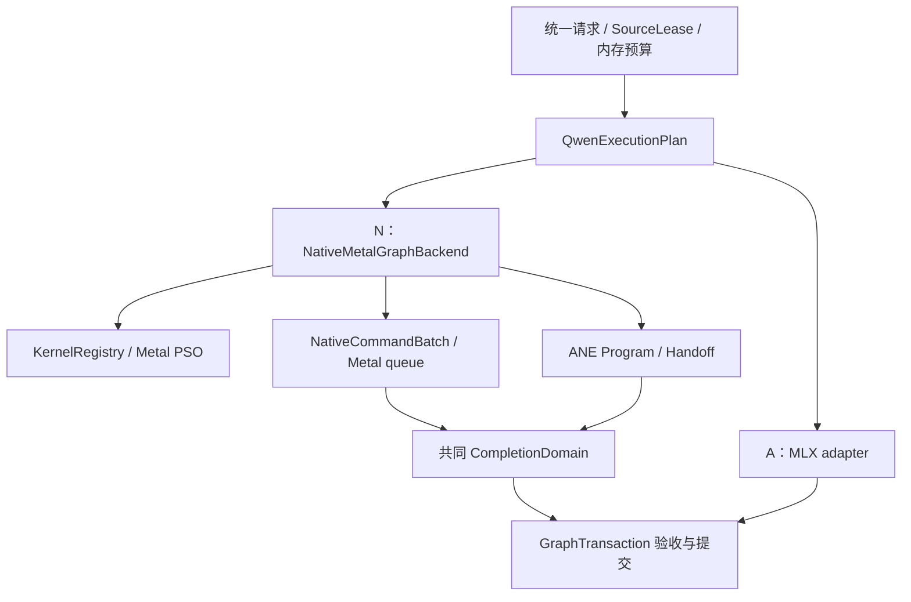

# 10 · 独立 Native Metal Graph 后端：Splash 式完整执行路线

更新：2026-10-08。状态：**native backend、完整 base DiT／Euler／Session、阶段内存，以及 private W1S 稳态 32 层接线已存在。上一整图验证构建 `4fd1e980…`（cache off）的一组 register W1S vs native GPU Base E2E 测得去噪省时 13.60%、请求省时 9.97%；这是此组完整请求收益，尚非性能资格。** [本轮状态](../../status/2026-10-08-native-register-w1-base-e2e.md) 保留样本、图像、完成域和资源回执。历史 GPU 配对及较早 held-out FFN 收益不稳定的结果继续绑定各自构建。原生 encoder、全请求内存认证、App、hybrid LoRA、编辑和 Z-image 尚未通过当前路线；GPU LoRA 窄域已完成一组真实六步对照，但未证明提速。当前请求域见 [13](13-native-session-and-memory-phase.md)，原始 W1 草案见 [14](14-native-w1-parallel-ffn.md)，实际实现见 [15](15-native-w1-implementation.md)。[16 完整后端规格](16-splash-native-backend-spec.md) 补充 Splash 完整 runtime、W1S／W1R／W2、Base→LoRA 和复审决策。当前源码另实现默认关闭的 request-local compact scale cache；生成数据和真实 FFN 的身份／精确复用已验证，未证明完整组件净收益，未追加 E2E，见[真实缓存筛选](../../status/2026-10-08-native-scale-cache-real-screen.md)。下文目标语义 IR 等未列为实际 API 的类型仍是提案。

当前源码的低层命名空间是 `tc::metal_graph`：`Backend` / `CommandGraph` / `SharedEvent` / `Ticket`、`NativeFfn` / `NativeLinear` / `NativeLoRA` / `NativeAttention` / `NativeQwenOps` / `NativeStepOps`、`NativeAneHandoff` 及 MLX bridge。`MlxFfnIsland` 仍是 **W0 FFN island**；`tc::qwen21::native_graph::NativeBlock` 自主编码 GPU block，`NativeDenoiser` 进一步组织完整图，`NativeSession` 接入共同请求。Linear 已支持 BF16 bias 与 64 对齐 K/N，仍不支持任意尾部；独立 `NativeLoRA` 实现投影后的有序修正和 bias-last。GPU Viggle 窄域的实际接线／验证见 [17](17-native-lora-integration.md)，不能把独立修正等同于 Linear 内部 fused LoRA。当前请求入口不等于 App 路由或完整统一执行器。`tc::hetero` 及下文 denoiser 接口表达目标语义层。实际组件和资源缺口见 [11](11-native-block-and-handoff-integration.md)，当前完整图 API 见 [12](12-native-denoiser-runtime.md)，历史 [GPU Session/E2E 状态](../../status/2026-10-08-native-session-and-e2e.md) 与[本轮 register W1S 状态](../../status/2026-10-08-native-register-w1-base-e2e.md) 分别记录各自构建的验证范围；历史组件记录保留原始范围。

本章根据新的要求，在基础改造之外增加一个独立后端：由 TurboCider 直接持有 Metal device/queue、GPU kernel、command graph、资源和 ANE handoff，执行完整 Qwen Image 去噪阶段。以 Splash #260 的完整 runtime 组织为主要参考，结合本地模型语义及 vpipe 的原生执行经验。**此路线可以独立启动，不以 MLX adapter 失败为前提。** 两条路线共用资源与模型合同，分别证明性能。

## 1. 两条路线的定位

| 维度 | A：现有实现的基础改造 | N：新增独立后端 |
|---|---|---|
| 建议身份 | `mlx` / 受控 MLX graph adapter | `native-metal-graph` |
| GPU 算子执行 | 保留 MLX GEMM / SDPA，增加事件适配或 FFN island | 原生 Metal dispatch；自行选择、绑定和提交 kernels |
| 热路径 command ownership | 受 MLX stream/primitive/内部 ABI 约束 | 后端直接拥有实际 GPU queue 和 command buffer |
| ANE 接入 | 外部执行与 MLX 互操作 | 同一 native graph 中的 ready / wait / restore / join |
| 初期价值 | 少改现有 GPU 数学，尽快验证交接收益 | 建立完整的提交、内存、融合和跨设备调度控制 |
| 主要风险 | 外部副作用与存储寿命、逐层框架交接 | GEMM / attention 重建后退化、Qwen 模型语义遗漏 |
| 比较依据 | 对当前最佳 GPU / hybrid | 对当前最佳路线，同时对本后端 GPU-only |

`native-metal-graph` 是执行器身份；`gpu` / `gpu_ane` 是设备策略；`BaseOnly` / `ActivationLoRA` 是模型变体；BF16 / W8A8 是精度 recipe。四个维度分开，不能继续把所有组合塞进 `hybrid_mlp_mode` 或用“开启 ANE”隐式替换整个后端。

两条路线是设计与实现上的独立分支，并不要求同时跑模型实验。保持 [06](06-calibration-performance-and-validation.md) 的笔记本预算，一次只验证一个问题。

### 1.1 直接管理 Metal，与 MLX 图的能力边界

这里的 N 路线是**独立执行器**：TurboCider 持有 Metal queue、PSO、资源视图、参数、实际 command buffers 和 ANE jobs，在已完成的 conditioning／source 边界之后自行生成完整 DiT commands。它不截获再重放 MLX 的内部图；源仍可以来自 MLX loader，加载方式和热路径提交权是两回事。

MLX 本身存在不同层级的接口，不能把它们混称为“掌握 MLX command graph”：

| MLX 能力 | 可用作用 | 对本方案的边界 |
|---|---|---|
| `mx::compile(function)` | 编译和优化 array 函数 | 不是应用拥有的 Metal CB／事件／ANE 副作用图，也不提供任意设备命令重放 |
| `metal::start_capture/stop_capture` | 获取 GPU trace，辅助诊断 | 是测量捕获；不能据此缓存／重新执行 command graph |
| stream `CommandEncoder` 的 wait／signal／commit／command-buffer 接口 | A 路线可探索事件 primitive 和明确交接 | 属于固定版本的 backend 接缝；不自动接管 lazy work、allocator、框架提前 commit 和全部资源寿命 |
| N 自有 `metal_graph::Backend` | 在自身执行域控制编码、分段和提交 | 不依赖上述 MLX stream 内部 ABI；仍需独立证明 GPU 数学、完成域与整体性能 |

上述判断来自 [08 的 MLX 来源](08-source-map-and-decisions.md#3-mlx-来源与适配假设)。A 若采用内部 encoder，必须固定版本，验证 lazy evaluation、compile、多 stream、资源 donation、提前 commit 和异常合同；接口存在不授予成功。N 不等待 A 完成，直接沿用本地原生 DiT 基线，下一步收敛到 [16 §4.2 的 graph lowering](16-splash-native-backend-spec.md#42-从模型算子到实际-command-buffer) 与 §6 的有界异构窗口。

## 2. “完整新后端”的具体范围

N 路线首先实现 **Qwen DiT 原生执行域**：

- native 权重视图、activation、prefix K/V 和 scratch；
- 输入/条件投影、timestep 与 modulation；
- 32 层的 norm、QKV、Q/K norm、三轴 RoPE、attention、输出投影、FFN、门控 residual；
- 首步 prefix-build、后续稳态、最终输出 norm/projection；
- 采样步的 latent 更新、数值检查、取消与事务提交；
- GPU-only 和 GPU+ANE 两种计划，调度代码及资源系统共用。

文本编码器、图像编码器和 VAE 第一阶段沿用现有实现，在**去噪阶段入口/出口**交换已完成的张量。整个 App 此时仍可依赖 MLX，不能宣称已去除 MLX；但 native DiT 稳态循环中不能调用 `mx::matmul`、`mx::fast::scaled_dot_product_attention`、`mx::eval` 或依赖 MLX 持续生成 GPU commands。

实现过程中可以先做 FFN/block 纵切，但这是 N 路线内部里程碑。只有完成上述去噪执行域，才能标记“native DiT”；每层返回 MLX attention 的 island 仍标记为桥接实现。它不以重写所有模型或 encoder/VAE 为先决条件。

“控制所有 GPU 任务”必须说明执行域，不能仅凭创建一条 Metal queue 判定：

| 任务 | 当前 FFN island | 完整 native DiT 的必要归属 |
|---|---|---|
| norm、QKV、RoPE、attention、residual、输出与采样 | MLX | N 自己编码、绑定并提交；不得隐式落回 MLX |
| FFN GEMM / SiLU | 新原生纵切，已有少量 base 回放；覆盖和性能资格仍不足 | N 的 kernel 计划；GPU-only 与 GPU+ANE 共用 |
| A8、rotation、weight staging、restore、join、必要 blit | 既有 hybrid 路径；N 的 register W1S 已有一组 base 整图记录，未获性能资格 | 纳入同一依赖图和内存预算，不能隐藏在独立 MLX stream |
| prefix K/V、activation、临时 buffer、有限值检查 | 框架拥有大部分准备和执行 | N 管理访问区间、producer readiness 与物理使用期 |
| 文本/参考图编码及 VAE | 现有实现 | 第一阶段是明确的阶段边界；之后逐项原生化，不能称已覆盖整个 App |

Qwen edit encoder 是后续独立里程碑：本地视觉塔为 27 层、H=1152、16 heads、D=72，GELU FFN 宽度为 **4304**，不能套用 DiT 的 D=128/SwiGLU kernel；文本塔为 36 层、32 个 Q heads/8 个 KV heads、因果 GQA。还需覆盖视觉 patch/merge、DeepStack 注入、不同 RoPE、图像 token 保留规则及参考 VAE 编码。先保留现有编码结果边界，后续单独证明原生 encoder 的语义和收益；不以“FFN 支持 H=4096”表示整条编辑编码已支持。

## 3. Splash 完整实现的复用地图

源码固定为 `80827e1c3593f7d10c266394e4d4381321b73ad0`。以下是已核对的上游行为及本项目的改造要求：

本机 `/Users/kd/Documents/project/splash` 当前 HEAD 实际为 `0d5a035ea26d1cc566e3c7ee4e08e5e06fa68cf7`（合并 #324）。本次只读对比确认，下表中的 `CommandGraph.hpp`、`MetalBackend.hpp/.mm`、`AneFfn.cpp`、`Program.mm`、`Handoff.mm` 这六个文件与上述 #260 固定版本相同；**不据此断言整个仓库相同**。文档引用继续固定 #260，实际复用时在 notice 中记录真正采用的文件版本，避免把本地 HEAD 和设计 pin 混用。

| 上游部件 | 可采用的机制 | TurboCider 必须补充/适配 |
|---|---|---|
| [CommandGraph.hpp](https://github.com/incoai/splash/blob/80827e1c3593f7d10c266394e4d4381321b73ad0/runtime/metal/CommandGraph.hpp) | 有序 dispatch 与 event step；graph 持有参数字节；不可拷贝以防参数指针失效 | 接收 `tc::hetero::CommandGraphTemplate` 的 lowering；增加统一 storage/range/epoch 约束 |
| [MetalBackend.mm](https://github.com/incoai/splash/blob/80827e1c3593f7d10c266394e4d4381321b73ad0/runtime/metal/MetalBackend.mm) | PSO 解析、事件处分 CB、异步 ticket、保留底层 allocation、健康状态和队列容量控制 | 接入既有 memory ledger；部分提交异常与跨设备事务合同沿用 03 |
| [MetalBackend.hpp](https://github.com/incoai/splash/blob/80827e1c3593f7d10c266394e4d4381321b73ad0/runtime/metal/MetalBackend.hpp) | 设备、buffer/view、dispatch、event、ticket 的原生边界 | 原生接口不把 `mx::array` 作为必须类型；bridge 只在阶段边界 |
| [Linear.cpp](https://github.com/incoai/splash/blob/80827e1c3593f7d10c266394e4d4381321b73ad0/runtime/ops/Linear.cpp) | 按 workload/shape/格式选择 kernel，显式参数和临时资源 | 本轮本地源是 dense BF16；不能将上游 Q4/GGUF 跑分或物理布局直接套用 |
| [PagedAttention.cpp](https://github.com/incoai/splash/blob/80827e1c3593f7d10c266394e4d4381321b73ad0/runtime/ops/PagedAttention.cpp) | attention 的 workspace、计划、可见 K/V 范围和分阶段编码 | Qwen Image 的 segment mask、prefix/target 双区间、三轴 RoPE；不直接使用 LLM paged decode 语义 |
| [AneFfn.cpp](https://github.com/incoai/splash/blob/80827e1c3593f7d10c266394e4d4381321b73ad0/runtime/ops/AneFfn.cpp) | 动态程序、rows function、双 bank、scales、GPU 补集与 ANE branch 交接 | 精确 BaseOnly ABI、Qwen rows/舍入、每层权重映射与资格 |
| [ane_ffn.metal](https://github.com/incoai/splash/blob/80827e1c3593f7d10c266394e4d4381321b73ad0/runtime/metal/kernels/prefill/ane_ffn.metal) | GPU 侧量化/旋转/权重准备及合并相关 kernel 组织 | 本地 BF16 源、所选 Hadamard basis、完整误差与成本；不能混换 rotation recipe |
| [Program.mm](https://github.com/incoai/splash/blob/80827e1c3593f7d10c266394e4d4381321b73ad0/runtime/ane/Program.mm)、[Handoff.mm](https://github.com/incoai/splash/blob/80827e1c3593f7d10c266394e4d4381321b73ad0/runtime/ane/Handoff.mm) | load、binding、一次性 request、ready 起计时与 outstanding 生命周期 | 03 的失败读取许可、bank 物理结束、隔离和 replay 证明仍必须成立 |
| [QwenTarget.cpp](https://github.com/incoai/splash/blob/80827e1c3593f7d10c266394e4d4381321b73ad0/runtime/model/QwenTarget.cpp)、[Runtime.cpp](https://github.com/incoai/splash/blob/80827e1c3593f7d10c266394e4d4381321b73ad0/runtime/model/Runtime.cpp) | 完整模型 mixer/FFN 写入共同 graph，整段提交、状态暂存与失败重跑 | 换为 DiT 的 mask/modulation/prefix/latent/sigma 事务；不复制 LLM chunk KV／采样逻辑 |
| [Startup](https://github.com/incoai/splash/blob/80827e1c3593f7d10c266394e4d4381321b73ad0/runtime/engine/AneFfnStartup.cpp)、[Calibration](https://github.com/incoai/splash/blob/80827e1c3593f7d10c266394e4d4381321b73ad0/runtime/ops/AneFfnCalibration.cpp)、[RuntimeResources](https://github.com/incoai/splash/blob/80827e1c3593f7d10c266394e4d4381321b73ad0/runtime/engine/RuntimeResources.mm) | 准备、预算、校准、负结果、breaker、idle release/reload | 以 N 后端自己的 GPU 基线校准，同时对现有最佳路线验收；不得沿用 A 的性能资格 |

“完整参考”指 device → allocation → kernels → graph → submission → ANE → calibration → lifetime 的完整链条。上游模型层针对其 LLM；TurboCider 的 Qwen Image 数学必须由本地实现和逐层对照确定，不能因为同属 Qwen 就移植其 Transformer 拓扑。

上游 `AneFfn` 使用 2560 分段、H 整除及 affine Q4／相应 GGUF 来源限制，不能直接接受本地 H4096 dense BF16。另需注意其 MetalBackend 先创建分段 CB 再提交，依容量校验控制；本项目的滚动有界提交是后续适配设计。完整调用层、准确来源行号、舍入与计时差异见 [16 §3](16-splash-native-backend-spec.md#3-参考-splash-完整实现复用到哪一层)。

具体移植代码时，记录文件、版本、修改范围，更新 [第三方声明](../../../THIRD_PARTY_NOTICES/splash-ane.md) 并保留 Apache-2.0 所需 notice。文档阶段不将 Splash 可执行程序或整仓库设为 runtime 依赖，不引入 Python 推理依赖。

## 4. 后端边界、类型和目录

目标语义层 `tc::hetero` 应唯一拥有语义计划、资源准入、依赖与事务；它尚未整体接线。N 后端负责将共同计划变为实际 GPU/ANE commands：



建议目录归属：

```text
native/backends/metal_graph/                 # 02 已提出的模块，扩展为独立后端
  backend.hpp / backend.mm                  # device / queue / dispatch / completion
  buffer_view.hpp                           # StorageLease 的原生视图
  kernel_registry.hpp / kernel_registry.mm   # 精度、shape、能力、PSO key
  command_batch.hpp / command_batch.mm       # 共同 graph 的具体 lowering
  mlx_bridge.hpp / mlx_bridge.cpp            # 当前 NativeSession 已接阶段边界；更多域仍独立验证
  mlx_adapter.hpp / mlx_adapter.mm           # A 路线专用，N 热路径不依赖
  kernels/                                  # 原生 MSL 与 host ABI

native/models/qwen21/
  execution_plan.*                          # 两后端共用的语义/phase/geometry
  denoiser.hpp                              # 建议的执行接口
  native_denoiser.*                         # N 路线，32 层及采样
  native_ops.*                              # 模型算子到 kernel dispatch
  prepared_lora.*                           # Base 后的独立扩展
```

`NativeCommandBatch` 是共同 graph 的后端编码结果，不是另一个有独立策略的 `ExecutionPlan`。不能分别在 Splash 风格 manager 与现有 runtime 中决定显存、清理或模型身份。

接口草案：

```cpp
namespace tc::qwen21 {
enum class DenoiserBackend { Mlx, NativeMetalGraph };

class Denoiser {
public:
    virtual ~Denoiser() = default;
    virtual PreparedDenoiser prepare(
        const QwenExecutionPlan&, ModelSourceViews, MemoryExecutionContext&) = 0;
    virtual PendingStep enqueue_step(
        const PreparedDenoiser&, StepBindings, tc::hetero::GraphTransaction&) = 0;
    virtual DrainOutcome drain_or_quarantine() = 0;
};
}
// 仅表达职责；具体类型沿用 02/03/05，不是可直接编译的头文件。
```

当前 [pipeline](../../../native/models/qwen21/pipeline.cpp) 已按请求建立 NativeSession delegate；共同采样配置、模型验证、encoder/VAE 和导出继续走原 Session 协议。`tc::hetero` 的单一语义计划、通用 graph lowering 仍是后续目标，不能因 delegate 已存在便声称模型只维护一份流程。不要让 factory 偷读环境变量决定不可追溯的后端。

## 5. 原生 Tensor 与权重：自主执行但不复制整份模型

`NativeTensorView` 至少包含 storage lease、byte offset/range、dtype、shape、stride、device identity 和 readiness。buffer view 不拥有独立的释放权；图提交持有 backing allocation 直到 GPU 与 ANE 均物理结束。参数字节由 graph instance 持有，不能引用已经退出作用域的栈内存。

权重接入分两种实现阶段：

1. **受控桥接加载**：复用现有 loader，物化所需权重后导出可验证的 buffer lease；N 热路径只使用原生视图。桥接必须证明 ownership、stride、device 相同及可见性，不能把 MLX array ID 当 buffer 完成凭据。
2. **原生来源读取**：沿用 SourceLease 和 checkpoint 索引，直接建立 native 权重视图/有界加载槽。内存映射文件不是自动可用的 Metal buffer；page alignment、bytes-no-copy 支持及寿命必须验证，否则走纳入预算的有界读入。

两种方式都要求：

- 使用同一本地 BF16 文件，不另存一份后端专用 checkpoint；
- 不同时保留两套完整 MLX/native DiT 权重；外部 storage 的导入只增加消费者和持有期，不双计物理字节；
- 需要 packed QKV、转置或转换缓存时逐项预算，不默认全模型重新排列后常驻；
- 进入 VAE 前按已完成使用期释放 DiT 资源；模型/adapter 切换重新验证 source generation；
- bridge 不能零拷贝时如实计入 copy bytes、时间和峰值；禁止通过 CPU 全张量往返隐藏桥接成本。

初期仍可使用现有 component-staged 策略。原生执行器拥有 command graph 不代表所有组件常驻，也不代表它已支持所有 streaming 档位。

## 6. 必须覆盖的 Qwen GPU 算子

以 [transformer.cpp](../../../native/models/qwen21/transformer.cpp)、[sequence.cpp](../../../native/models/qwen21/sequence.cpp) 和 [scheduler.hpp](../../../native/models/qwen21/scheduler.hpp) 为语义依据。先保留可对照数值边界，再尝试 fusion：

| 算子组 | 首轮正确性要求 | 后续优化候选 |
|---|---|---|
| 输入、条件和时间投影 | 源布局、latent patch 排序、prefix/target modulation 与 sigma 一致 | 常量/几何准备复用；每 step 共用 modulation |
| LayerNorm / 调制 / residual | 保留原均值方差、epsilon、cast 和 tanh gate；不能把 LayerNorm 换成 RMSNorm | norm + modulation、residual epilogue |
| QKV / QK norm / RoPE | 32 heads ×128，三轴 [16,56,56]，QK RMSNorm 的权重和边界正确 | head-major 直接输出，融合已有 QK/RoPE 算法 |
| attention | 按 SequenceGeometry 处理 causal 文本段与图像可见范围；稳态 K/V 含 prefix | 原生 tiled SDPA；prefix 与 target 双区间读取，减少 concat |
| 完整 GPU FFN | fused gate/up、SiLU×up、down 与 BF16/FP32 边界一致 | 联合 gate/up GEMM，避免额外全张量物化 |
| GPU channel FFN | 原始权重 stride 和两个投影区间正确；不能为切分退化成大量小 GEMM | 双区间投影、SiLU epilogue、partial join |
| 最终 norm/projection 与采样 | 最终目标行、latent 更新与有限值检查、事务提交一致 | 输出转换/采样融合，保留明确数值合同 |

本地 [QKV kernel](../../../native/models/qwen21/metal/qkv_projection.hpp) 与 [QK norm/RoPE](../../../native/models/qwen21/metal/qk_norm_rope.hpp) 通过 `mx::fast::metal_kernel` 接线；算法/MSL 可作为候选，但 host binding、宏、参数和临时资源需要重做成原生 PSO，不能原封不动调用后宣称摆脱 MLX 调度。

上游 [Linear](https://github.com/incoai/splash/blob/80827e1c3593f7d10c266394e4d4381321b73ad0/runtime/ops/Linear.cpp) 的格式/shape 调度值得采用，但不预设它现成覆盖本项目全部 dense BF16 GEMM。每项核对后标记为“可直接复用 / 需适配 / 新实现”。类似地，paged LLM attention 不能代替 Qwen Image SDPA：稳态有 1024 个 target queries，并非单 token decode。

优先把支持的 shaders 构建为版本化 metallib，PSO 在 prepare 阶段有界准备；这减少运行时源码编译，不承诺消除驱动 specialization 或首次加载成本。MPP / simdgroup kernel 依设备及 SDK 能力选择，软件 BF16 转换与 FP16 替代是不同合同，不能静默互换。

当前 N 路线已有显式 `qwen21_native_w8_staging="generic"|"register"`，只接受 private native W1S 请求；省略时仍选 generic。register 仅对 dense BF16 Sylvester H128／H512 的 W scale/code 使用 32-thread 寄存器 kernel，prepare 额外创建 4 个 PSO，保留同一 W8 两 pass、source stride／offset、Surface 和 phase ledger。A8／restore 不切换到该 kernel；不改变 Program ABI，不新增完整模型副本或权重 bank。具体实现与回执字段见 15。

## 7. GPU/ANE 在一个原生图中的编排

首个 native base 候选仍采用 [09](09-base-first-splash-review.md) 的域：512²、base、无参考图、真实稳态 1024 行、既有旋转 W8A8；prefix-build 阶段先使用本后端 GPU-only。

每个 steady block 的目标顺序：

1. GPU attention / residual / FFN input norm；
2. A8/rotation 与当前 bank readiness，提交 ready 所在 GPU segment；
3. ANE 执行通道分支；GPU 执行其通道补集；
4. 另一 bank 安全时插入下一层权重 staging；按带宽测量决定放置位置；
5. 经有效的读取许可 restore ANE partial，与 GPU partial 合并；
6. residual → 下一层。下一层 attention 不能越过当前层依赖。

用原生 graph 编码完整窗口，ANE 请求与 GPU commands 都先登记在同一事务完成域，再进行 enqueue / commit。每次 driver request 是新对象，binding/PSO/program 可以复用。任何一次部分提交失败，都保留已经可能被设备访问的资源。

```cpp
// 设计伪代码：共同模板由 N 后端 lowering，不调用 MLX 执行。
PendingStep NativeDenoiser::enqueue_step(
    const PreparedDenoiser& prepared, StepBindings bindings,
    tc::hetero::GraphTransaction& tx) {
    auto instance = instantiate(prepared.plan, bindings, tx);
    auto batch = lower_native(instance, prepared.kernels);
    validate_ranges_aliases_capabilities_and_window(batch);
    // 提交器按容量有界编码；不是先创建整 step 全部 command buffers。
    return backend.submit_bounded(std::move(batch), tx.completions());
}
```

直接拥有 queue 可以减少不透明的提交时机，但不会自动解决失败语义。W0/W1 → W2/W3 的认证仍按 [03](03-command-graph-and-handoff.md)：人工拉高 done 不能允许迟到 ANE 正在写的 output 被读取，也不能让另一 GPU command 提前覆盖 bank。B2 设备驱动目标的必要条件是**正常依赖能在设备端推进，同时失败访问仍有完整证明**。

### 7.1 事件来源与异步 ANE 接入的实施缺口

现有低层 `EventSource::ThisQueue / External` 只声明谁能够产生事件；`signal_external()` 不是 ANE 物理完成证明。Metal `Ticket::Completion.physically_complete` 只覆盖该次提交的 **Metal command buffers**。NativeAneHandoff 检查实际 producer、ANE callback 和 provenance；当前 NativeHybridFfn 再纳入 GPU 补集、restore/join，NativeDenoiser 聚合最终 GPU graph，形成 W1S 的完成域。它仍以主机准入 consumer，尚未认证 W2。扩大接入须继续满足以下合同；W0 边界见 [11 §6](11-native-block-and-handoff-integration.md#6-w0-桥与真正并行的分界)，W1S 实现见 15，多层图目标见 16：

1. ready/done 的实际 `MTLSharedEvent`、device/context、queue generation、单调值与 request/bank epoch 一起登记；由 N queue signal 的 ready 必须位于最后一次输入/权重写入之后。不得用另一队列的同值事件或未验证的 ObjC 指针冒充已桥接事件。
2. private ANE adapter 验证 driver 支持该 event 的交接方式，并将同一 backing IOSurface 的 ANE binding 与 Metal view、stride、范围关联。仅有 shared memory 或 `External` 标签，不能证明 device wait、内存可见性或已提交的 producer 存在。
3. ANE request 在提交前登记并独立持有 program、binding、bank、输入输出和来源；outstanding 生命周期持续到可确认的物理结束。CPU callback 的逻辑完成、取消、超时和 event 解锁是不同状态。
4. restore 读取权限必须来自 [03](03-command-graph-and-handoff.md) 的 `ResultReadPermit` 与窗口证书。W0/W1 在物理完成准入后读取；W2/W3 按认证的失败协议读取。人工 signal 只能释放等待，不能授权读取 output、复用 bank 或启动会覆盖它的 GPU replay。
5. 部分 enqueue/commit 失败也要汇合 GPU 与 ANE 两个物理完成域；未结束的对象隔离并纳入预算。先以 W0/W1 接通，再以经过故障验证的设备驱动协议消除逐层 host admission，不能直接删除 host wait。

其中 W1S 的完成聚合和许可已有源码接线；多层预排的 device wait、失败访问和 bank 复用仍须独立认证。复用既有类型不能自动授予深窗口资格。

不要求整 step 只有一个 command buffer。Splash 在 signal 处分 CB；N 也采用可控分段、及时提交和在途容量上限，避免先创建过多未提交 CB 导致队列等待。CPU 可以在 step/事务边界验收、取消和更新进度；B2 不允许依赖 CPU 每层检查后才继续。

## 8. 原生资源、缓存和资格

共享 [05](05-resources-cache-and-worker.md) 的 cache 分层，额外明确：

- `BackendBuildKey`：native host/shader ABI、metallib digest、kernel family、设备/OS/编译选项，不能与 MLX build 混为一项。
- `PipelineKey`：函数、function constants、dtype、shape class、threadgroup、数值模式。避免按实际地址建立无限 PSO 条目。
- `NativeGraphKey`：结构、phase、operator recipe、variant、window certificate；活跃 event 值、地址、step sigma 留给实例。
- `QualificationKey`：包含后端与本后端 GPU 基线；A 的 6144 通道收益只作候选，不直接给 N 授权。
- `BridgeKey`：数据布局与源代次；prefix cache 的 math/layout/rounding 不兼容时必须重建，不得只换 backend 标签。

程序/scale 双 bank 管理沿用 09 的有界 session；不再建 Splash 风格的第二套全局内存池。App 模型中心继续展示同一源模型和加速衍生物。后端切换不是切换一份下载模型，也不默认保留两份完整 DiT。

`NoGain`、质量拒绝与暂时资源压力分开记录。N 的性能 breaker 对照 N-GPU 的有效记录，同时保存与现有最佳路线的采用资格。PSO/binding cache 命中、private ANE 请求提交或 INT8 输入都不能单独表示“已加速”。

## 9. 回退与产品接入

请求进入执行前由统一 registry 解析 `backend × device_policy × variant × recipe`：

- 显式 N 请求不支持的输入在准备前明确拒绝；未来自动策略才选择已资格的兼容路线，并写明确理由；
- N-GPU+ANE 的局部失败优先在相容且健康的 N-GPU 上按事务回放；
- 需要转回 MLX 时，由共同执行层判断状态/布局/舍入是否可兼容；不兼容则按声明的边界重建条件或重启请求，计入耗时，不伪造无回退成功；
- 无法确认设备物理结束时隔离，不能一边旧图仍访问同一缓冲一边启动回放；
- 预留 replay 内存，必要时释放已结束的 native 资源再准备旧路径，不能把双份完整权重当作免费保险。

新增后端先在 CLI/测试 registry 以实验 profile 接入。App 高级配置后续可显示“现有 MLX / 原生 Metal 图（实验）”以及“GPU / GPU+ANE”，但默认自动选择只使用真实通过资格的组合。不新增另一套模型库、导出路径或任务状态机。

private ANE adapter 的构建/分发限制沿用当前隔离；没有 private capability 时 N 后端仍应可使用 GPU-only。公共 Core ML 可以作为能力较低的后续适配器，但同步 prediction 不能宣称具有同样的设备事件重叠。

## 10. 独立实施里程碑

N 系列与 [07 的 CG 系列](07-implementation-roadmap.md) 共用合同，不依赖 CG-05 MLX adapter 完成：

| 阶段 | 交付 | 进入下一阶段的依据 |
|---|---|---|
| N-00 | kernel/ABI/source 清单与权重桥接设计 | 每个现有算子有覆盖项；资源和数值身份一致 |
| N-01 | Metal backend、PSO、buffer views、batch/ticket、fake 失败测试 | 小张量 dispatch/event 正确，参数和 allocation 寿命可证明 |
| N-02 | 原生 GPU-only FFN，再加入 ANE 通道分支 | 用相同 base 真实输入区分 GPU kernel 质量与 ANE 收益 |
| N-03 | 原生 Qwen block，含真实 attention/mask/modulation | 对现有完整 block 正确；性能、带宽和 bridge 成本可解释 |
| N-04 | 原生 DiT、prefix-build/steady、采样与阶段边界 | 每层/每步对照成立；稳态不调用 MLX GPU 执行 |
| N-05a | W1S/W1R Base B1 配对验收 | 当前构建的完整路径安全、质量、资源和完整请求收益共同通过 |
| N-05b | B2 设备驱动协议、有界多层窗口 | 独立证明无逐层成功路径 host admission、失败访问与净收益；不阻塞 LoRA 起步 |
| N-06 | N-05a 通过后接入 LoRA | 先 native GPU 全 target 与精确 ActivationLoRA ABI，再独立低秩共享/fusion 与资格 |
| N-07 | profile registry / App / 后续域 | 同一回执、回退、内存与模型管理；本机实验与默认资格分离 |

N-02/03 可产生有用实验结果，但不能提前授予 N-04/05 的性能资格。N-05a 之后，N-05b 与 N-06 可分别推进，不要求在笔记本上同时做实验。如果某项 native kernel 明显变慢，先定位，不靠较慢的 native GPU 对照夸大 ANE 倍率，也不默默调用 MLX 后仍标记为全原生。保留 A 路线，N 未完成范围写进回执。

## 11. 怎样证明新后端更快

以下是分阶段矩阵，不是要求一次运行五种完整生成：

| 对照 | 要回答的问题 |
|---|---|
| 当前最佳 MLX GPU vs N-GPU | 自己管理 GPU 后，kernel/attention/提交整体是否退化？ |
| N-GPU vs N-GPU+ANE | 同一原生后端中，ANE 带来的净变化是什么？ |
| 当前最佳 hybrid vs N-GPU+ANE | 新后端是否超过已有可用方案？ |
| A-graph vs N-graph（A 已实现时） | 独立控制执行域是否比适配框架更有价值？ |

优先已有样本和小张量，随后一个完整 block；组件门通过后，一次会话最多两组配对 E2E。可先做 N-GPU / N-hybrid 一组，另一组比较当前最佳路线 / N-hybrid；预算不足或环境不可比就保留未决项，不追加长扫描。条件、source、seed、步数、精度、近似 cache、worker 冷热和 instrumentation 匹配；所有额外校准/准备计入相应首次请求成本。

本轮 `4fd1e980…` 的对照只完成上表 N-GPU vs N-GPU+ANE 一项：native 去噪／request wall 为 41.616892042／48.602237417 s，register W1S 为 35.956603708／43.758467125 s，分别省时 13.60094%／9.96615%。条件为同一 512²、20 步、seed=42、blue teapot、base、cache off；每路线 1 样本，固定 native→hybrid，新进程但系统缓存未清。图像目视接近、608 FFN／19 稳态步及两路 phase 释放成功，不等于跨提示词／设备资格。未在此构建重测最佳 MLX 路线或 generic W1S 完整请求，不能据此排名所有后端或把收益全部归因于 register；[原始回执与边界](../../status/2026-10-08-native-register-w1-base-e2e.md) 单独保存。

用户允许的 **5–8% 数值差异用于候选筛选参考**：记录具体张量、指标、归一化与最差样本，最终仍需同 seed 图像的肉眼对照和原有功能检查。它不是任意层或整图都可放宽到 8% 的统一质量资格，更不能用于接受漏算、错误 mask、遗漏 LoRA、内存竞态或未完成设备写入；详见 [06 数值门](06-calibration-performance-and-validation.md#5-正确性与数值门)。

必须同时给出：

- N-GPU 对现有 GPU 的性能与数值差异；
- ANE 的同后端收益和相对于当前最佳方案的实际净收益；
- host admission gap、CB 数、dispatch 数、GPU/ANE spans、暴露 join 等待与 staging 竞争；
- 首次 prepare / PSO / program、后续复用、bridge bytes/time 和峰值 footprint；
- 实際 native 算子覆盖、ANE 调用、fallback、replay 和窗口协议。

若 N-GPU 慢、N-hybrid 只胜过 N-GPU，仍不能说明新后端更适合采用。若 N-hybrid 确实超过现有最佳完整请求，可保留其独立资格，同时如实记录 N-GPU 的回归和回退代价。一次配对只授予本机实验状态，不推导其他 prompt、设备或 LoRA。

性能假设为：

```text
T_block ≈ T_attention_and_norm
        + T_prepare_exposed
        + max(T_gpu_share_with_contention, T_ane_branch)
        + T_join_residual
        + T_host_gaps
```

其中 next-weight staging 和 A8 在 GPU 上执行，会占用 GPU/共享带宽；不能视为独立的第三台设备。N 有机会减少 host gaps、重复 dispatch、concat 和中间物化，并更准确安排 ready 和 staging。但是否更快取决于原生 GEMM/SDPA、带宽竞争和这些开销当前占比。**不能由 Splash 的 LLM 加速比预测本机 Qwen 加速比，也不能承诺固定的额外倍率。**

## 12. LoRA 后续接入与完成定义

先完成 N 的 BaseOnly B1 验收，再按 04/09/16 加入一个本地 adapter，不以 B2 为前置。先覆盖实际 adapter 的全部 native GPU 投影 targets，再新增精确 ANE IO ABI、FP32 low、pre-SiLU 修正、分片 down-rank 和独立样本/资格；不能只给 FFN 加 delta。N 的原生 kernel 允许探索低秩 epilogue fusion，但每项融合必须保留或明确变更舍入合同，不从“能融合”推断一定提速。

此新后端完成的判据：

1. 原生执行域覆盖完整 DiT，热路径由本后端直接编码和提交；
2. 同一个后端同时有可用 GPU-only 与 GPU+ANE，模型语义可对照；
3. command、ANE ticket、buffer、source、PSO 和 cache 生命周期可验证；
4. 设备驱动成功路径与失败访问协议均成立，而非只删除 host wait；
5. 完整请求相对现有最佳方案有实测价值，功能/精度/资源范围明确；
6. Base 独立通过，LoRA 后续通过，未支持域保留原功能；
7. 无额外模型下载、无默认完整模型副本、无新增 Python runtime 依赖。

本章增加的是一条完整、可独立推进和对照的新后端设计。完整 native DiT／Euler 与 W1S 已有实现；共同语义 IR、可复用 Invocation、W2、安全持久资产及其他模型仍待完成。既有成功路径不授予这些能力，也不改变当前产品默认路线。
