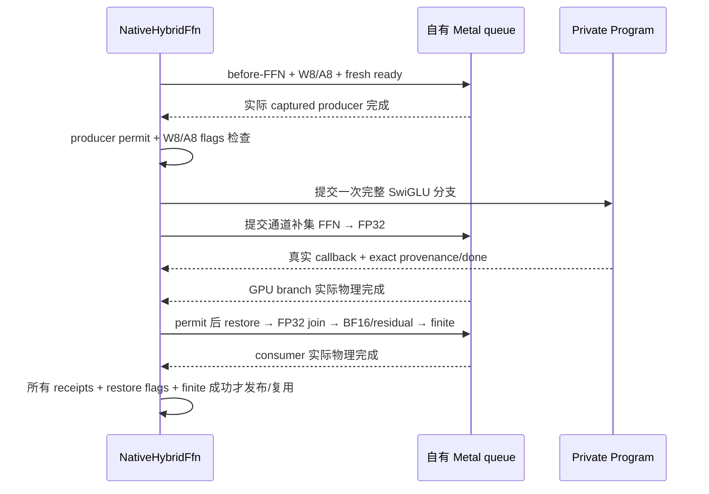

# 15 · 独立 Splash 式后端：W1 完整 FFN 与整图接线

更新：2026-10-08。本章记录实际代码，目标设计见 10/14，完整后端规格见 [16](16-splash-native-backend-spec.md)。**新后端是独立执行路线 N；不是给现有 MLX FFN 增加另一个开关。** 完整 native GPU DiT／Euler／Session 和 private W1S 已接入稳态 32 层及阶段账本。上一构建 `4fd1e980…` 在尺度缓存关闭时的一组 register W1S vs native GPU Base E2E 测得去噪省时 13.60%、请求省时 9.97%；此组有收益，尚非性能资格，见[历史 Base 状态](../../status/2026-10-08-native-register-w1-base-e2e.md)。当前源码新增显式请求内 compact row-scale 缓存；GPU tiny 验证见[新缓存状态](../../status/2026-10-08-native-request-scale-cache.md)，后续[真实缓存筛选](../../status/2026-10-08-native-scale-cache-real-screen.md)中真实 importer、命中和输出逐位一致通过，正式均值没有净收益，未追加 E2E，不授予缓存收益。App、LoRA、编辑、Z-image 未通过当前路线；历史 tiny／真实 FFN 证据继续绑定原构建。

## 1. 基础改造与独立新后端

| 路线 | 谁编码 GPU 热路径 | 谁控制交接 | 当前验证边界 |
|---|---|---|---|
| A：现有 MLX／hybrid 改造 | MLX，部分自定义 Metal kernel | 既有 executor／框架桥 | 原有模型路线；历史结果绑定各自构建 |
| N：独立 Native Metal Graph | TurboCider 的 Backend、prepared PSO 和 CommandGraph | native producer、private Program、native restore/join，实际 tickets | W1S 全层接线；上一构建 cache-off register Base E2E 有收益；新 request-scale-cache 尚无整图收益证据 |

N 的去噪阶段自己编码 norm、投影、RoPE、attention、FFN、residual、输出投影和 Euler。文本编码与 VAE 在当前阶段仍使用已有 MLX 实现，在阶段边界交接已经就绪的张量。不能据此称整个 App 已去除 MLX；也不能把逐层回到 MLX attention 的 FFN island 称为完整原生去噪。

[Splash #260](https://github.com/incoai/splash/pull/260) 的主要参考点是完整运行时的通道切分、应用自有 dispatch/event graph、程序缓存、资源归属和校准。本项目借用这些机制，保留 Qwen Image 的模型数学。上游 LLM 的 prefill 倍率不作为本机图像模型收益预测。固定版本和完整源码地图见 10；vpipe 的 LoRA scratch／residency 参考见 [08](08-source-map-and-decisions.md)。

## 2. 本轮实际文件与责任

| 文件 | 实际责任 |
|---|---|
| [native_hybrid_ffn.hpp](../../../native/backends/metal_graph/native_hybrid_ffn.hpp)／[实现](../../../native/backends/metal_graph/native_hybrid_ffn.mm) | prepared BaseOnly Program、一个权重 bank、一个 ANE 请求槽、GPU 补集、提交顺序、完整完成聚合、退休与 drain |
| [native_ane_stages.hpp](../../../native/backends/metal_graph/native_ane_stages.hpp)／[实现](../../../native/backends/metal_graph/native_ane_stages.mm) | W8 generic／register、compact scale gather／scatter、A8、FP32 restore；只记录 native graph，不提交 legacy queue |
| [stage contract](../../../native/backends/metal_graph/native_ane_stage_contract.hpp)／[MSL assembler](../../../native/backends/metal_graph/kernels/native_ane_stages.hpp) | 原 source pitch／offset、ABI、跨阶段 alias、状态 writer mask；generic body 适配与 BF16 H128／H512 register W specialization |
| [native_ane_handoff.hpp](../../../native/backends/metal_graph/native_ane_handoff.hpp)／[协议](../../../native/backends/metal_graph/native_ane_handoff_state.hpp) | 分离 producer admission、ANE submit、ANE finish；一次性不可伪造 permit；共享绝对截止时间 |
| [native_ffn.hpp](../../../native/backends/metal_graph/native_ffn.hpp) | GPU 通道补集输出 FP32；显式 cold prepare 的 FP32+FP32→BF16 join |
| [scale-cache contract](../../../native/backends/metal_graph/native_weight_scale_cache_contract.hpp) | 真实 allocation owner／source／view／recipe key，Empty→Pending→Valid→Retired；metadata 不构成设备完成许可 |
| [native_block.hpp](../../../native/models/qwen21/native_block.hpp) | `plan_parallel()` 事先验证三段图与跨图 alias；复用同一套 PSO／arena |
| [aggregate state](../../../native/backends/metal_graph/native_hybrid_state.hpp) | producer／ANE、GPU branch、restore consumer 的物理完成与发布条件 |
| [ane_gpu.hpp](../../../native/backends/ane_gpu.hpp) | `SurfaceAllocationHooks`：原 IOSurface 保留同一账本 token；native import 不重复收费 |
| [native_denoiser.cpp](../../../native/models/qwen21/native_denoiser.cpp)／[contract](../../../native/models/qwen21/native_denoiser_contract.hpp) | 首步完整 GPU、稳态 32 层 W1S、整步绝对期限、所有分支物理完成、608／19 完成收据与 latent 事务 |
| [native_session.cpp](../../../native/models/qwen21/native_session.cpp)／[phase plan](../../../native/models/qwen21/native_memory_plan.cpp) | 同一 phase hooks／来源／预算，hybrid sites、释放前 metrics 副本，异常 drain／quarantine |
| [native_route.hpp](../../../native/models/qwen21/native_route.hpp)／[pipeline](../../../native/models/qwen21/pipeline.cpp) | 显式 private BaseOnly 请求，严格域、准备与执行区别、完成计数验收；不调用旧 manifest executor |

公开分发构建继续不链接 private Program/handoff/controller。private 源文件只在 `TURBOCIDER_ENABLE_PRIVATE_ANE=1` 构建中出现；新增实验请求域见 13，默认策略与 App 入口未改变。

## 3. 首轮几何与算术

生产候选仅 Qwen base，M=1024、H=4096、F=12288、G=A=6144，稳态图像 token；首步 prefix-build 继续完整 GPU。另一个白名单 M=32、H=128、F=1024、G=A=512 **仅用于生成数据的组件测试**。不同模型、首步 rows、编辑、LoRA 和其他分区不隐式复用此资格。

GPU 使用 gate/up 的前 G 行、down 的前 G 列；ANE 使用后 A 个通道。原 fused up view 已含 F×H×2 字节偏移，不再重复加一次。down 始终保留完整 F×2 的源 row pitch。GPU hidden 保持模型 BF16 边界，down partial 保持 FP32；ANE 使用既有 Sylvester DH、H128／H512、seed=20260930、per-row W8 与 per-token A8、headroom=1，再恢复为 FP32。只有 join 相加之后转一次 BF16，然后沿用 Qwen gated residual。

W8A8 是输入表示与量化 recipe；当前 MIL 的 int8 输入经 dequantize 进入 FP16 图，**不证明硬件正在使用 INT8 算术，也未验证真实 ANE placement**。此次不改变 headroom、不自动重试、更不将放宽质量门槛用于容忍非有限值或资源不安全。

## 4. 实际提交顺序



这是当前 API 名称 W1，按 03/16 的细分称 **W1S**：host 负责 producer admission 和分支 join，GPU 与 ANE 分支允许同时执行。它未实现 W1R reactor、W2／W3 深窗口或下一层权重预取。ANE submit 先返回再提交 GPU 补集；**次序允许并行，不是物理重叠或性能收益的测量证明**。

全部阻塞步骤共享一个绝对截止时间。剩余亚毫秒使用向上取整的 wait 参数，返回后再检查原截止时间；避免提前 `wait(0)` 退休整个 Metal Backend。同步 driver prepare/submit 不能被 host deadline 抢占，超时在返回后记录。失败不 force-signal，不以 done event 代替 callback。

## 5. 真实接口的组合

```cpp
NativeHybridFfnOptions options;
options.program_cache = owned_cache_absolute_path;
options.register_weight_staging = true; // 显式实验；省略仍为 generic
// 将同一 MemoryBridge 的 hooks 适配给 Surface；不能另建预算。
options.surface_allocation = {existing_hooks.reserve, existing_hooks.allocated};
auto hybrid = NativeHybridFfn::prepare(backend, options);

auto block_plan = block.plan_parallel(bindings, workspace,
                                     hybrid.gpu_complement(), partial_workspace);
NativeHybridFfnPlan plan;
plan.before_ffn = std::move(block_plan.before_ffn);
plan.gpu_ffn = std::move(block_plan.gpu_ffn);
plan.after_join = std::move(block_plan.after_join);
plan.input = block_plan.ane_input;
plan.gate = bindings.weights.gate;
plan.up = bindings.weights.up;
plan.down = bindings.weights.down;
plan.gpu_partial = partial_workspace.gpu_partial;
plan.ane_partial = partial_workspace.ane_partial;
plan.published_output = bindings.output;
auto result = hybrid.execute_until(std::move(plan), whole_step_deadline);
// 只有 completion.ok 才能让外层事务接受结果。
```

这段是实际 API，NativeDenoiser 的稳态层已按此组合，全部层共享整步 deadline。`NativeHybridFfnPlan` 是内部可信 builder 输入；调用者须用同一组绑定产生验证过的图。通用 CommandGraph 没有完整语义写集元数据，controller 无法独立认证任意 shader 是否真正计算指定 FFN／写入指定输出；其完成回执不能用于证明外来插件或任意图的语义。

## 6. 完成域、寿命与复用

一个成功 ANE callback 只覆盖 ANE 分支。controller 另外保留 GPU branch 和 restore/join 的实际 Tickets，并检查全部物理完成。producer/read permits move-only、私有构造、绑定 domain／epoch／request／slot／producer generation／program identity，不能由用户自报 Completion 构造。

Producer status 捕获具体的 down scale backing；检查通过后封存 provenance。restore 只能沿同一 snapshot，不能偷换另一个 bank 的 sd。restore status 与 producer status 分开，不能清零仍有消费者访问的状态字。成功还需 GPU partial、ANE partial 与最终 BF16 输出全部 finite。

一个 bank 只有在最终 consumer 物理完成后才复用。失败永久退休该 controller，即使迟到回调最终完成也不恢复结果资格。未知提交没有 ticket 时，physical 状态持续未知；析构或移动赋值不能据此释放完整 owner，会保留整组 Program、events、Surface、source views 与 PSO。`drain(0)` 只是非阻塞收集；有界 drain 只等待物理回执，不 force-signal、不重开 slot。

## 7. 资源与缓存的准确边界

没有 checkpoint 副本或全模型 W8 bank。每次换层仍从原 BF16 views 重新生成当前 bank 的 W codes。缓存关闭时 gate/up/down 共六个 scales／codes staging dispatch，A8 两个 dispatch，restore 一个 dispatch；开启后的冷／命中路径如下。已增加 `qwen21_native_w8_staging="register"` 显式实验入口；省略时仍为 generic。该字段只允许 private native W1S，schema 1 顶层／schema 2 execution 的严格解析和非法组合拒绝见 13。

register **只优化 W staging**：dense BF16、Sylvester basis、H128／H512、无 activation group／额外列缩放，使用 32-thread 寄存器 scale/code kernel。prepare 时额外准备 H128、H512 各 2 个 PSO；generic 不承担这 4 个 PSO 的准备。W8 仍是 scale/code 两 pass，source row pitch／offset、输出 Surface、flags、seed／量化 recipe 保持对应合同；A8 和 restore 沿用原路径。仅开启 register 时原有 38 sites／105 backings 不增加，不添加权重副本或额外 bank，也没有把准备成本隐藏到去噪计时外后宣称请求收益。参数不符合 register 域时拒绝，不能静默运行 generic 却报告 register。

当前已经新增原生、**仅 request 内**的 compact row-scale 复用，没有接入 legacy 的队列／缓存分配器。显式 `qwen21_native_scale_cache=true` 开启；默认 false，strict boolean，schema 1 顶层／schema 2 execution，只允许 private native W1S。显式 false 在 GPU／MLX／其他模型也拒绝；public、LoRA 域不扩张，generic／register staging 默认和选择保持独立。NativeDenoiser 在每个 Run 为所有层建立有界 slots，所有层共用现有一个 ANE bank，不缓存整个 W8 权重。

一个 entry 合并一层 gate/up/down 三组 FP16 标量；key 包括真实 MLX Data control block（`data_shared_ptr()`，不是 import 的新 wrapper）、native handle、view offset／extent／rows／cols／pitch／dtype、immutable source revision／generation，以及通道分区、H128／H512、seed／basis／norm bit pattern、staging 和 recipe version。源 owners 持续保留；真实 allocation identity 仅是寿命身份，不能替代可信 base 路线的不变权重合同。地址复用、不同 fused gate/up offset、不同来源或 recipe 不得当作命中。

- **Cold/miss：** 每份 W 执行 scales→codes→gather，将当前 padded Surface 的 FP16 scale bits 收集到 compact backing；还没有 Valid 资格。
- **Hit：** compact bits scatter 回当前 sg／su／sd 的 64-byte row pitch，再执行 codes；不做 FP16→FP32→FP16 额外舍入。A8 每次按本层本步输入重算。
- **Commit：** producer／ANE／GPU complement／restore／join／finite 及完整 controller 的实际物理完成全部成功，才将该 invocation 的 Pending entry 置 Valid。producer-ready、flags 或 event signal 不单独授予 commit。
- **Failure：** controller 执行失败将全部 entry Retired，迟到 callback 不复活；cache／source owners 留到完整 physical drain，Session quarantine 合同保持。缓存不会跨请求保留或写盘。

结果新增 `weight_scale_cache` 的 enabled／entries／payload_bytes／hits／misses。统计单位是一层三矩阵的整体 lookup，且只统计成功 FFN。生产完整 20 步的结构预计首步 GPU、之后 **32 misses＋576 hits**；这是预计计数，**尚非当前缓存的真实模型测量**。旧 tiny 两步只有一次 steady pass，各层只能 miss，不能用它宣称 hit 已验证。
Surface 在原分配前 reserve，实际 MTLBuffer allocatedSize 在同一 token commit，Surface／slice／import 共享原 owner。配对 hooks 不完整或容量超界直接失败。编译器、driver、ANE scratch 不由 Surface charge 自动覆盖，需要额外观察和 guard，不能从这个接口推导完整请求内存认证。

**NativeSession phase 已源码包含 hybrid sites。** 原 GPU 为 22 sites／89 backings，缓存关闭的 W1S 为 38／105；一个 bank 的 9 个 Surface、32 MiB 双 FP32 partials、signs／zero／status 共用原账本。生产计划新增 capacity upper 122,798,080 B（117.109375 MiB），包含 pitch／alignment；不是实际峰值。Program/constants、compiler/driver 仍使用未认证 allowance。CPU 已验证重复 site、late release、别名去重、预算与零账本；真实设备异常／完整请求内存尚未授资格。不得绕过 hooks 或增加第二个私有账本。

启用 scale cache 后，同一 phase 新增 `tc-native-hybrid-weight-scale-cache` 一个 site、`instances=layers=32`，共 **39 sites／137 backings**。每层 payload `(2×6144+4096)×2=32768 B`，总 **1 MiB**；计划容量为 `align16KiB(payload+16KiB)=49152 B`／层，总增加 **1.5 MiB**。实际只分配 payload；额外每层 16 KiB 是显式保守 headroom，actual allocated capacity 经原 hooks 入账，不能当成实测上界或复制 64-byte Surface padding。cache-off 的计划、分配和行为保持原样。

Program 保持 checkpoint-independent BaseOnly 精确 ABI，cache key 仍包含 MIL/constants、OS、device 和 ABI。source、量化 recipe、conditioning、adapter 与 runtime build 属于执行资格身份，不合并成只按几何命中的“模型缓存”。本轮测试使用明确归属的临时程序目录；结束后清理无效编译产物，保留必要的日志和测量 binary，不清理用户模型或系统缓存。

## 8. 验证和下一阶段

### 8.1 历史证据保留原构建范围

CPU 布局／alias／mask、MSL 绑定、permit／deadline／退休、FP32 join 合同和严格 host 验证支持接线。历史 tiny dense／hybrid 数值 RRMS 约 2.48%，源／padding、物理完成和账本归零正常，见[原始 W1 状态](../../status/2026-10-08-native-w1-parallel-ffn.md)。[较早统一接线组件状态](../../status/2026-10-08-native-w1-session-components.md) 记录 tiny latent RRMS 0.2765%，真实 layer 0 FFN step 1／19 RRMS 0.3388%／0.2727%；耗时分别省 38.85%／增加 1.07%。这些各输入一个样本的 held-out 收益当时不稳定，未推进完整 hybrid E2E；AB／BA 与输入混杂，不能平均或解释为频率／cache 原因。原始记录不改写为本轮 same-build 证据。

### 8.2 上一构建 register Base E2E：尺度缓存关闭

此历史 runtime build 为 `tc-runtime-build-v1-4fd1e980da701fa564cafc1f77702fcba49542d251cb5324ce42907c48324c23`。同一本地 Qwen BF16、512²、20 步、seed=42，提示词为 `A blue ceramic teapot on a wooden table, soft daylight, realistic photograph.`，无 LoRA／参考图，近似 DiT cache off，**请求内 W scale cache 也未开启**，component_staged。

| 此历史构建的实际路线 | denoise（s） | request wall（s） |
|---|---:|---:|
| native GPU | 41.616892042 | 48.602237417 |
| native private W1S、register W staging | 35.956603708 | 43.758467125 |
| 相对 native GPU 省时 | **13.60094%** | **9.96615%** |

这里 request wall 是 runtime 请求计时，不替换成进程监督器含启动／退出的 wall。每路线 **1 个样本**，固定 native→hybrid，新进程但共享 OS source／driver cache 未清；不证明稳定倍率、泛化或严格冷缓存优势。此组比较完整 GPU 路线与包含 W8A8 的 W1S 路线，不能把收益全部归因于调度或 register kernel；此历史测量没有 generic W1S 的同构建完整请求反事实对照，也没有同构建最佳 MLX 路线排名。

hybrid 回执为实际 `weight_staging=register`、**608 successful FFNs／19 completed hybrid steps**，第一步保持全 GPU；608 次成功 FFN 均有配对 GPU span 覆盖。两路 phase `succeeded`，native storage／reserved／cached／pending／unknown 归零，无 taint／quarantine；这是 native phase 释放证据，保留的原始 source baseline 并非应归零的 native allocation。4 个来源文件 stat 身份不变，外部前后 swap used／Swapins／Swapouts 未增加；内置 phase swap observation 未提供该证明。最终两张图已目视接近；单提示词视觉对照不能覆盖 LoRA、编辑、App、Z-image 或所有图像质量。

[历史 Base 状态](../../status/2026-10-08-native-register-w1-base-e2e.md) 和[完整原始 receipt](../../../outputs/native-w1-register-20261008/e2e-pair/receipt.json) 保留原始计时、图片、来源及资源记录。结论是**此历史组有完整请求收益，尚未授予性能／产品资格，也不能转授新缓存源码**，`whole_request_performance_qualified=false`、`full_request_certified=false` 继续成立。register 仍是显式 CLI 实验，generic 和产品默认路线不变；W1S 未变为 W1R／W2，硬件 INT8 与真实 placement 仍未验证。

### 8.3 计时边界与下一步

`producer_seconds` 含 before_ffn attention／norm 与 W8／A8 等整个 producer 阶段；submit_ane、branch_join、consumer、total 均为 host controller spans。`total` 不包含完整请求／整个 DiT step 的所有工作。新 device spans 来自实际 Metal ticket first-start／last-end，包含 command-buffer 间隙，只对 producer 和 GPU complement 都有正数时间的成功 FFN 成对累计；`device_timed_ffns<=successful_ffns`。它们不是可相加的 kernel busy time，也不给出纯 ANE device 时长或物理 overlap 证明。

上述 cache-off 历史组累计 host producer **19.263116622 s**、branch_join **12.571460831 s**、controller total **32.464763046 s**；配对覆盖 608 次的 producer GPU span **15.754880958935246 s**、GPU complement span **12.456846708781086 s**。这些是整请求跨 FFN 累计量，不是单层时间；不把其差值直接当作可消除的纯同步成本，也不把两条 GPU span 加起来估算请求时间。

下一阶段顺序：

1. 保存历史独立构建、receipt、图像和 binary，维持数值／有限值／来源／padding／物理完成与 ledger 合同；历史结果不混算。
2. 本轮 request-scale-cache 已实现，GPU tiny 验证见[新缓存状态](../../status/2026-10-08-native-request-scale-cache.md)。先验证身份变化、cold／hit、A→B→A bank 覆盖、FP16 bits／codes、padding／flags／完整物理完成及零账本；后续[真实缓存筛选](../../status/2026-10-08-native-scale-cache-real-screen.md)覆盖真实 importer／完整 FFN 的精确复用和零账本，但顺序反转且无净收益，缓存保持默认关闭，不追加 E2E。
3. 后续有限 Base 验证针对固定顺序、冷热和代表性输入尚未解决的问题；一组收益不直接改变自动选择、App 或默认 staging。
4. Base B1 资格成立后再扩展 LoRA：覆盖全部目标投影、非线性前 gate／up 修正、正确 hidden 的 down 修正与独立舍入合同。BaseOnly 不携带无用 LoRA 输入；之后独立推进编辑 encoder、Z-image adapter 与 App 接入。
5. W1R／W2／W3 是 Base B1 后的另一条优化，不阻塞 LoRA 起步。alternate bank、设备等待、窗口和 replay 必须分别证明失败访问与净收益；未完成前不能宣称达到 Splash 式深窗口目标，见 16。
