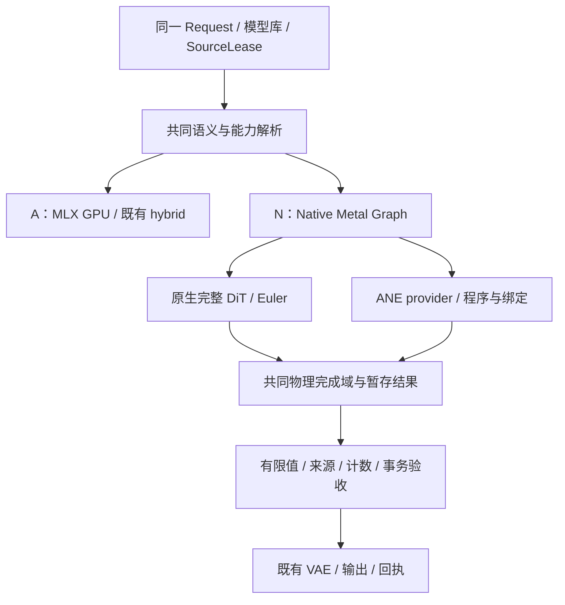
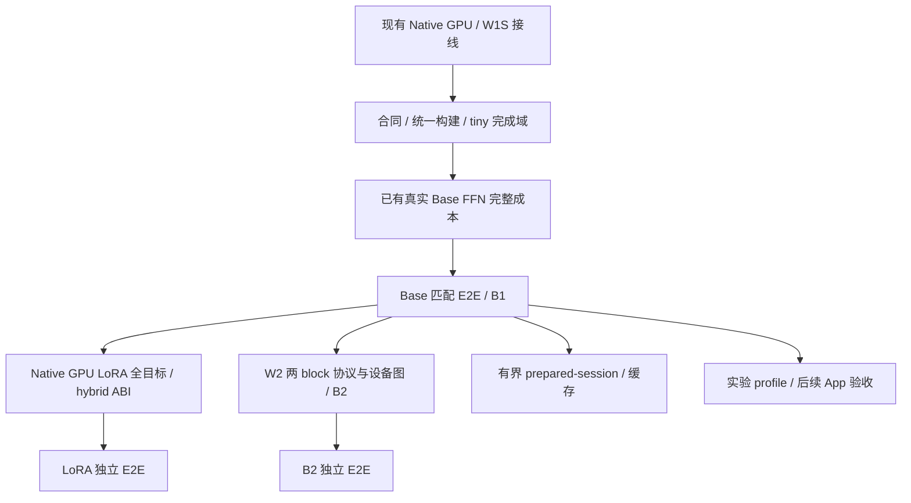

# 16 · Splash 风格独立后端：完整运行时规格与复审决策

更新：2026-10-08。本文补充用户要求的**全新后端**，并作为 10 的详细实施规格。它与现有 MLX 路线并列，直接控制 Qwen Image DiT 的 Metal dispatch、command graph、内存与 ANE 交接；不是新增一个 FFN 开关。本文中的新增类型、调度器和窗口算法是设计，代码块是职责伪代码，不是已存在的 API。

当前源码已有 native GPU DiT／Euler／Session，以及 private W1 FFN 到稳态 32 层、请求和阶段账本的接线。[上一构建 Base 对照](../../status/2026-10-08-native-register-w1-base-e2e.md) 在 `4fd1e980…`、请求内 W scale cache 未开启时完成独立 native GPU 与 native GPU/ANE 的 512² 整图请求：register W staging 路线去噪省时 13.60%，完整请求省时 9.97%，最终图片肉眼接近。每条路线仅一次，属于本机 Base 成功路径证据，**尚不授自动采用、LoRA／edit／Z-image／App 或通用性能资格**。本轮新增默认关闭的 request-scale-cache，GPU tiny 验证见[新缓存状态](../../status/2026-10-08-native-request-scale-cache.md)，后续[真实缓存筛选](../../status/2026-10-08-native-scale-cache-real-screen.md)中真实 FFN 精确复用通过、无稳定净收益，未追加 E2E；上一构建收益不转授当前源码或缓存。当前 W1 仍逐层主机准入，不能称已达到 Splash 的多层设备事件调度。实现边界见 11–15，[前一构建组件状态](../../status/2026-10-08-native-w1-session-components.md) 与其他历史回执保留各自构建范围。

较早库 `61fe967c…` 完成 Native GPU LoRA 算子、两层 tiny 图与来源／Session／内存接线，generated 对照零差异，当时请求门仍 BaseOnly，见[组件状态](../../status/2026-10-08-native-lora-gpu-components.md)。随后新库 `6d914980…` 已开放 GPU Viggle r128／strength1／六步／512²／无参考图显式候选，并完成一次真实配对：全部 227 target 与阶段释放通过，图片目视接近；native request 25.437 s 对 MLX 20.939 s，慢 21.48%，见[真实 LoRA 状态](../../status/2026-10-08-native-lora-gpu-e2e.md)。保持实验未资格状态，hybrid LoRA 仍拒绝。独立后端继续收敛到可复用计划／Invocation 和有界设备调度，LoRA 成功路径不代表 W2 已实现。

后续 `77863b3f…` 已增加严格 opt-in FP32 SGMMA LoRA kernel。单层完整 FFN 的两种顺序有 7.26%／3.59% 收益，六步整图配对仍为 Native 23.987 s、MLX 20.960 s（慢 14.44%），因此仅完成本输入成功路径验证；SGMMA、hybrid LoRA 和 W2 的性能／自动资格都未授予。见[组件](../../status/2026-10-08-native-lora-sgmma-screen.md)与[整图](../../status/2026-10-08-native-lora-sgmma-e2e.md)，不同构建的 scalar E2E 不作为因果对照。

独立组件 `NativeGateUp` 随后在 `e6ea1909…` 完整构建、同一真实 LoRA FFN 六次筛选中输出逐位一致；暖机后两顺序分别慢 0.0970%／0.5691%，未接模型／App 或追加整图。它说明减少一次 dispatch 仍需完整成本验证，不能据此认定 N 的主瓶颈已解决。后续 hybrid LoRA 的 HiddenReference／Rank128Candidate ABI 与末项 up-SiLU fusion 的精确实施合同集中在 [17 §5.3、§10–11](17-native-lora-integration.md)；仍分别标注设计、实际原语和性能证据，不与 W2／图编译器混为一个交付。

## 1. 复审后必须明确的决定

| 发现的不足 | 本次修订 |
|---|---|
| “统一计划”“MLX 适配”“完整原生后端”容易混为一项 | 保留 A 基础改造；增加独立 N 执行器。共同语义计划是目标，当前两套模型流程仍靠 oracle 对照 |
| 已拥有 Metal queue 容易被理解为达到 Splash 完整调度 | 将算子覆盖、提交控制、无逐层主机准入和性能资格分别记录 |
| 03 的 W1 要求 reactor，实际 W1 却同步等待 | 本文区分 W1S 同步准入和 W1R 完成驱动；两者均非 B2 深图 |
| 10 把 B2 作为 LoRA 的前置，其他章只要求 Base B1 | Base B1 通过后，LoRA 与 B2 分别推进，不互相阻塞 |
| 复用地图关注算子，缺少完整模型调用与回放 | 加入 Splash QwenTarget／Runtime／启动校准／idle 生命周期；保留本地 DiT 数学 |
| 只给 FFN 加 LoRA delta 就被视为完整 adapter 支持 | 按实际 adapter target 全集接入；不同 ANE ABI、数值与资格独立 |
| “支持 native”与“默认采用 native”没有充分区分 | 显式请求不支持时拒绝；自动策略才按资格选择兼容路线 |

## 2. 执行域和后端身份



身份分别为 `executor × device policy × model variant × precision recipe × window protocol`。例如 `native-metal-graph / gpu_ane / BaseOnly / SylvesterDH-W8A8 / W1S`。这些维度不能隐含在一个 `hybrid_mlp_mode` 字符串里。

N 的首个完整执行域是 DiT：输入／时间／文本投影、32 个完整 block、prefix K/V、输出投影与 Euler。稳态内部不调用 MLX matmul、SDPA、compile、eval 或 Metal Primitive。初期 loader、文本／视觉 encoder、初始 noise、VAE 沿用既有实现，阶段边界显式同步与保留真实 backing owner；此时 App 仍依赖 MLX。

| 阶段范围 | 当前 N 路线 | 后续独立验收 |
|---|---|---|
| source／adapter 读取、conditioning、noise | 使用既有 loader／MLX，在边界保留 produced backing | source 管理共用；不为了“原生”复制模型 |
| 完整 DiT／Euler | 自有 Metal queue、dispatch、scratch 与提交；Base 已有整图证据 | LoRA、新窗口和不同 recipe 各自验证 |
| 文本／视觉 encoder、编辑参考处理 | MLX 已加入 FP32视觉fusion与语言GQA/causal，1–3图计算通过用户5%筛选；见[18](18-edit-encoder-acceleration.md)。不属于已验证native/ANE域 | Native GQA／VL精度／DeepStack／arena接线，默认1024完整编辑成本；512 reference整图encoder本组无净收益 |
| VAE／App | 既有 VAE 与 worker；没有切换产品默认执行器 | 原生 VAE 如有收益再接；App capability／取消／实际回执另验 |

这里的 graph 是应用拥有的 dispatch/event 调度表示，**不要求 MTLIndirectCommandBuffer，也不等于 MLX 编译图捕获**。模板只缓存结构；实例拥有当前地址、参数、事件代次与一次性请求。自有 graph 的意义是能决定何时提交 ready、何时执行 GPU 补集、哪些 staging 可重叠、何时允许 restore，以及何时发布 latent。

当前完整 native DiT 已经由 N 执行，不是把一个 FFN island 插回 MLX 去噪循环；但其 `CommandGraph` 仍是绑定实际 views／参数的本次提交对象，尚不是可跨请求直接 replay 的模板系统。复用算子、PSO、program 或请求内尺度，不意味着可以再次提交旧 graph／Ticket／ANE request。后续模板只能保存符号资源和不可变算子描述，由每次 invocation 重新绑定 source、backing、参数和完成代次；W2 则另须证明跨 block 的设备依赖与失败访问协议。

## 3. 参考 Splash 完整实现，复用到哪一层

设计 pin 为 `80827e1c3593f7d10c266394e4d4381321b73ad0`，入口是 [Splash #260](https://github.com/incoai/splash/pull/260)。本机只读核对 HEAD `0d5a035ea26d1cc566e3c7ee4e08e5e06fa68cf7`：下表中的 CommandGraph、MetalBackend、AneFfn、Program、Handoff、Runtime、QwenTarget 核心文件与 pin 无差异；不推断整仓库相同。

| 固定源码 | 完整参考内容 | 本项目必须改变的内容 |
|---|---|---|
| [CommandGraph](https://github.com/incoai/splash/blob/80827e1c3593f7d10c266394e4d4381321b73ad0/runtime/metal/CommandGraph.hpp) | 图拥有 dispatch 参数和事件顺序 | 增加可信算子 read/write 范围、generation 与事务语义 |
| [MetalBackend:810](https://github.com/incoai/splash/blob/80827e1c3593f7d10c266394e4d4381321b73ad0/runtime/metal/MetalBackend.mm#L810) | signal 处分 CB，保留实际 allocations，异步完成 | 接入唯一账本；有界滚动提交是本项目的后续设计，不能写成上游已有机制 |
| [MetalBackend:1071](https://github.com/incoai/splash/blob/80827e1c3593f7d10c266394e4d4381321b73ad0/runtime/metal/MetalBackend.mm#L1071) | 预建 CB 的容量约束 | 上游先创建再提交、使用容量检查；本项目不可无界创建 32 层所有 CB |
| [QwenTarget:210](https://github.com/incoai/splash/blob/80827e1c3593f7d10c266394e4d4381321b73ad0/runtime/model/QwenTarget.cpp#L210)／[327](https://github.com/incoai/splash/blob/80827e1c3593f7d10c266394e4d4381321b73ad0/runtime/model/QwenTarget.cpp#L327) | 每层 mixer／FFN 进入同一原生图；模型调用接上 split | LLM attention／RMSNorm 不替代 Image DiT 的 LayerNorm、modulation、三轴 RoPE、prefix mask |
| [AneFfn:530](https://github.com/incoai/splash/blob/80827e1c3593f7d10c266394e4d4381321b73ad0/runtime/ops/AneFfn.cpp#L530)／[568](https://github.com/incoai/splash/blob/80827e1c3593f7d10c266394e4d4381321b73ad0/runtime/ops/AneFfn.cpp#L568) | W8／A8→ready→GPU 补集和 alternate staging→wait→join；先排 ANE jobs，再提交多层图 | BF16 source、Qwen 行数、精确 BaseOnly ABI、失败访问许可与舍入 |
| [Program:673](https://github.com/incoai/splash/blob/80827e1c3593f7d10c266394e4d4381321b73ad0/runtime/ane/Program.mm#L673)／[707](https://github.com/incoai/splash/blob/80827e1c3593f7d10c266394e4d4381321b73ad0/runtime/ane/Program.mm#L707) | reusable program／binding，每 job 新建 ANE event wrappers／request | 底层 SharedEvent timeline 可以复用，但值和 request 不重用；不能缓存并再次提交已消费请求 |
| [Handoff:42](https://github.com/incoai/splash/blob/80827e1c3593f7d10c266394e4d4381321b73ad0/runtime/ane/Handoff.mm#L42) | ready 起计时、outstanding、sticky retirement | 人工放行不能成为读取 output 或覆盖 bank 的凭据 |
| [Runtime:2080](https://github.com/incoai/splash/blob/80827e1c3593f7d10c266394e4d4381321b73ad0/runtime/model/Runtime.cpp#L2080)／[2104](https://github.com/incoai/splash/blob/80827e1c3593f7d10c266394e4d4381321b73ad0/runtime/model/Runtime.cpp#L2104) | 整段提交、发布前验收、失败重跑与计时 | 换为 DiT step 的 latent／sigma／prefix 事务，不复制 LLM chunk KV／采样逻辑 |
| [Startup](https://github.com/incoai/splash/blob/80827e1c3593f7d10c266394e4d4381321b73ad0/runtime/engine/AneFfnStartup.cpp)／[Calibration](https://github.com/incoai/splash/blob/80827e1c3593f7d10c266394e4d4381321b73ad0/runtime/ops/AneFfnCalibration.cpp)／[Resources](https://github.com/incoai/splash/blob/80827e1c3593f7d10c266394e4d4381321b73ad0/runtime/engine/RuntimeResources.mm) | 准备、校准、负结果、breaker、idle unload/reload | 本地真实 FFN 与 DiT 对照；不使用 LLM KV 预算或上游性能资格 |
| [ExecutionPlans:12](https://github.com/incoai/splash/blob/80827e1c3593f7d10c266394e4d4381321b73ad0/runtime/ops/ExecutionPlans.hpp#L12) | runtime 唯一不可变算子计划，模型借用，覆盖动态 rows 的 scratch 上界 | 复用本地 operator bundle，再收敛到 IR lowering；不能仅对一个 bucket 估计变长容量 |
| [RuntimeResources:165](https://github.com/incoai/splash/blob/80827e1c3593f7d10c266394e4d4381321b73ad0/runtime/engine/RuntimeResources.hpp#L165)／[ReleasableMemory:11](https://github.com/incoai/splash/blob/80827e1c3593f7d10c266394e4d4381321b73ad0/runtime/engine/ReleasableMemory.hpp#L11) | 持久资源唯一 owner、销毁次序、idle release／reload | Session 上方可复用 PSO／program 资产；request phase hooks、Surface、Invocation／jobs 每请求独立 |

不能原样移植 `AneFfn`：它在 [32／80 行](https://github.com/incoai/splash/blob/80827e1c3593f7d10c266394e4d4381321b73ad0/runtime/ops/AneFfn.cpp#L32) 固定 2560 分段，要求 H 整除，且该入口接受 affine Q4／相应 GGUF。H=4096、本地 dense BF16 不满足。应复用分段 MIL、graph、binding、校准的组织方式，使用本地已验证 emitter 和 BF16 staging；不能只修改常量就认为算法和布局成立。上游 restore／residual／BF16 join 的顺序也不能替代本地 FP32 partial 求和后 BF16、再 gated residual 的合同。

核对的 Splash 固定版本没有可直接移植的 adapter parser、ordered A/B correction 或 LoRA ANE ABI：[Linear.hpp:134](https://github.com/incoai/splash/blob/80827e1c3593f7d10c266394e4d4381321b73ad0/runtime/ops/Linear.hpp#L134) 的 SwiGLU projections 只有 gate/up/down。Splash 提供完整运行时与调度组织；本项目的 LoRA target、舍入和 hybrid ABI 仍需自行扩展。其 `CommandGraph` 也是绑定实际资源的一次性 dispatch 列表；本设计的符号模板／跨请求 Invocation 系统是后续工作，不能当作上游现成能力。

vpipe 作为补充：采用其 [command stream](https://github.com/tgo-app-dev/vpipe/blob/3e2682a0847c9e76dd37978f2be01f53195ae5e3/apple-silicon/metal-compute/command-stream.cc)、[runtime LoRA](https://github.com/tgo-app-dev/vpipe/blob/3e2682a0847c9e76dd37978f2be01f53195ae5e3/generative-models/shared/runtime-lora.cc) 和 [block residency](https://github.com/tgo-app-dev/vpipe/blob/3e2682a0847c9e76dd37978f2be01f53195ae5e3/generative-models/shared/block-residency.h) 的批处理、有效 rank、scratch 和有界 refill 思路。其 staging-time LoRA merged FP16 recipe 与本地 activation correction 是不同方案，不共享数值资格。完整来源见 08；移植实际代码时记录版本、修改范围和 notice，不把两仓库作为运行时外部依赖。

本次核验同时区分来源：vpipe 的固定版本是 2026-10-07 上游提交，相关源码／tree 已只读验证；本机 checkout 停在 2026-09-06，并不包含该版 Qwen21／ANE 文件。后续实施若读本地旧目录，必须报告该版本差异，不能误用旧代码给新方案背书。

## 4. 模块责任与当前实现差距

| 模块 | 当前可复用代码 | 后续新增责任 |
|---|---|---|
| 语义／能力 resolver | Request、native_route、SequenceGeometry、schedule、source leases | 共同不可变 QwenExecutionPlan，逐投影 variant 与 phase policy；尚非已落地统一 IR |
| Native device／graph | `metal_graph::Backend/CommandGraph/Ticket` | 可信算子资源声明、graph template/lowering、有界多段 scheduler |
| 原生 DiT | NativeLinear/Attention/QwenOps/StepOps、NativeBlock/Denoiser；GPU LoRA 已接通 227 targets 的窄域请求 | liveness 复用、prefix 两区间 attention、把既有 LoRA 全目标语义纳入共同 IR lowering；hybrid LoRA 另行接线 |
| ANE provider | private Program、NativeAneHandoff、NativeHybridFfn | W1R／W2 completion domain、binding reuse、窗口证书；public/fixed 按不同能力接入 |
| 准备与缓存 | PSO、MIL/constants cache、SourceLease、模型库、请求内 compact row scales | prepared-session 有界复用；尺度缓存真实路径验收；NoGain／资格与 idle 闭环 |
| 内存 | NativePhaseMemory、MemoryBridge、Surface hooks | 深窗口／隔离／replay site，上游模型、compiler／driver 与全请求资格分别认证 |
| worker／产品 | 现有 Session、CLI、App worker | 版本化 profile registry、真实 capability/receipt、后续高级 UI；不能另建模型库 |

共同 IR 可分小步引入：先抽出 geometry、phase、rounding、variant 身份，再让 A/N 从同一模型描述生成各自 operator plan。无需为第一组 native 性能验证重写全项目；但在两套流程仍存在时，测试必须覆盖模型拓扑，不能声称已消除语义重复。

ANE provider 的统一接口只统一 admission、来源、资源和完成报告，不能赋予相同设备能力：

| provider 路线 | 必须单独解析的合同 | 不可继承的能力 |
|---|---|---|
| frozen／fixed Core ML | 内嵌权重／adapter recipe、实际输入 function／容量、导出与编译身份 | 固定分区的资格不覆盖动态权重，也不自动提供 native graph 的 ready/done 交接 |
| public runtime Core ML | 当前 program 的动态输入 ABI、shape 支持、prediction 完成与真实执行记录 | `computeUnits`、异步 host 调用或 INT8 表示不证明 ANE placement、硬件 INT8 或设备事件调度 |
| private native ANE | 实际 private ABI、Surface、generation、物理完成及访问许可 | 当前 W1S 的成功证据不授予 W2；private 可调用也不独立证明硬件算术或更快 |

因此 public／fixed 可以作为 N 的后续 provider，但只有其能力合同满足目标窗口时才采用该窗口；否则使用自己的安全提交协议并独立比较完整成本。不同 provider 的 program、binding、数值 recipe 和 qualification 不互相冒用，见 [02 能力与计划合同](02-architecture-and-contracts.md) 和 [05 分层缓存](05-resources-cache-and-worker.md)。

建议的最小新增类型如下，复用现有 StorageId／lease／completion ledger，而非另建账本：

```cpp
// 设计伪代码；强类型 ID、错误和真实内存适配省略。
struct NativePlan {
    SemanticKey semantic;       // geometry, mask, sigma recipe, variant, rounding
    ResolvedSelection selection; // source/AdapterSet、资格、环境与 phase 的解析结果
    BackendKey backend;         // host/shader ABI, device, OS
    WindowCertificate window;  // W1S/W1R/W2；认证覆盖具体访问协议
    GraphTemplate graph;        // symbolic buffers/events, immutable op parameters
    MemoryPlanView memory;      // 来自权威 MemoryExecutionContext
};
struct NativeInvocation {
    std::shared_ptr<const NativePlan> plan;
    SourceLeaseSet sources;
    LeaseBindings storage;      // actual backing + byte range + generation
    OwnedParameterBytes params; // step sigma, valid rows, offsets
    OneShotJobs ane_jobs;
    CompletionDomain completion;
    TentativeStepState output;  // latent/prefix/receipt 尚未发布
};
```

这里的 `NativePlan` 是 [02](02-architecture-and-contracts.md)／[05](05-resources-cache-and-worker.md) 所述已解析 `tc::hetero::ExecutionPlan` 的原生 lowering 示意，不新增一套计划 ABI 或预算决策器。跨 checkpoint 的结构复用属于 `GraphTemplate`；来源、adapter 顺序／强度、资格或环境改变后，必须重新解析 `selection` 并 admission，即使模板与动态 program 仍可命中。`NativeInvocation` 则拥有一次执行的资源与状态，不能存入持久模板缓存。

通用 `CommandGraph` 目前没有语义写集，不能认证任意 shader 正确实现指定 FFN。新增 IR 的资源声明只能由审计过的算子 builder 提供；其 shader ABI 与读写声明一起版本化。外来 plugin 不能通过自报范围获得“安全 graph”证书。

### 4.1 独立后端的接口和执行闭环

下面是后续收敛接口的设计名称，**不是当前新增了一套可调用 API**。`ResolvedPlan` 指共同 `tc::hetero::ExecutionPlan`，`Invocation` 对应其 `GraphInstance` 的本次执行状态；`BackendGraph` 是原生 lowering 的结果，不能自行再选模型、设备份额或预算。

| 接口／对象 | 输入与输出 | 所有权与拒绝条件 |
|---|---|---|
| Qwen graph builder | 经解析的 geometry／phase／schedule／adapter recipe → 符号投影、attention、FFN、Euler 及读写依赖 | 保留 Qwen 数学与 BF16／FP32 边界；不调用 MLX 算子，不持有 Metal 地址；未知 target／phase 在提交前拒绝 |
| `ResolvedPlan` | 语义描述＋来源／资格／环境 → GPU／ANE 分工、provider、window、资源要求 | 不可变选择；缓存命中后仍检查 source、能力与 admission；不携带一次性 request 或 event value |
| `BackendGraph` | 符号图＋已选原生 kernel／program ABI → 有界 segment 模板及 slot liveness | 应用自行决定 dispatch、CB 切分、ready／done 依赖；模板保留 PSO／program 资产租约，不捕获 request MatrixView 或旧 Weights closure |
| GPU executor | 绑定后的 segment → 真实 `metal_graph::Ticket` | 使用自有 Backend queue；提交前将可能访问的 buffers／params 移交完成域；部分提交失败不能丢失 owner |
| ANE provider | 已选 program＋完整 Surface binding＋one-shot invocation → producer／read／completion 许可 | reusable program／binding 和不可重复提交的 job 分开；read permit 必须符合 §6 协议，不把逻辑 timeout 当设备已结束 |
| Window scheduler | `BackendGraph`＋`Invocation`＋同一步 deadline → 有界准入和完成收集 | W1S 使用现有 host admission；W2 用另验的设备依赖。停止新工作、排空和隔离都由同一 owner 状态机负责 |
| Phase resources | 计划中的 allocation sites＋实际 Buffer／Surface → leases 与绑定 | 适配现有 `NativePhaseMemory`／`MemoryBridge`，不另建 ledger；保持 StorageId、实际 allocation identity、range 与 generation；同 backing 不重计 |
| `Invocation` | source leases＋produced inputs＋参数＋本次 leases／jobs → tentative latent／prefix／receipt | 持有本次全部 owner 与 CompletionDomain；有限值、来源、计数、物理完成均通过后才发布；失败保留资源到安全释放 |

建议调用链如下；可分步把现有 `NativeDenoiser`／`DenoiserRun` 和 W1S 控制器接到这些职责，不能仅包一个同名 facade 就声明模板或深图完成：

```text
resolve(request, sources, capabilities, qualification) → ResolvedPlan
admit(existing phase context, plan.resource_requirements) → BufferLeases
prepare(plan, owned asset cache) → BackendGraph / PreparedPrograms
bind(plan, graph, produced sources, leases, fresh generations) → Invocation
for each exact schedule step:
    lower/bind phase: PrefixBuild or SteadyDecode
    scheduler.submit_bounded(invocation, shared_step_deadline)
    collect producer + ANE + GPU + restore/output/Euler physical users
    verify finite/source/coverage → publish this step atomically
drain all physical users → release request owners → settle phase
```

首步 `PrefixBuild` 将实际 text／reference rows、两行时间调制和全部目标 rows 纳入目标图；稳态使用已验收的 prefix bank，仅推进 target。每层 QKV／attention-out、gate/up 的 pre-SiLU correction、down 与全部全局投影都由同一 builder 选择 Base 或 LoRA 分支，不能在某些 projection 静默回到 MLX。实际请求当前接受 Base 与 GPU Viggle 窄域；generated 及一组真实 GPU LoRA 已通过，编辑与 hybrid LoRA 仍未开放。共同符号 builder 仍是收敛目标，不能据此声称统一 IR 已实现；详见 [17](17-native-lora-integration.md)。

资源 liveness 必须覆盖 producer、两个分支、restore、prefix reader 和最终 output／Euler，而不只覆盖 GPU dispatch 顺序。后续 W2 的窗口大小同时受可用 bank、CB capacity、driver outstanding jobs 和阶段预算限制；这些限制由同一 `ResolvedPlan` 与资源上下文提供。当前没有实现这个通用模板／窗口接口，也没有 W2 成功路径证据；已经存在的完整原生 DiT 与 W1S 是其独立可运行基线。

### 4.2 从模型算子到实际 command buffer

“掌握 graph”必须落到编码器及提交器，而不只是创建一份计划 JSON。当前 [backend.hpp](../../../native/backends/metal_graph/backend.hpp) 的 `CommandGraph` 已按序持有 dispatch、复制的参数、buffer views、Signal／Wait；[backend.mm](../../../native/backends/metal_graph/backend.mm) 已进行设备／线程／view／事件校验，预留整次提交的 CB capacity，在 signal 处分段，并提交 producer 后才创建 consumer。`Ticket` 保留实际 owners，失败不人工 signal。现有每 dispatch 的全 buffer barrier 是保守路径；它尚无可信语义读写集，因此不能直接删 barrier 或声称具备通用图优化。

后续 lowering 增加以下合同，继续使用同一 Backend／MemoryBridge，而不另建提交队列或账本：

| 编译阶段 | 必须产出的内容 | 提交前检查 |
|---|---|---|
| 语义 builder | 精确 norm／projection／attention／FFN／Euler 节点、phase、mask 与舍入边界 | 所有 adapter targets 和实际 rows 覆盖；Base 结构不携带无效 LoRA 节点 |
| kernel selection | audited operator ID、host/shader ABI、PSO／program recipe、work geometry | 设备／SDK 支持；非支持形状显式拒绝；优化不暗改 BF16 cast 或 bias 顺序 |
| access lowering | backing slot、连续或带步长的 byte region、generation、read/write/read-modify-write、GPU/ANE owner 域 | 同 backing 的重叠视图按真实逐行范围判 hazard；裸指针／array ID 不作为身份；来源不可写 |
| liveness／slot planning | producer→所有 reader→最后物理使用者，prefix 与 tentative latent 独立 | GPU 与 ANE 分支同时使用时不复用；窗口／失败／late callback 都计入上界 |
| segment planning | dispatch list、barriers、ready signal、consumer wait、有限 CB／job 数 | 同队列不等待未提交的未来 producer；外部事件满足窗口证书；不能在 ready 尚未提交时阻塞取 capacity |
| invocation binding | 当前 leases／参数、fresh event values、one-shot requests、tentative output | 按实际 allocation owner／range／generation 重新核对 alias／hazard 和 source／adapter；已提交 graph／request 不重用；全体潜在使用者先注册 |

示意接口是**待实现的 lowering 草案**，不是新生产 API：

```cpp
// 每个 operator 的访问声明由可信 builder 和已审计 shader 一起提供。
struct StridedRows {
    CheckedByteOffset first;
    CheckedByteCount row_bytes, row_pitch;
    CheckedRowCount rows;
};
using AccessRegion = std::variant<ByteRange, StridedRows>;
struct Access {
    SymbolicSlot slot;
    AccessRegion region;
    AccessMode mode;             // Read / Write / ReadModifyWrite
    CompletionDomainId domain; // GPUProducer / ANE / GPUConsumer
};

BackendGraph lower(const ResolvedPlan& plan, const TrustedModelGraph& model) {
    auto selected = select_audited_kernels(model, plan.capabilities);
    auto accesses = derive_verified_accesses(selected); // 不接收 plugin 自报证书
    auto slots = plan_liveness(accesses, plan.memory, plan.window);
    auto segments = partition_at_handoffs(selected, accesses, plan.window);
    verify_no_unsubmitted_future_wait(segments);
    verify_capacity_and_physical_reuse(slots, segments, plan);
    return BackendGraph{selected, slots, segments}; // 符号 slot，无本次地址／request
}

// 先强持有全部 owners；提交异常也由 registry 保留失败 Invocation。
PendingWindow submit(Invocation& invocation, const SegmentWindow& window) {
    verify_bound_generations_and_permits(invocation, window);
    verify_actual_backing_aliases_and_hazards(invocation, window);
    auto owned = register_potential_physical_users(invocation, window);
    // provider 契约决定具体提交顺序，不能一概先 enqueue ANE。
    return enqueue_under_certified_protocol(owned, window);
}
```

同一 `[M,F]` hidden backing 的 GPU 前半列与 ANE 后半列保留完整 `F` pitch。两个窗口的**包围区间会重叠**，只用一个 `ByteRange` 会把合法列切分判断为冲突，或迫使调用方错误地把它们登记为不同 storage。因此 lowered region 必须表示逐行半开区间：`[first+r*pitch, first+r*pitch+row_bytes)`，保留同一个实际 allocation owner／generation。相同 row origin／pitch 且两列窗不交时可使用已证明的快路径；其他情形用有界、按地址排序的逐行区间遍历判断。跨行碰撞也属于 hazard，不能只比第一行。

以上 region 仍是**待实现的 lowering 合同**，不放宽当前 conservative barriers。构造时检查正数 rows／row_bytes、`pitch>=row_bytes`、乘加溢出及最后一行不超 view／backing；不认识的算子或非规则 gather 声明整个 backing，宁可保留 barrier。CPU 验收覆盖同 backing 左右列窗、偏移一字节的重叠、不同 pitch、跨行重叠、超界和 overflow；source 的任意写仍拒绝。独立 region 只证明字节不相交，不能代替 producer／ANE／GPU／consumer 的物理完成与复用许可。

先保留已验证 barrier。只有读写集、导入资源 hazard 模式和跨 encoder／CB 的依赖已证明，才比较缩小到确切资源的 barrier、减少无 hazard barrier 或融合 kernels。融合门槛是数学／访问／物理完成均成立且完整路径有收益；不能单看 dispatch 数下降。

GraphTemplate 缓存的是结构、可信算子描述与不含 request 地址的资产 lease；PSO／program cache 缓存的是编译资产。 跨请求复用还需 §7 的持久资产／request hooks 分离及相同 backend context；当前 dispatch 拒绝其他 Backend 的 PSO，不能仅凭相同 device／shape 把旧 PSO 搬给新 Backend。二者都不缓存已使用的 `Ticket`、实际 event 代次、Surface job 或 graph 中的旧 source views。当前按请求准备的 PSO 已共享给各层，不把“避免每层编译”当作尚未实现的收益。

### 4.3 第一份真正由后端掌握的异构窗口

首个 W2 候选仍限定 Base、两个 block。同一步内后一个 block 的 activation 依赖前一个 block 的 join／residual；可以预排后续 commands 与下一层只读权重 staging，不能提前计算依赖未满足的 activation。提交图明确包含：

```text
block i attention / norm
 → join{W8(i) in bank A, A8(i)} → signal ready(i) → commit producer(i)
 → parallel{GPU complementary FFN(i), ANE(i) after real ready(i)}
 → certified completion(i) → restore / FP32 join / gated residual(i)
 → block i+1 attention / norm → A8(i+1)
 → join{A8(i+1), W8(i+1) staged in bank B}
 → signal ready(i+1) → commit producer(i+1)
 → parallel{GPU complementary FFN(i+1), ANE(i+1) after real ready(i+1)}
 → certified completion(i+1) → restore / join / residual(i+1)
 → window boundary physical collection
```

权重 staging(i+1) 可以使用独立 bank，在当前 GPU 补集前后安排；其最优位置需计入统一内存争用后实测。预排队不代表缩短运算依赖。窗口提前提交的条件是 §6.2 的完整协议已获得证书；无法证明 ANE completion／abort 下的访问安全时仍执行 W1S。现有 W1S 已能并行两设备分支，但尚未实现这份跨 block 设备窗口。

## 5. BaseOnly 完整计算与图布局

首个域：本地 BF16、512²、batch=1、20 步、无 adapter／参考图，H=4096、F=12288、G=A=6144。首步使用完整 native GPU，实际文本行数参与 prefix-build；后续 19 步只计算 1024 target queries，继续读取对应 prefix。1024 是图像 token 数，不是 prompt 限制，不截断文本。

以行向量、源权重 `[out,in]` 表示：

```text
g = X Wg^T; u = X Wu^T; h = SiLU(g) ⊙ u
Ygpu = h[:,0:G] Wd[:,0:G]^T
Yane = h[:,G:F] Wd[:,G:F]^T              // 此支路采用独立 W8A8 recipe
Y = BF16(Ygpu_FP32 + Yane_FP32)
block_out = existing_gated_residual(Y)   // 保留本地逐算子 BF16/FP32 边界
```

稳态每层的依赖：

```text
attention/norm/modulation → FFN X
                  ├→ GPU gate/up → SiLU → down partial ───────────┐
                  └→ A8 + current W8 readiness → ANE → restore ──┤
                                                               join → residual → next layer
free next-weight bank → staging next layer weights              // 可预取的是权重
```

BaseOnly 不携带 LoRA correction、rank scratch 或 hidden 导出。GPU 补集数学不依赖 A8，ready 优先只是可选排程策略；先采用已验证顺序，再独立测“ready 更早”是否值得挤占 GPU。下一层 activation 依赖本层输出，不能跨层同时执行 FFN 来制造并行。

生产完成计数是 **32×19=608 个 hybrid FFN、19 个 hybrid step**，首步完整 GPU；最终输出 graph／Euler 不计为 FFN。部分成功 FFN 仅是诊断计数，后面失败的整步不得发布 latent 或完成进度。

## 6. 从当前 W1 到 Splash 式设备图

| 协议 | 提交与复用 | 当前状态／含义 |
|---|---|---|
| W0 | 单桥／单分支，物理完成才消费 | 基础互操作证据 |
| W1S | ANE 提交后 GPU 补集并行；主机逐层验收，再 restore／下一层；单 bank | 当前 `NativeHybridFfn::execute_until`，属于同步控制面的并行 FFN |
| W1R | 有界 reactor 按真实完成准入 consumer／下一 segment | 待实现；减少阻塞线程，仍有逐层 host admission |
| W2 | 一次预排少量完整 block，成功路径由 ready/done 设备依赖推进 | B2 候选；需要额外失败访问与容量证书 |
| W3 | 整步逻辑图，有界分段提交与 step 事务 | 后续目标；不要求整步只有一个 CB |

03 的旧 W1 名称现在是 W1R；现有 API／历史回执保留 W1 名称，以 `control_plane=synchronous_host_admission` 区分。不能仅去掉 wait、改成 async future 或创建另一条 queue 就声称 W2。

### 6.1 当前 W1S：保留作正确性与收益基线

```text
producer native graph → 实际 producer Ticket 完成、stage flags 验收
ANE submit → native GPU complement submit
真实 ANE read permit + GPU complement 物理完成
restore + join + residual + finite → consumer Ticket 完成
单 bank 归还 → 下一层
全部层 + output/Euler + finite + source 验收 → 发布 step
```

整步只有一个绝对截止时间，所有层和最终 GPU graph 共用；不是每层重新获得一份超时预算。当前默认 30 秒限制的是准入、等待与结果发布：调用前检查剩余时间，阻塞调用返回后重新检查原始 end；它不能硬中断同步的 `Backend::submit`、private request prepare／evaluate，也不包含 Session 准备时的编译／load。超时停止后续准入与发布，仍须保留并收集已经可能提交的物理工作，不能承诺 driver 卡住时 30 秒内返回。

当前 `NativeSession::step()` 没有 cancel token，pipeline 只在每个 step 前检查取消；查询／drain 又与 step 共用 mutex，因此取消可能等待当前完整 step 或同步 driver 调用返回。W1R 需明确 owner-thread 与 completion mailbox，把取消检查加入每个尚未提交的 segment 准入点，并在停止新工作后继续 drain／quarantine；这能缩短控制面响应，但仍不等于抢占已提交 GPU／ANE 工作或中断 driver 调用。该边界来自 `native_denoiser.cpp` 的 `step`、`native_session.cpp` 的 `step` 和 `pipeline.cpp` 的 native 采样循环，尚无逐层即时取消的验收结论。

### 6.2 W2 首个方案：小窗口、独立资源、真实完成事件

先设计 **两个 block 的窗口**，不直接预排 32 层。每个可能同时被 driver 引用的 job 具有独立 W8 bank、A8、scale、output 和 status generation；权重预取发生在空闲 bank。复用只在窗口全体 GPU producer／ANE／GPU consumer 的物理完成域确认后进行。

设计流程：

```cpp
// 提案：不调用当前同步 execute_until 来伪装深图。
PendingWindow enqueue_window(const NativePlan& plan, WindowBindings bindings) {
    auto tx = prepare_transaction(plan, bindings); // 先预算、保留、验证全部访问
    auto graph = build_trusted_window(tx);         // attention/FFN/restore/residual
    auto requests = bind_one_shot_jobs(tx);        // 每个 job 不可复用
    auto owned = inflight_registry.register_owned(tx); // 移交强引用，不只是 metadata
    register_all_potential_physical_users(owned);       // 外部提交前登记全部域
    try {
        enqueue_ane_jobs_waiting_on_real_ready(requests, owned);
        submit_native_segments_with_capacity_limit(graph, owned);
    } catch (...) {
        owned->retire_and_stop_admission();        // 首个错误不可被晚到成功覆盖
        owned->retain_or_quarantine_unknown_users();
        // 不擅自 signal；未知部分提交也保有资源。返回持有失败事务的对象。
    }
    return PendingWindow{owned};                   // registry 只在物理清零后解除持有
}
```

ANE jobs 可在 GPU producer 完成前预排，但绑定的 ready 必须来自同一 native graph 的真实输入／权重写入。GPU `signal(ready)` 后立即提交 producer CB；GPU 补集在 `wait(done)` 之前。若两个 job 共用 timeline，未来 ready 必须严格位于前一个 done 依赖之后，不能用无序 staging queue 的未来 signal 提前放行旧 job。

Splash 的两个解锁行为必须一起审查：[Handoff.mm:44](https://github.com/incoai/splash/blob/80827e1c3593f7d10c266394e4d4381321b73ad0/runtime/ane/Handoff.mm#L44) 在 retirement 时人工推进最高 event 值；[MetalBackend.mm:823](https://github.com/incoai/splash/blob/80827e1c3593f7d10c266394e4d4381321b73ad0/runtime/metal/MetalBackend.mm#L823) 在 producer CB 出错后由 CPU 补发 ready。因此 ready 和 done 都不能独立证明数据有效或 ANE 已结束，不能只移植成功路径。W2 capability preflight 还需核对 [Program.mm:720](https://github.com/incoai/splash/blob/80827e1c3593f7d10c266394e4d4381321b73ad0/runtime/ane/Program.mm#L720) 的共享事件 `eventPort` 能力；validation 包装事件可能缺少该接口。callback 的 evaluate 结果、物理访问结束证明和 GPU 可读取许可保持分别建模。

窗口计划明确 `completion_protocol=provider-device-event` 或 `callback-proxy-event`，并分别绑定 provider／ABI／窗口证书与计时；实际回执另记录 `physical_evidence=completed|pending|unknown`。只有已证实物理完成的回执才填对应 completion source。协议 2 的 abort 人工放行另记 `dependency_release=certified-abort`，不伪装成真实 completion，仍 unknown 的 ANE users 继续持有和隔离，不授 output read／bank reuse。callback-proxy 可以移除 owner 每层准入，但仍包含每 job 主机通知与代理 signal；不能称为全设备、无 CPU 交接。当前 W1S 不提供这套 W2 字段；以上是未来回执合同。

窗口中的消费者预排前，必须通过以下**二选一完整协议**，不是混合其片段：

1. **只凭真实物理完成解除依赖。** 需要认证 provider 的真正完成事件，或真实 callback 证明物理结束后发布独立 completion-proxy event；当前 private `done` 本身不是该证书。proxy 可无需 owner 逐层准入，但仍有逐 job 通知延迟，须单独测量。成功或可证实已物理结束的失败均可结束依赖，但失败结果绝不发布；未知 timeout 不人工 signal、不覆盖、不 restore，整个执行域保持隔离。已提交等待可能长期存在，须报告无法恢复的 worker／内存占用，不承诺无缝 GPU 回放。若不能满足产品故障恢复，此方案仅保留实验状态。
2. **经过认证的 abort／conditional-access 协议。** 在任何人工放行前，设备可见 retired 状态有可证明的发布顺序；所有 restore、staging、后续 ready producer 都依据该状态跳过危险读写；已排 ANE request 的源与目的继续独立持有。需要证明所有 shader 路径、CPU/GPU 可见性和 private driver 顺序。一个 Shared buffer 的普通布尔写入、或只给最终 join 加 guard，均不成立。

独立地址只解决覆盖，不解决 timeout 后读取仍由 ANE 写入的 output。若无法证明上述协议，保留 W1S/W1R，并以 host gap 报告性能上限；不能用“丢弃整图”代替访问安全。

### 6.3 双 bank 是优化，不能作为安全前提

两个权重 bank 交替 staging 可隐藏一部分 W8 开销，但 `bank(i)` 被 `ANE(i)` 读时不得 stage(i+2)。初始 W2 窗口采用独立 generation，窗口结束再循环；只有失败情况下的 reuse certificate 通过，才向连续滚动双 bank 演进。activation/output slot 的最后消费者也要登记，不能只保护权重。

提交器按 CB capacity／job count／内存共同限制窗口，及时 commit producer，不无界创建全部 CB。部分 enqueue 或 commit 抛异常时，状态对象仍持有已经可能被设备使用的资源；“没有返回 ticket”不能解释成“没有提交”。

## 7. 准备、缓存与内存统一管理

准备次序为 **source／geometry → 预算与 capability → 质量/性能正负记录 → 少量 PSO/program/binding → request**。不能每次用户生成都重新校准，不能先编译所有 rows／份额再看能否使用。

| 层级 | key 必须包含 | 失效边界 |
|---|---|---|
| shader／PSO | host+MSL ABI、digest、设备/OS、function constants、数值策略 | 构建、能力或 recipe 变化 |
| graph template | 模型语义、phase、variant、rounding、window certificate | 拓扑／访问／数值合同变化 |
| ANE program | MIL/constants、IO ABI、basis、rows functions、headroom、设备/OS | 不兼容程序／load generation |
| binding | program generation、function、全部 Surface backing/range/pitch/slot | unload／resize／slot generation |
| row scales | held source identity、投影区间、basis、scale rounding | source 换代；弱 owner 失效；不同 recipe |
| prefix／conditioning | base SourceIdentity、文本/参考顺序/来源、完整 AdapterSet 顺序/强度、mask/RoPE、首步 sigma/调制、rounding、后端 layout/math | 任一语义／来源／代次变化 |
| qualification／NoGain | 上述身份＋模型 variant、实际输入域、基线与冷/热生命周期 | 构建、OS、源、数值或资源策略变化 |

当前 W1S 的 9 个原始 Surface、2 个 FP32 partial、signs／zero／flags 已进入同一 NativePhaseMemory：GPU 原计划 22 sites／89 backings；hybrid 38 sites／105 backings。生产几何新增 capacity upper **122,798,080 B，约 117.109 MiB**，包括 64-byte pitch 和逐 backing 16 KiB 上界；这是计划增量，不是完整进程实测峰值，也不是 32×20 份 bank。

**物理完成与最后 owner 释放是两个结算条件。** 当前 private `Ticket::Impl` 持有 Surface／program；`ane_program.mm` 的完成回调在锁内记录 physical completion、断开 request 的 callback cycle，随后通知等待者，但 driver 仍可能暂时持有 callback block 及其捕获的 state。`NativeSession::finish()` 在释放 native owner 后立即要求阶段账本归零；若这些回调 owner 延迟消失，当前实现会拒绝成功收尾，残留仍无法回收时进入 quarantine。这是保守的安全行为，也是待验证的误隔离窗口，不能把已收到 physical receipt 当作所有 owner 已析构的证明。

后续生命周期验收需增加“物理已完成、callback owner 仍保留、稍后释放”的可控故障用例，并定义有界 owner-reap：关闭新分配／提交，在期限内确认最后 owner 及 claim 实际释放，再结算零账本；也可评估在 provider 已证明安全的完成回调点主动解除请求 backing 的额外持有。两者均是待实现／验证的方案。超时仍保留隔离和计费，不能提前清 lease、修改账本或人工 signal 来通过验收。该用例应同时证明迟到释放可回收内存，却不会把已 retired 的结果或 worker 恢复为成功。

仅 gate/up/down 的 W8 权重 payload 就约 72 MiB；新增第二 bank 还需 scales、pitch、alignment，新增 job 还需 A8/output/status/partials。不能把现有单 bank 预算直接授予 W2。Program constants、compiler、driver workspace 的 guard 仍未认证；phase 归零不证明 encoder/VAE 或全请求容量。

prepared-session 可在安全 idle 时复用 PSO／program／binding，但每次请求重新验证来源和 capability，活动 request 不缓存。进入 VAE、内存压力或 idle 超时时有明确释放顺序，不能以“持久 worker”默认留下两份完整权重。GPU 与 hybrid 对照享有同样的 worker 复用能力。

实施前需拆开**持久 device/PSO/program 资产**与**请求 allocator/phase hooks**：当前 Backend hooks 绑定会 close 的 Context，不能直接保留旧 Backend、旧 reservation 或借旧 hook 为下一请求分配。新 request 建立新 Context／generation；共享只读资产具有独立、可计费的持久 lease，导入不重复计费；含 request Surface 的 binding 要重新验证或重建。完成后分别结算请求与持久域，不能靠旧 phase ledger 已归零证明未来分配受控。

全模型 packed／merged checkpoint 不作为默认缓存。只使用本地模型，允许外部路径/链接由既有模型库登记；持有文件 lease 后校验真实来源。清理仅删除明确 owned、可重建的无效衍生物，保留模型、必要回执和测量 binary。

## 8. LoRA 在 Base B1 之后如何接入

首个 LoRA 域为已有 r128、strength=1、六步 adapter，独立设置资格；并不开放任意 rank／strength／多 adapter。BaseOnly ABI 和资格保持原样，切回 base 不携带零修正或无用 hidden。

先做 **完整 native GPU LoRA oracle**：loader 解析实际 adapter target 集合，覆盖所有命中的 image/text/time/modulation/QKV/attention-out/FFN/norm-out/output 投影；未覆盖 target 在运行前明确拒绝，不能静默漏算。当前 runtime-adapter importer、ordered FP32 rank kernel、共享 low／gate／up scratch 和全目标模型接线已通过 host／CPU、generated 与一组真实 Viggle 六步对照；Base importer 继续拒绝 adapter。**GPU 窄域候选可运行，但当前更慢、没有性能资格；hybrid LoRA ABI／App 仍待验收**。实际 scope 与剩余工作见 [17](17-native-lora-integration.md)。

对单投影采用行向量约定：

```text
low = FP32(X) A^T
delta = RuntimeLoRA.scale × low B^T
out = ordered_adapter_update(base_gemm_without_bias, delta)
out = original_dtype_add_bias_after_all_adapters(out)
```

`RuntimeLoRA.scale` 由 loader 产生并只应用一次：当前无 alpha 时就是 strength；有 alpha 才乘 alpha/rank，不能在 kernel 中额外除 rank 或重复乘强度。`base_gemm_without_bias` 先按原输出 dtype 舍入；所有有序 adapter add/cast 后才加 bias 并保持原 dtype，现有 NativeLinear bias epilogue 不能原样前置到 LoRA。

`ordered_adapter_update` 沿用 04 的真实合同：普通 GPU 按 adapter 有序相加并逐次 BF16 舍入，legacy hybrid 的 delta 提前聚合/转换是另一 recipe。融合不可偷偷改变 oracle；不同 recipe 记录各自误差和效果。

随后才扩展 hybrid：

- gate/up：同一 X、同一 adapter、同一个 A 的 FP32 low 可在该投影的 GPU/ANE 两通道共享；gate 与 up 的 A 不同就不能共享 low。复用 key 包含输入 generation、factor identity 与 rank dtype；各通道修正在 **SiLU 之前**加入，不能只加在 final output。
- down：需要真正的 post-SiLU hidden。当前 BaseOnly 输出 H+1 不包含它，不能从 ANE final partial 反推出 down-LoRA。
- 为避免完整 hidden concat，可计算 `low_down = hG A_down,G^T + hA A_down,A^T`，再做 `low_down B_down^T`。但 hA 的获取／ANE 侧低秩投影需要新增 ABI、量化与 basis 合同；先验证正确，再测是否胜过完整 hidden 导出。
- 旋转不能跨越 SiLU；gate/up 输入 basis、hidden/down basis、rank factors 和 restore 必须一一对应。SmoothQuant／旋转／merged-weight 也分 recipe，不能混用 scales 或资格。
- vpipe 的 staging-time B×A 合并和 native fused epilogue 留作第二候选；逐层成本、BF16/FP16 差异、strength 失效与缓存内存计入首次/连续请求。禁止另存整份 merged model 来隐藏成本。

先比 native GPU LoRA 与既有 GPU，再比 native GPU／hybrid。同一 adapter 的 base→LoRA→base 与失败后切换必须验证 program/binding/source/scale/graph 不串用。B2 不作为 LoRA 起步条件，但 LoRA 的新 IO/资源不能继承 Base 的窗口证书。

逐文件接线与本地 adapter target 审查见 [17 Native LoRA 全目标接入](17-native-lora-integration.md)。native 重载后的重绑定、adapter held-fd 读取和绑定后 materialize 已进入实际请求；持久 worker 切换、新 recipe、hybrid ABI 和自动性能资格仍需独立验收，不能由一次 fresh-process 配对转授。

## 9. 收益机制与优先优化次序

自有 command graph 能减少提交与框架交接开销，不能突破模型依赖或统一内存带宽。完整成本近似为：

```text
Tblock = Tattention_norm
       + Texposed_weight_activation_prepare
       + max(Tgpu_complement_with_contention, Tane_branch)
       + Trestore_join_residual + Thost_gaps
Trequest = Tload_encoder_prepare + ΣTstep + TVAE_export
```

先测 host gap、staging、GPU 补集、restore 与 attention 占比，再决定下一项：

1. 保持当前同 request 的共享 operator/PSO，优先解决跨请求冷准备及实际仍重复的 staging/status 工作；本轮已实现受来源约束的请求内 row-scale 复用，先完成其独立验证。当前没有每层重新编译 PSO，不能把已解决的问题当作预测收益。
2. 保持完整 GPU GEMM/SDPA 不退化；优化 prefix/target 双区间读取、减少 K/V concat 和 arena 物化。
3. 以 W1S 完整 FFN 为基线，比较小窗口 W2 是否实际减少暴露等待；W1R 只在 thread/reactor 成本值得时实施。
4. 固定一个份额，测试有界下一层 staging；GPU/ANE 共享带宽，预取可能反而拖慢补集。
5. 独立比较 norm/modulation、gate/up epilogue、restore/join/residual fusion；保留明确舍入边界与 GPU-only 对照。
6. Base 通过后优化 LoRA low 复用与 down rank，再比较新的量化 recipe；不把所有改变合为一次不可归因实验。

前一构建真实 layer 0 回放的 step 1／19 输入与顺序同时变化，held-out step 19 没有净收益。之后的 `4fd1e980…` 构建在 row-scale cache 关闭时固定同一 step 19 输入，先 warmup AB，再各一次 AB／BA 记录，共六次完整 FFN；两次记录 GPU→hybrid 耗时分别为 53.965→26.010 ms、41.039→35.377 ms，RRMS 均 0.27265%。实际 producer Ticket GPU 跨度为 4.041／11.588 ms，GPU complement 为 20.480／21.862 ms；波动仍在设备跨度中，尚无频率、cache 或调度归因。两种顺序均有完整路径净收益，随后只增加一组整图对照，没有扩大扫描。

`PreparedAneStages` 现已实现**仅 W staging 的原生 H128／H512 寄存器旋转 variants**。使用既有 `tc_ane_sylvester_register_scales/codes` 算术，分别生成 BF16／Sylvester 常量特化的两份 library，prepare 增加四个 PSO；每个 block 32 个 SIMD lanes，native buffer／parameter slots 按 register entry 重排。FP32 butterfly 顺序、FP16 scale／int8 舍入、source offset/pitch、status flags 与 alias 检查保持原合同，A8／restore 和默认 generic shader 保持原路径。register 变体本身没有新增 buffer、Surface 或 phase allocation。该变体历史生成数据的有限值、Inf、NaN、scale overflow 四个 case 已确认 generic/register 的 codes、scales、padding 和 flags 逐字节一致；随后 tiny 完整去噪和真实 FFN 通过。显式实验开关是 `qwen21_native_w8_staging="register"`，仅 native private W1 域允许；generic 仍为默认值，不自动选择 variants。

上述 `4fd1e980…` 的历史整图对照未开启请求内 row-scale cache，为 512²、20 steps、seed 42、同一 prompt、cache off、native→hybrid 各一次新进程。去噪 41.617→35.957 s，完整请求 48.602→43.758 s；native 准备 0.459→1.329 s 已计入完整请求。实际执行 608 个 FFN／19 个 hybrid step，两个 phase 均成功释放。最终 RGB 相对 L2 为 0.868%，肉眼保持相同主体和构图。这支持继续开发此 Base 路线，但不证明稳定加速、当前最佳 MLX GPU 的同构建三方排名或其他模型／输入。OS／driver cache 未重置，结果不归因为 register kernel 的独立加速比；要量其单项收益仍需同构建、相同输入的 generic/register 完整路径对照。

当前源码已经实现独立的 **request-local compact row-scale cache**；不是复用 legacy queue／Device cache。显式 `qwen21_native_scale_cache` 是严格 boolean，默认 false，只在 native private W1S 合法。schema 1 位于顶层、schema 2 位于 execution；显式 false 也不能传给 GPU／MLX／其他模型，错误类型／public／LoRA 明确拒绝。可与 generic 或 register W staging 组合；不改其默认值，不写磁盘，不跨请求复用，也不依赖持久 worker。

一个 layer slot 对应 gate/up/down 三组 scales。来源 key 持有真实 MLX `data_shared_ptr()` control-block identity 的身份信息，连同 retained MatrixView owners、source revision／generation、native buffer、offset／extent／shape／pitch／dtype，以及 channel slice、rotation block／seed／basis／norm bits、staging、recipe version。新 import wrapper、相同裸地址、相同文件 stat 或 layer ordinal 均不足以命中；Data owner identity 证明分配寿命，不独立证明内容不变，仍依赖当前可信 BaseOnly Session 的 immutable-source 合同。另一来源／view／recipe 必须重新生成，不复用旧尺度。

冷路径执行 **scales→codes→gather**；命中执行 **scatter→codes**，在 compact FP16 bits 与当前 bank 的 padded sg／su／sd 之间复制，不增添浮点舍入。A8 每次重算。Pending entry 只有在 controller 全部 producer／ANE／GPU／restore／finite 成功、完整物理完成域确认后才 commit；producer flags 或信号事件本身不够。执行失败使所有 entry Retired，迟到回调不能复活，cache/source owners 保持至 drain；失败不以命中绕过 Session 隔离。

注意比较基线：缓存关闭原路径是三组 **scales＋codes，共 6 个 W dispatch**；缓存启用的 cold fill 为 9 个，hit 为 6 个。hit 相对自己的 cold fill 少三个 dispatch，但相对 OFF 只是把三个 scale reduction 换成 copy，不能宣称减少提交次数。仍须读取 BF16、旋转并生成当前约 72 MiB W8 bank；紧凑尺度的 32 KiB payload 不代表整个 staging 的工作量。当前 producer 物理完成后才准入 ANE／GPU 补集，这段依然暴露在临界路径，实际净收益以完整 OFF／ON 成本为准。

生产按层合并为 **32 个 backing**：每层 `(2×6144+4096)×2=32768 B`，有效载荷共 **1 MiB**。同 phase 新增一个 site `tc-native-hybrid-weight-scale-cache`，从关闭时的 **38 sites／105 backings** 增至 **39／137**；每层 capacity upper 为 `align16KiB(payload+16KiB)=49152 B`，总 upper 增量 **1.5 MiB**。实际仅申请 payload，16 KiB 是显式保守 allocator headroom；实际 allocated bytes 仍按同一 hooks 计费，超上界拒绝。保留 Surface 64-byte pitch 会变为约 32 MiB，当前 compact 实现不采用该布局。

一份 cache entry／lookup 表示完整一层三矩阵，结果分别报告实际 enabled／entries／payload_bytes／hits／misses，仅累计成功 FFN。对于首步全 GPU、后续 19×32 次 W1 的生产循环，**预计** 32 misses／576 hits；这不是本轮实测。cache GPU tiny 验证与精确构建身份见[新状态](../../status/2026-10-08-native-request-scale-cache.md)，后续[真实缓存筛选](../../status/2026-10-08-native-scale-cache-real-screen.md)已覆盖真实 layer 0 的 actual MLX Data、1 miss／2 hits、逐位相同及物理释放；两种顺序的完整 FFN 耗时反转，未证明净收益，未运行整图。旧 tiny 两步只覆盖 misses，新增验证需 cold/hit、A→B→A bank 覆盖和独立未缓存 oracle，不能用计数自测代替 scales／codes／padding／flags 验证。

缓存 32 层全部 W8 codes 约需 **2.25 GiB** 有效载荷，另需 scales／padding；并未实现或作为本机默认方案。请求内尺度复用不等于跨请求缓存，不消除 codes 重算，也没有实现 alternate bank、W1R／W2。`4fd1e980…` 的 13.60%／9.97% 结果明确属于缓存关闭的历史构建，不作为此改动的性能证据。
总收益受不可加速比例及新增准备成本约束；如果 GPU/ANE 两分支本已接近平衡，削减 host gap 的收益上限就是其在临界路径中的占比。不能由 Splash LLM prefill 倍率推导 Qwen Image 倍率，也不能把 W8A8 representation 写成已证实硬件 INT8 arithmetic。

Splash `gpuSeconds` 是首 CB 开始至末 CB 结束的跨度，可含 event wait；ANE ready→callback 也含服务/通知开销。两者相加既不等于总耗时，也不证明硬件并行。当前 native hybrid 已记录捕获的 producer 与 complement Ticket GPU 跨度，只累计两侧均正值的成功 FFN，并报告覆盖计数；上述 cache-off 历史构建覆盖 608／608，物理 overlap 仍未知。`producer_seconds` 含 before_ffn 的 attention/norm、W8/A8、提交与等待，不是独立 staging 时间；`total_seconds` 是控制器内部跨度，不是完整 DiT step。当前缓存实现先构造来源 key 并 lookup，再启动此计时，因此它也不包含这些新增 host 成本；缓存对照必须以包含 plan／key／encode／提交／物理完成的外层 wall 为完整 FFN 成本，另计 prepare 的 buffer／PSO 开销。该历史构建 host producer 19.263 s、producer GPU 跨度 15.755 s，两者差额含提交／通知／等待等，不能全算可消除开销；complement GPU 跨度 12.457 s，host branch join 12.571 s，也不能把后者称为 ANE 纯计算时间。细分与硬件 overlap 仍需明确 instrumentation。

## 10. 下一步工作包和验收



| 工作包 | 可审查交付 | 退出条件 |
|---|---|---|
| N-04g | 可信算子访问声明、graph lowering、slot liveness、有限 segment 模板 | 先无设备 CPU/fake 验证 hazard／generation／capacity／部分提交；再独立 GPU 验证正确与不退化；不得以 CPU 或 facade 代替设备结论 |
| N-05a | 当前 W1S 请求、来源、phase、计数、请求内尺度复用与异常收尾 | 当前构建合同＋tiny 完成域＋真实 FFN＋Base 配对；完整请求与图片成立才授 B1 |
| N-05b | W2 两 block graph、一次性 ANE jobs、失败访问证书 | 无逐层成功路径 host admission；所有失败／late callback／容量／隔离测试通过，完整请求值得采用才授 B2 |
| N-06 | Base 后 native GPU LoRA 全目标，再 ActivationLoRA ABI | adapter 效果、pre-SiLU／down、rounding、资源与独立收益通过 |
| N-07 | 共同 profile／模型库存／CLI/App receipt | App 功能与取消验收；自动资格和本机实验状态分开 |

尺度缓存的 CPU／host／generated GPU 验证见[实现状态](../../status/2026-10-08-native-request-scale-cache.md)；后续仅做六次真实 FFN OFF／ON 筛选，精确复用通过但没有稳定净收益，见[真实缓存筛选](../../status/2026-10-08-native-scale-cache-real-screen.md)，未追加整图。下列是后续分阶段预算，不表示本轮继续运行。

本机验证保持轻量：先 CPU/fake，无模型故障注入；再 generated tiny；随后复用已有 Base FFN step 1／held-out step 19，固定一个份额，包含 W8/A8/submit/join/restore/冷准备。完整组件路径有收益才做 512² 配对 E2E，每次会话最多 1–2 组；不自动扩展成 share×rows×quant×LoRA 扫描，不导出全模型。

至少有两类性能对照：**N-GPU vs 当前最佳 GPU** 判断原生重写是否退化；**N-hybrid vs N-GPU 和当前最佳路线** 判断 ANE 净价值。准备、encoder、VAE、回放、冷/热 cache 和峰值都计入。质量用已允许的 5–8% 张量筛选范围及最终同 seed 图像对照，不能用于放宽 finite、mask、LoRA 语义、来源或物理完成合同。

## 11. 请求、自动策略和产品管理

当前实验请求已使用 `qwen21_denoiser_backend="native-metal-graph"`。GPU 为 `execution="gpu"`；private W1S 为 `execution="gpu_ane"`、`qwen21_w8a8=true`、明确绝对 `qwen21_native_ane_cache`，并满足现有 strict base 域。显式 `qwen21_native_w8_staging="generic"|"register"` 只在 native private W1 域合法；即使显式 generic 也不能误传给别的路线。schema 2 字段在 `execution` 对象中。实际结果另报 `native_denoiser_hybrid.weight_staging` 与完成计数，不能仅使用请求值证明执行。新增 `qwen21_native_scale_cache=false|true` 为同一 strict private W1 域的 request-local 选项，省略保持关闭；实际 `native_denoiser_hybrid.weight_scale_cache` 与 requested plan 字段分别报告，禁止用请求值伪造命中／完成数。GPU Viggle 候选使用既有顶层 `loras`／`lora_strategy`，实际完成另报 `native_denoiser_lora`；W1R/W2、hybrid LoRA、持久 session 没有已支持的 JSON 开关，需后续版本化 profile。

显式 native 请求超域或 public 构建缺 private capability，准备前明确失败。未来 `auto` 策略才根据实际资格选现有兼容路线并报告理由；不得暗中替换用户显式配置。运行中 replay 只有物理安全、健康队列、同数值合同和预算均成立才允许，且计入回执。

模型中心仍管理同一 source、LoRA、加速衍生物及其路径/links，不为 N 下载另一模型。高级 UI 后续显示执行器、设备策略、实验/资格和冷准备状态；用户不必选择 bank 或事件值。回执必须区分 requested、planned、executed，列实际完成计数、窗口/control-plane、fallback/replay、来源、phase 范围；不得仅凭 request 字段宣称 GPU+ANE 已执行或已提速。

此路线最终完成需要同时满足完整 native DiT、真实 GPU/ANE 设备调度、安全失败访问、统一资源/cache 管理和完整请求收益。Base、LoRA、编辑 encoder、Z-image、App 和全请求内存分别验收；完成其中一项不会自动授予其他能力。
